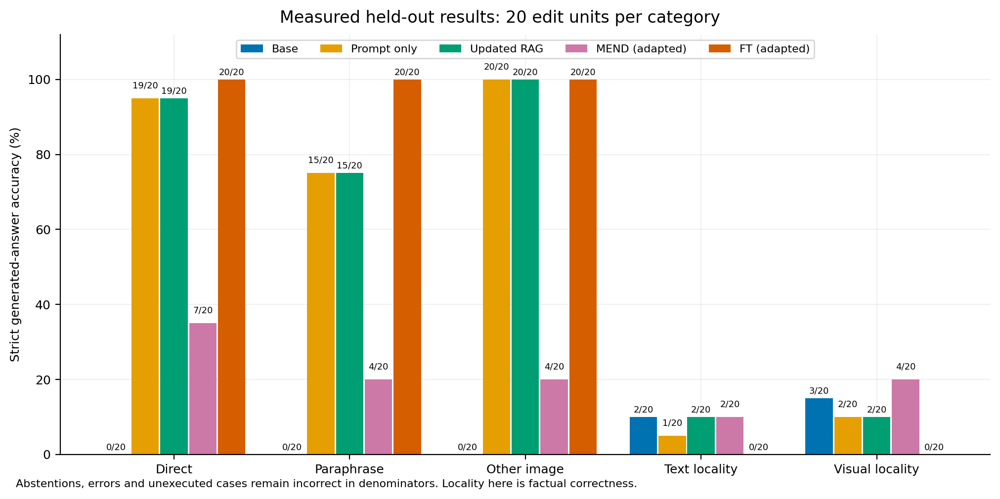

# EditGuard: Chat & Knowledge

A local website for **normal text conversation, optional image questions, and
knowledge corrections you can publish, inspect and withdraw**. Chat Studio uses
pretrained `qwen3-vl:2b-instruct` through Ollama for generated responses and
`all-minilm:22m` for semantic correction retrieval. Its default editing method is
approved external memory plus retrieval-augmented generation; the base model's
weights stay unchanged.

The explicit `2b-instruct` tag avoids relying on the generic tag's thinking-mode
default. An earlier generic-tag attempt produced no visible answer within its
384-token budget; that remains a development diagnostic, separate from the
sealed visual experiment. Switching tags is not a new accuracy result.

## Open the website

With Python and [Ollama for Windows](https://ollama.com/download/windows)
installed, open PowerShell in this repository, prepare the isolated environment
and local models once, then launch the website:

```powershell
cd "C:\Users\shiva\OneDrive\Desktop\projekt-KE"
.\scripts\run-chat.ps1 -Setup
.\scripts\run-chat.ps1
```

Open **http://127.0.0.1:8004/**. The launcher opens that page by default; keep its
server window and Ollama running. Initial setup downloads the named models.
Chat Studio runs locally and does not require the research workbench's Colab
session. Check the website's model-status badge before sending a message.

Read the [Chat Studio walkthrough](docs/CHAT_STUDIO.md) for launch details,
examples, source/history controls and the distinction between retrieval-based
corrections and parameter editing.

## Chat, edit knowledge, then compare

1. **Chat:** have a normal conversation, ask follow-up questions, or attach an
   optional image. You can switch approved knowledge off to ask the original
   model without supplied corrections.
2. **Knowledge:** publish a specific correction with its intended answer,
   subject/scope and source. Publishing is explicit local-operator approval;
   assertions made in a customer conversation are not silently added to memory.
3. **Back to Chat:** ask again or try different wording. Inspect the generated
   answer and the retrieved correction/source evidence. Use **Compare** to obtain
   fresh original and correction-enabled responses from matched question history.
4. **Withdraw or restore:** inspect version history and change which records are
   active. Later responses use the current knowledge revision; previous messages
   remain visible as historical answers. Replacing an active correction in the
   same normalized question and scope requires explicit conflict resolution.

Chats and correction records persist in SQLite under `runtime/chat/`, outside
Git. The website is a local single-operator academic application, not a publicly
hosted multi-user service. Retrieved sources and operator approval do not certify
that arbitrary model prose is factually correct. The chat similarity threshold
is an uncalibrated development setting, not a probability or the old visual
study's calibrated threshold.

## What we built

Our contribution is the usable maintenance workflow around pretrained models:
persistent conversations, a separate correction-approval interface, versioned
memory, scoped semantic retrieval, source evidence, matched before/after
comparison, conflict handling and withdrawal/restoration. We did not train Qwen
or MiniLM or invent a new foundation-model architecture. Chat Studio performs
external-memory editing; it must not be described as permanently changing model
parameters.

The repository also preserves the real parameter-editing research workbench,
its documented adaptations, exact weight rollback, and sealed five-method
comparison below. This combines a practical conversation website with an
independently inspectable research component. The BLIP-2/MEND benchmark measures
that earlier model and protocol; it establishes **no general chat-accuracy number
for Qwen or this new serving workflow**. Updated RAG is the application's default
choice, not a claim that it is the best method for every question.

## Separate research: visual knowledge editing workbench

For the panel, start with the [beginner guide](docs/VISUAL_PROJECT_EXPLAINED.md),
the [six-minute presentation and Q&A](docs/VLKEB_PANEL_QA.md), and the
[illustrated research report](output/pdf/editguard-visual-report.pdf).

EditGuard lets a researcher propose a correction to a vision–language model,
inspect its generated answers and side effects, approve a saved parameter patch,
activate it, and restore the original weights exactly. It integrates the released
**VLKEB/MEND editor with BLIP-2 OPT-2.7B**, alongside a bounded last-layer
fine-tuning baseline and an updated visual retrieval comparison.

The completed, sealed **20-edit / 500-answer T4 experiment** shows why reviewing
side effects matters: FT matches all 60 edited-question targets but none of the
40 unrelated locality targets, breaking all five previously correct locality
answers. MEND retains those five answers but matches fewer edit targets. Updated
RAG and prompt-only correction each match 54/60 edit targets. These are results
on one small nonrandom benchmark slice, not an arbitrary-edit guarantee.

Start with the [project explanation](docs/VISUAL_PROJECT_EXPLAINED.md),
[measured results and limitations](docs/VLKEB_RESULTS.md), and
[workbench guide](docs/VLKEB_WORKBENCH.md). Published paper numbers remain in a
separate [attributed reference](docs/VLKEB_UPSTREAM_RESULTS.md).

### What this project contributes

| Component | Responsibility |
| --- | --- |
| Pretrained visual model and MEND network | Reused upstream research assets; we did not train the foundation model or meta-train the released editor. |
| Reproduction bridge | Pinned assets, integrity checks, bounded generated answers, explicit token alignment, saved tensors and exact restoration. |
| Last-layer FT | Real per-edit optimization: 15 fixed AdamW steps on two OPT matrices, with disclosed precision and answer-termination adaptations. |
| Updated RAG comparison | The current correction in image/question memory, pretrained text and visual features, and a fixed applicability gate. |
| Research workbench | Inactive candidate preview, explicit approval and activation, provenance, history, evidence export and rollback. |
| Experiment controls | A 20-edit, five-method protocol with sealing, strict whole-answer scoring, linked cases, paired uncertainty and separate latency measurements. |

The [results report](docs/VLKEB_RESULTS.md) preserves the seal, raw evidence,
failure cases, paired uncertainty and latency. All 500 calls executed with zero
execution errors; many generated answers were still incorrect.

| Method | Direct | Paraphrase | Other photograph | Text locality | Visual locality |
| --- | ---: | ---: | ---: | ---: | ---: |
| Base | 0/20 (0%) | 0/20 (0%) | 0/20 (0%) | 2/20 (10%) | 3/20 (15%) |
| Prompt only | 19/20 (95%) | 15/20 (75%) | 20/20 (100%) | 1/20 (5%) | 2/20 (10%) |
| Updated RAG | 19/20 (95%) | 15/20 (75%) | 20/20 (100%) | 2/20 (10%) | 2/20 (10%) |
| MEND (adapted) | 7/20 (35%) | 4/20 (20%) | 4/20 (20%) | 2/20 (10%) | 4/20 (20%) |
| FT (adapted) | 20/20 (100%) | 20/20 (100%) | 20/20 (100%) | 0/20 (0%) | 0/20 (0%) |

Each cell has 20 assigned cases. Edited categories use counterfactual replacement
targets; the base's zero there is not its original-association factual accuracy.
Locality uses unrelated factual targets. Only five baseline locality answers were
correct, making retention evidence small. FT's 60/60 edited-target success does
not outweigh its locality failures automatically.



### Run the workbench

Use the [standalone Colab workbench notebook](notebooks/03_visual_editing_workbench.ipynb)
for the pinned environment, verified asset download, CUDA hardware checks and
private notebook viewer. The [one-edit reproduction notebook](notebooks/02_vlkeb_mend_smoke.ipynb)
and [reproduction guide](docs/VLKEB_SMOKE.md) preserve the earlier development
configurations and failures.

After preparing the Linux/Colab environment and assets, run from the repository root:

```bash
artifacts/vlkeb/environment/bin/python -m ke_repro.workbench --port 8003
```

Open `http://127.0.0.1:8003/` on that host, or use the notebook's signed-in port
viewer. Wait for **Model ready**, select a development fixture, generate its
original answer, choose MEND or FT, then click **Preview correction**. Review the
candidate's target answer and unrelated probe before **Approve and activate**.
Ask a paraphrase, export the evidence, then roll back and regenerate.

Preview restores the base before returning; the patch remains inactive until
explicit approval. Only one patch can be active. The session token and loopback
binding support a local research demonstration; they are not a production
multi-user administration system.

The measured full-model path uses a Tesla T4. The laptop's 6 GB GPU is not the
demonstrated target. Model/data assets require a separate download of about
13.2 GB before dependencies and patches; each saved candidate patch is about
600 MiB. Preserve exported evidence and patches before releasing a temporary
Colab runtime. Never run simultaneous full-model jobs on the same GPU.

### Evidence and reproduction

The [results report](docs/VLKEB_RESULTS.md) links the original machine-readable
receipts, including the unsuccessful first run. The
[fixed evaluation protocol](docs/VLKEB_EVALUATION_PROTOCOL.md) defines 20 source
entities, five cases per edit and five configurations: base, prompt-only, updated
RAG, context-aligned MEND and adapted last-layer FT. Missing and failed answers
remain in the assigned denominators. The selection is a small nonrandom slice;
source-directory disjointness does not prove absence from pretraining.

`scripts/render_vlkeb_results.py` renders saved evidence into PNG/PDF figures and
CSV/JSON data with source hashes. It loads no model and estimates no missing
metrics. Renderer verification uses visibly marked synthetic fixtures; those
figures are never project results.

Focused application checks run without the large model:

```bash
python -m unittest tests.test_ke_repro_workbench
```

The 11 workbench contract tests use a tiny fake backend to verify candidate
review, activation, failure handling, exports and restoration behavior. Actual
model evidence comes from GPU reports. A separate [real T4 application rehearsal](reports/vlkeb/t4-workbench-1/workflow-evidence.json)
passed 15 lifecycle checks, covering inactive previews, explicit activation,
conflict rejection, export, exact rollback and fresh restart with retained history
and no automatic patch activation. These are workflow checks on training fixtures,
separate from the 500-answer benchmark. [Container and HTTP details](docs/VLKEB_WORKBENCH.md)
document the packaged Linux path and its validation limits.

### Limits to the claim

The project does not guarantee that an arbitrary correction works or stays
local. Teacher-forced token scores can be high while generated answers repeat
or fail. The development fixture comes from upstream training annotations, and
its labels are controlled counterfactual associations. We have not independently
human-reviewed those labels or established real-world factual truth from them.
Our loading, contextual alignment and FT objective adaptations also prevent
claiming reproduction of the paper's full benchmark numbers. The completed comparison exposes a tradeoff between target success and locality;
it does not establish broad superiority over retrieval or other models. The
completed application rehearsal uses fixed author-training fixtures and one
unrelated probe; it does not establish arbitrary-upload reliability, production
security, GPU Docker deployment or permanent public hosting.

### Preserved earlier projects

The earlier **VisionPatch** CLIP projection-editing studio remains separately
runnable at port 8002 and preserved at Git tag
`visionpatch-preserved-2026-10-22`. Its completed study belongs to that project:
read the [studio guide](docs/visionpatch/WORKBENCH_GUIDE.md),
[V2 results](docs/visionpatch/RESULTS_V2.md), and
[reproduction instructions](docs/visionpatch/REPRODUCING_V2.md). Start its existing
environment with `scripts/run-visionpatch.ps1`.

The earlier customer-support **EditGuard V1** is preserved at `editguard-v1.0.0`
with its [original README](docs/EDITGUARD_V1_README.md). Its text-task results and
the VisionPatch results are historical evidence for those systems, separate
from this VLKEB visual question-answering experiment.
