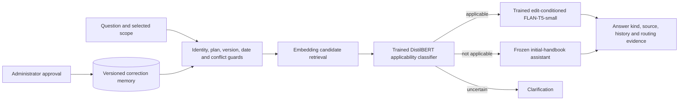

# EditGuard

**A SERAC-inspired knowledge editing and verification platform for bounded AI
customer support.** Registered topic: Knowledge Editing.

When a product limit changes, an administrator approves a precise correction.
EditGuard stores its scope, source and history, routes relevant questions to a
trained answer model, preserves neighboring facts, exposes conflicts and supports
rollback. New approved corrections update memory without per-edit retraining.
The base assistant's saved weights remain frozen.

The application uses a controlled fictional support catalogue. It is a learned
editing project with real trained models and measured limitations, not evidence
of production or unrestricted-language reliability.

## Measured project status

Both auxiliary models are trained, independently artifact-audited and integrated:
DistilBERT scope classifier `pilot-v3-neutral2` and FLAN-T5-small answer model
`pilot-v2-polarity1`. The audit passes 986 integrity/state checks. Source, run
cards, reviews, checkpoint identities and saved local exports are recorded.
Structured database answers remain separately labeled from model generation.

The frozen matched final comparison contains 4,080 observations over 720 standard
held-out questions and 96 agent-authored challenges. It completed with 4,009
answers, 71 clarifications and zero runtime errors. Updated baselines receive the
same approved corrections and supporting information.

| Configuration | Frozen standard request-bound QA | Correct / all 720 |
|---|---:|---:|
| Unchanged base | 69.44% | 500/720 |
| Properly updated RAG | 90.14% | 649/720 |
| Prompt-only correction | 74.03% | 533/720 |
| Similarity editor | 87.78% | 632/720 |
| Trained scope editor | 85.14% | 613/720 |

These are controlled short-answer results using frozen request-bound rules;
pending cases and clarifications remain uncredited in the denominator. The
trained editor has 23 standard clarifications and 33 additional pending responses.
Updated RAG leads overall: editor minus RAG is -5.00 percentage points, paired
95% family-cluster interval [-6.67, -3.06]. The editor answers all 72 direct
applicable questions correctly, but gets 39/72 template paraphrases and 97/144
comparisons correct. Neither direct success nor low training loss implies
general reasoning reliability.

Raw final scope accuracy is 701/720, precision 288/307 and recall 288/288. Runtime
observes zero false edit applications in 432 out-of-scope cases, with deterministic
eligibility guards and a coverage cost. Scope preprocessing creates nine same-label
test inputs also present in training; the other 711 obtain 692/711 raw accuracy.
Raw entities and lineages remain disjoint, but templates are shared. Labels have
explicit automated review, with no human-review or human-authored-challenge claim.

The 96 challenges expose a limitation: learned runtime answers 48 and clarifies
48; its raw scope recall falls to 72/96. Their wording is unsupported by the frozen
request-bound scorer. Zero secondary credit there does not mean every generated
answer is wrong. The primary complete-assertion scorer also leaves many fragments
pending; its zero credit for RAG/base responses must not be called zero factual
accuracy or evidence of learned superiority.

The **original oracle measurement is incomplete**: 65/384 answers and 319 CUDA
runtime errors; primary credit is 45/384 with all errors retained. A separately
declared recovery first stopped before generation because CUDA was unavailable.
After GPU availability was restored, it answered all 319 selected errors without
new runtime errors. Its separate combined oracle view retains 65 original answers:
247/384 primary credits, 90 pending and 47 incorrect generated answers; standard
request-bound credit is 208/288. This is operational recovery with unchanged
models/settings, not an ML improvement or a replacement original result. The
failed original GPU instance's final fingerprint is unavailable;
fresh-process file/weight checks do not reconstruct that state.

A separate isolated learned HTTP workload completes 30/30 measured requests
without runtime errors or clarifications: warm client p50 230.42 ms, p95 372.04 ms.
Cold lazy loading takes 68,781.35 ms; three warmups are separate. This repeats
three development questions, includes the API's before-answer generation, and
records `ml_accuracy=null`. Its four-device comparison still wrongly answers Yes;
30 answered requests are not 30 correct answers. See [HTTP evidence](reports/final/neural-http.json).

See [final results, denominators and execution disclosures](docs/FINAL_EVALUATION.md),
[machine-readable summary](reports/final/summary.json),
[results CSV](reports/final/results.csv),
[paired uncertainty](reports/final/secondary-paired-uncertainty.json) and
[scientific figures](reports/final/figures-v2/manifest.json).
The [report PDF](output/pdf/EditGuard-Report.pdf) is rendered and visually
checked; the dashboard and byte-identical JSON/CSV downloads are verified.
Release regressions pass 516 tests with 18 explicit optional skips; a separate
34-test synthetic CPU numeric/checkpoint suite passes. Release CI checks regression,
CPU optimizer recovery and container restart. The hardware-dependent measurement
follow-up is complete: GPU availability is restored, all 319 declared oracle cases
are recovered separately, and finite learned-HTTP evidence is recorded. The final
13-page report, browser dashboard and local regressions are checked. All three
[release CI jobs](https://github.com/ShivamRaghav7/verity/actions/runs/38716200467)
passed on source commit `2c7938c`; the [recorded receipt](reports/final/engineering/github-ci-recovered.json)
identifies that exact revision. The finite A–H release is complete; no further
model search or accuracy target is required.

## Architecture



FastAPI/Pydantic, SQLite and same-origin HTML/CSS/JavaScript provide the app.
PyTorch/Transformers run the two auxiliaries, a frozen FLAN-T5-small base and
frozen MiniLM embeddings. Matplotlib generates the figures. There is no separate
vector database, queue or experiment server. This is **SERAC-inspired**; the
[architecture](docs/ARCHITECTURE.md) documents adaptations to the
[original paper](https://proceedings.mlr.press/v162/mitchell22a/mitchell22a.pdf).

## Run locally

Python 3.12+; tested locally with Python 3.14.3 on Windows. The structured
workflow requires no GPU, model download, API key, Node installation or frontend
build. From the repository root in PowerShell:

```powershell
python -m venv .venv
.\.venv\Scripts\python.exe -m pip install -r requirements-lock.txt
$env:EDITGUARD_ADMIN_TOKEN = 'replace-with-your-local-admin-token'
.\scripts\run.ps1
```

Linux/macOS:

```sh
python3 -m venv .venv
.venv/bin/python -m pip install -r requirements-lock.txt
export EDITGUARD_ADMIN_TOKEN='replace-with-your-local-admin-token'
.venv/bin/python -m editguard
```

Open [the application](http://127.0.0.1:8000) or
[interactive API documentation](http://127.0.0.1:8000/docs). Enter the administrator
token in Corrections to authorize mutations. The localhost demonstration default
is `local-demo-only` when no token is configured. The shared token is a demo
boundary; public deployment needs proper identity management.

SQLite persists at `runtime/editguard.sqlite3`. Seeding never reactivates withdrawn
edits. Transactional snapshots and revision changes keep facts and history
consistent. Customer messages cannot become approved corrections. Do not delete
the database to repeat a panel workflow; use the isolated setup in
[DEMO.md](docs/DEMO.md).

## Optional learned application

Use the separate [ML environment](docs/ML_SETUP.md), cached pinned backbones and
the two verified saved local exports. Model binaries are ignored by Git; a clean
checkout needs those verified exports or reproduced training. Missing/invalid
artifacts return HTTP 503, rather than silently substituting structured answers.

```powershell
$env:HF_HOME = (Resolve-Path runtime/hf-cache).Path
$env:HF_HUB_OFFLINE = '1'
$env:EDITGUARD_INFERENCE_CONFIG = 'configs/inference-final.json'
$env:EDITGUARD_EVALUATION_REPORT = 'reports/targeted-selected-development-evaluation.json'
$env:EDITGUARD_FINAL_EVALUATION_REPORT = 'reports/final/summary.json'
.\.venv-ml\Scripts\python.exe -m editguard
```

The selected configuration uses CUDA. After the evaluation interruption, GPU
availability was restored and a fresh RTX 4050 probe passed. The declared oracle
recovery then completed with the same configuration. The structured app and
recorded-results dashboard also remain available without model inference. A CPU
configuration would define a separate measurement; the frozen CUDA settings were
not changed to fill missing results.

The Evaluation lab displays recorded development/final artifacts, review policy,
coverage, pending cases, raw scope/calibration, oracle errors, latency and exports.
Refreshing it does not train or reevaluate models. Retrieved sources are supporting
facts, not verification of arbitrary generated prose.

## Panel demonstration

Follow [the six-part demonstration](docs/DEMO.md): original value → approved
correction → direct/paraphrase/comparison → unaffected neighboring facts → explicit
conflict → rollback. Present the deterministic structured workflow first and name
it clearly. Then show the trained configuration, recorded measured results and
actual failures. A correct database answer is never counted as neural generation.

## Reproducibility and tests

```powershell
.\.venv\Scripts\python.exe -m unittest discover -s tests -v
node --check editguard/static/app.js
```

GitHub Actions defines three jobs: Python/JS regression, CPU optimizer/resume
regression with tiny synthetic models, and Docker workflow/restart verification.
The latest release-head outcome must be checked before claiming release CI passes.
Tests cover approval authority, exact scope, conflict/supersession, historical
dates, rollback/persistence, concurrent revisions, API boundaries, dataset splits,
hash-bound training/final gates, resume and fixed-denominator scoring. Local
structured deployment previously passed 23/23 HTTP lifecycle and 3/3 restart
checks; that evidence does not establish neural GPU deployment.

The models actually train on four families (240 scope / 96 answer examples) and
validate on two others (120 / 48). The full original 80-family catalogue is not
all used for training. Family assignment precedes augmentation; variants remain
together. The final 12-family packet is training-ineligible and locked to selected
models, calibrations, source and scoring hashes. No final result was used to tune
them. [Dataset card](docs/DATASET_CARD.md), [model card](docs/MODEL_CARD.md) and
[final methods](docs/FINAL_EVALUATION.md) describe exact reconstruction and limits.

Both selected user-executed training runs used finite caps: 360 scope and 240
answer updates. Recorded loops took 112.55 s and 264.54 s on the inspected RTX
4050 laptop; peak allocated GPU memory was 1.318 and 1.504 GiB. Full-command
startup/export times were not measured. The [completed run guide](docs/ANSWER_REVISION_TRAINING.md)
preserves profiled estimates, expected artifacts and exact-state recovery. These
measurements are not promises for another machine. Historical
[development evidence](docs/TARGETED_REVISION_RESULTS.md) remains archived.

## Container

```powershell
$env:EDITGUARD_ADMIN_TOKEN = 'replace-with-your-admin-token'
docker compose up --build
```

The lightweight nonroot image runs the structured app with a persistent SQLite
volume and loopback port mapping. It does not contain auxiliary weights or a
neural GPU environment. [Deployment evidence](docs/DEPLOYMENT.md) records the
actual local image, isolated lifecycle checks and restart verification. Optional
local learned inference is a separate deployment path.

## Project records

- [Five-person responsibilities and finite A–H status](docs/PROJECT_PLAN.md)
- [Architecture](docs/ARCHITECTURE.md), [API](docs/API.md) and [interface contract](docs/IMPLEMENTATION_CONTRACT.md)
- [Dataset card](docs/DATASET_CARD.md), [model card](docs/MODEL_CARD.md) and [failure analysis](docs/FAILURE_ANALYSIS.md)
- [Final evaluation](docs/FINAL_EVALUATION.md), [report source](docs/REPORT.md) and [panel demo](docs/DEMO.md)
- [Training/resume implementation](docs/TRAINER.md), [scoring rules](docs/SCORER.md) and [archived initial training](docs/PILOT_TRAINING_RESULTS.md)

Resume claims can describe a transactional support knowledge editor, two trained
auxiliaries, five fair held-out comparisons and a containerized structured app.
Any numerical claim must name its measured population and metric. Do not claim
100% natural-language accuracy, learned superiority over updated RAG, independent
human review or production GPU deployment. Distinguish the original oracle's
runtime errors from its separate completed operational recovery.
