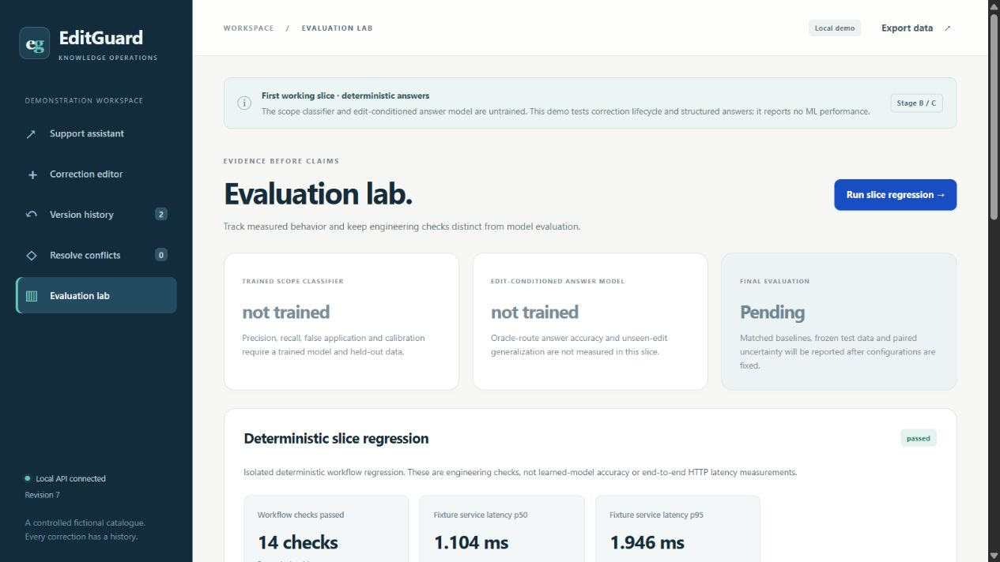

# EditGuard

**A SERAC-inspired knowledge editing and verification platform for bounded AI
customer support.** Registered research topic: Knowledge Editing.

EditGuard targets support answers that become outdated when product limits or
policies change. An administrator publishes a precise correction; the system
must apply it within the right product, property, plan, version and date scope,
preserve unrelated facts, expose provenance, resolve conflicts and support rollback.

## Current implementation

The first complete **engineering vertical slice** is runnable: customer questions,
before/after comparison, authenticated draft creation and approval, scoped fact
resolution, history, conflict resolution, rollback and JSON export. The application
uses a curated fictional Nimbus handbook. The dataset and products are controlled
demonstrations, not claims about real companies.

**Structured answers remain the default. Neither auxiliary model has completed
reviewed-data training.** Optional frozen FLAN-T5/MiniLM modes implement the
unchanged base, properly updated RAG and prompt-only correction. Real scope and
answer training loops, full-state resume, conservative scoring and fixed-denominator
metrics are implemented. Learned modes return HTTP 503 until eligible trained
artifacts and calibration are installed. Engineering checks and synthetic optimizer
smoke are not ML accuracy or project completion.

The editor wraps a frozen retrieval-based assistant with approved memory,
a trained pair scope classifier and a trained edit-conditioned seq2seq generator.
Adding an approved correction will update memory without per-edit retraining.
[Architecture and adaptations](docs/ARCHITECTURE.md) explain why this is
SERAC-inspired rather than a faithful reproduction.

[ML setup](docs/ML_SETUP.md), [matched comparisons](docs/COMPARISONS.md),
[trainer and resume](docs/TRAINER.md), [scoring rules](docs/SCORER.md) and
[data review](docs/DATA_REVIEW.md) document the next runnable stage.
The finite pilot contains 360 scope and 144 answer examples across disjoint
training/validation families and no test partition. All 504 labels received an
independent **automated development review**, followed by integrity and target
checks. The separate registry records 504 accepted and zero flagged; no human
approval or model accuracy is claimed. Immutable source rows retain their pending
human-review flags. [Per-row evidence](reports/pilot-v2-independent-review.json)
and four portable human-review pages are linked from the data-review guide.



## Run locally

Python 3.12+; the application was tested here with Python 3.14.3 on Windows.
No Node installation, GPU, model download, API key or frontend build is needed
for the first workflow. Production ML dependencies are kept separate.

Windows PowerShell:

```powershell
python -m venv .venv
.\.venv\Scripts\python.exe -m pip install -r requirements-lock.txt
$env:EDITGUARD_ADMIN_TOKEN = 'replace-with-your-local-admin-token'
.\scripts\run.ps1
```

Linux/macOS:

```sh
python3 -m venv .venv
.venv/bin/python -m pip install -r requirements-lock.txt
export EDITGUARD_ADMIN_TOKEN='replace-with-your-local-admin-token'
.venv/bin/python -m editguard
```

Open [the application](http://127.0.0.1:8000) or
[interactive API documentation](http://127.0.0.1:8000/docs).
Enter the administrator token in the Correction editor to enable mutation requests.
If no token is configured, the **localhost-only demo default** is `local-demo-only`.
The shared token is a demonstration boundary, not production identity management.

SQLite data persists at `runtime/editguard.sqlite3`. Restarting is idempotent;
seeding never reactivates withdrawn corrections. No answer cache is used, and
revision-consistent snapshots keep responses and exports coherent with history.
Server binds to localhost; public deployment requires proper authentication.

## Panel demonstration

1. Select Nimbus / Basic / v2 and date 2026-10-11. Ask “How many devices does Basic
   support?” The original value is five.
2. In Corrections select the device fact, original value `5`, corrected value `3`,
   effective date `2026-10-01`, and source “Fictional release notice EG-001”. Save
   a draft, inspect it, then explicitly approve it from History.
3. Ask the direct question and “What is Basic's device limit?”. Ask “Can I connect
   four devices on Basic?”. Structured answers show three and “No”, with provenance.
4. Ask Basic's monthly price, switch to Pro's devices, then Basic v1. They retain
   nine USD/month, twelve devices and five devices respectively. Set date before
   the correction to observe the initial value in v2.
5. Save an overlapping competing draft using original `3`, corrected `4`, same
   scope/date, without supersession. Approval is rejected; the affected question
   exposes the conflict. Withdraw the competing draft in Conflicts.
6. Withdraw the approved edit in History. Basic v2 returns to five devices; audit
   events remain. A withdrawn edit is immutable; a new reviewed draft can restore it.

Supported structured grammar intentionally covers short factual questions and
“Can I connect four devices on Basic?”. Unsupported wording, unknown tiers,
comparative capacity phrases and ambiguous scopes clarify. General natural-language
capability will be assessed after training; it is not inferred from this demo.

## Tests and reproducibility

```powershell
.\.venv\Scripts\python.exe -m unittest discover -s tests -v
node --check editguard/static/app.js
.\.venv\Scripts\python.exe scripts/prepare_data.py --output data/generated/controlled-v2
```

GitHub Actions defines the Python regression suite, JS syntax check, a separate
CPU optimizer/resume regression job and a Docker workflow/restart verification job.
The optimizer job uses tiny synthetic models without pretrained downloads.
GPU backbone smoke remains a separate local check. Tests cover
authority, exact scope, historical dates, half-open intervals, conflicting drafts,
supersession, rollback, persistence, concurrent revisions, API token checks,
leakage constraints and hash-bound review/freeze gates. The dashboard runs an
isolated engineering fixture and never mutates live memory.

The independent data pipeline starts with 80 fictional entity families, 4,800 scope
pairs and 1,920 short answer examples. It splits
families before augmentation, keeps all variants together, and generates a human
review queue. Training rejects unresolved or stale review records and defaults to
human review. The explicitly selected `automated_development` policy preserves
machine-review provenance in development runs; final-test locking still requires
human review. Generated labels are not automatically accepted as truth.
[Dataset card](docs/DATASET_CARD.md) describes counts, provenance and limitations.

## Training and evaluation stages

The observed host has an RTX 4050 Laptop GPU with 6 GB VRAM, 23.71 GiB RAM and
12 logical CPU threads. [Hardware inventory](reports/hardware.json) records the
actual inspected environment. The initial DistilBERT and FLAN-T5-small profiles
passed at batch size 2, with peak GPU allocation of 1.27 and 1.46 GiB respectively.
Profiling does not create a trained checkpoint. See the exact shapes, revisions and
limitations in [profiling evidence](docs/PROFILING.md).

`scripts/profile_models.py` profiles at most ten optimizer steps with bounded
batch/length settings; defaults require cached weights. It writes timing, peak
CUDA memory, package versions and model revision. It never reads the test set.
The first measured profile uses the existing host ML installation, separately
from the isolated application environment; full training must use its own pinned
environment and data/config hashes.

[Training preflight](docs/TRAINING_PREFLIGHT.md) validates reviewed inputs and
finite run cards. The separate [trainer](docs/TRAINER.md) implements training and
checkpoint restoration; preflight alone does not verify a completed training run.

[Initial pilot training instructions](docs/PILOT_TRAINING.md) provide the concrete
questions, reviewed inputs, measurements, conditional runtime/memory estimates,
artifacts and exact-resume rules. The user executes the finite GPU runs; the
default caps are 360 scope updates and 240 answer updates. Four-step profiles
remain ineligible as trained deployment artifacts.

[Measured embedding-baseline curves](docs/SIMILARITY_RESULTS.md) show raw and
compatibility-gated behavior on 120 development validation pairs, with explicit
denominators and the missed question. They are threshold-selection evidence,
not final-test or generated-answer performance.

The five final configurations are unchanged base, properly updated RAG,
prompt-only corrections, embedding retrieval corrections and trained scope-aware
editing. All updated baselines receive the same approved memory and context.
[Evaluation protocol](docs/EVALUATION_PROTOCOL.md) separates retrieval, raw scope,
oracle-routed generation and end-to-end quality, keeps abstentions in denominators,
and scores subject, relation, endorsed value and polarity. No LLM-only judge is used.

## Container

```powershell
$env:EDITGUARD_ADMIN_TOKEN = 'replace-with-your-admin-token'
docker compose up --build
```

The container runs the same structured application as a nonroot user, with a
persistent SQLite volume and localhost port mapping. Container definitions are
provided; a Docker build is not claimed unless recorded in verification evidence.
GPU training stays outside this lightweight application image.

The structured image was built and verified locally with Docker 29.2.1,
Python 3.12.15 and UID 1000. All 23 isolated HTTP lifecycle checks passed, as did
three restart/persistence checks. The verification container is stopped; its
dedicated volume and image remain available. [Deployment evidence and reproduction](docs/DEPLOYMENT.md)
distinguish this structured image from optional local neural inference.

## Project records

- [Five-person roles and finite A–H milestones](docs/PROJECT_PLAN.md)
- [Architecture](docs/ARCHITECTURE.md) and [interface contract](docs/IMPLEMENTATION_CONTRACT.md)
- [API behavior](docs/API.md)
- [Dataset card](docs/DATASET_CARD.md) and [model card](docs/MODEL_CARD.md)
- [Evaluation protocol](docs/EVALUATION_PROTOCOL.md)
- [Failure analysis](docs/FAILURE_ANALYSIS.md) and [interim report](docs/REPORT.md)
- [Measured profiling](docs/PROFILING.md) and [structured HTTP samples](reports/structured-http.json)

Stages A/B are implemented, and stage C's baseline and evaluation mechanics are
available. Both auxiliary trainers passed bounded synthetic GPU verification.
Scientific performance graphs, eligible trained artifacts and a final results
report are pending reviewed-data runs.
Resume claims must follow those artifacts. No arbitrary-question accuracy guarantee
or numerical ML improvement is claimed.
