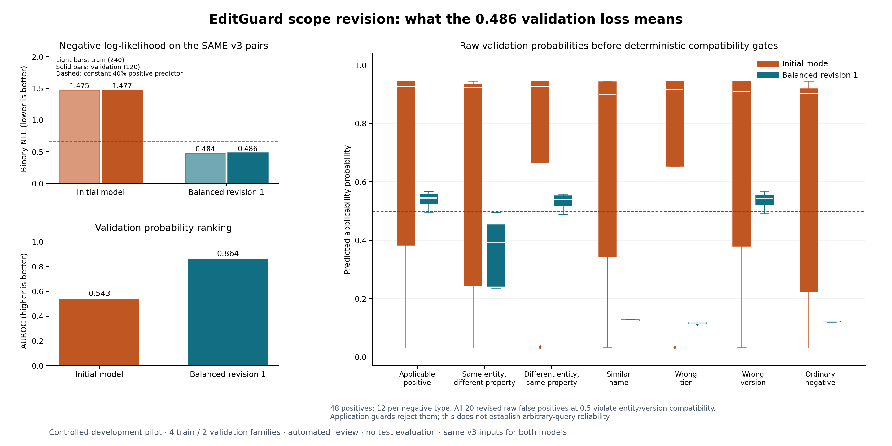

# EditGuard

**A SERAC-inspired knowledge editing and verification platform for bounded AI
customer support.** Registered research topic: Knowledge Editing.

EditGuard targets support answers that become outdated when product limits or
policies change. An administrator publishes a precise correction; the system
must apply it within the right product, property, plan, version and date scope,
preserve unrelated facts, expose provenance, resolve conflicts and support rollback.

## Current implementation

The first complete **engineering vertical slice** is runnable: customer questions,
before/after comparison, authenticated draft creation and approval, scoped fact
resolution, history, conflict resolution, rollback and JSON export. The application
uses a curated fictional Nimbus handbook. The dataset and products are controlled
demonstrations, not claims about real companies.

**Both auxiliary models are trained and integrated; the user also completed the
bounded pilot-v3 scope revision.** The current learned configuration uses that
revised classifier with the original correction-conditioned answer model.
Both have validation-selected local exports and recorded artifact identities.
Structured answers remain the default. Optional neural modes implement the
unchanged base, properly updated RAG, prompt-only correction, similarity editor
and trained scope editor. Missing or invalid required artifacts return HTTP 503.
Model binaries are local ignored artifacts; Git contains their configuration,
recorded identities and reproduction tooling. A clean checkout needs verified
exports or reproduced training to enable learned inference.

The latest validation uses two held-out entity families and shared question
forms. On the exact same balanced pilot-v3 pairs, raw scope accuracy at 0.5
improves from 56/120 for the original model to 98/120 for the revision. Its
validation loss of 0.486 is negative log-likelihood, not a 48.6% error rate.
Raw entity/version matching remains weak. Deterministic compatibility guards and
the validation-selected policy route 46/48 applicable corrections, falsely apply
0/72 negatives and clarify 5/120 questions; answer coverage is 115/120. These are
routing results selected on validation data, not generated-answer accuracy.

The unchanged answer model receives strict oracle credit on 31/48 answers and
still produces `Yes` for all 12 comparisons requiring `No`. End-to-end strict
credit is 30/120 for the learned editor; short baseline fragments remain pending,
so zero credited baseline assertions does not mean zero factual correctness.
The separate exploratory short-QA analysis credits updated RAG on 91/120
questions and the trained editor on 80/120. No superiority is claimed. All results
use automated development review, not final-test or arbitrary-question guarantees.

The editor wraps a frozen retrieval-based assistant with approved memory,
a trained pair scope classifier and a trained edit-conditioned seq2seq generator.
Adding an approved correction will update memory without per-edit retraining.
[Architecture and adaptations](docs/ARCHITECTURE.md) explain why this is
SERAC-inspired rather than a faithful reproduction.

[ML setup](docs/ML_SETUP.md), [matched comparisons](docs/COMPARISONS.md),
[trainer and resume](docs/TRAINER.md), [scoring rules](docs/SCORER.md) and
[data review](docs/DATA_REVIEW.md) document the reproducible pipeline.
The finite pilot contains 360 scope and 144 answer examples across disjoint
training/validation families and no test partition. All 504 labels received an
independent **automated development review**, followed by integrity and target
checks. The separate registry records 504 accepted and zero flagged; no human
approval is claimed. Immutable source rows retain their pending
human-review flags. Pilot-v3 received fresh hash-bound decisions for all 504 rows.
[Per-row evidence](reports/pilot-v3-independent-review.json) and the
[data-review guide](docs/DATA_REVIEW.md) expose the review provenance.

[Training results](docs/PILOT_TRAINING_RESULTS.md),
[validation and failure analysis](docs/PILOT_VALIDATION_RESULTS.md) and
[exploratory short QA](docs/SHORT_QA.md) disclose denominators, limitations and
all five archived initial comparisons. [Pilot-v3 results](docs/PILOT_V3_RESULTS.md)
record completed scope training, the shared-input comparison, the correction to
calibration selection, all five end-to-end configurations and remaining failures.
The scope revision preserves facts, splits and all 504 rows. Its
[completed training guide](docs/SCOPE_REVISION_TRAINING.md) remains a historical
run record. One bounded answer-polarity
experiment is being prepared using the [documented objective](docs/ANSWER_OBJECTIVE.md).
Neither a low loss nor passing workflow tests establishes reliable new-entity
routing: a subsequent isolated Nimbus workflow returned stale `5` after an
approved device-limit correction to `3`; a device paraphrase returned its price
and both capacity comparisons clarified. The 31/31 governance/integration checks
passed, but those handpicked cases are not a representative accuracy estimate.
[The complete recorded workflow](reports/pilot-v3-learned-workflow.json) preserves
the actual model outputs and separate oracle probes.

This finding motivates the **second and final scope revision**, not a larger
dataset or another backbone. Its `entity_neutral_v1` preprocessing replaces
correction-referenced product/alias, plan and version selectors with consistent
phrases while retaining relation, values and units. Original metadata continues
to govern approval, compatibility, dates and provenance. It keeps the same
pilot-v3 rows and reviews, 360-step cap, backbone, seed and learning rate. The
separate answer revision keeps the same v2 inputs and 240-step cap. **Both are
prepared, not trained, and have no measured improvement.** Their
[released run guide](docs/ANSWER_REVISION_TRAINING.md) provides the concrete
questions, hash-bound inputs, measured resource estimates, expected artifacts,
finite caps and exact-state recovery. The user executes these substantial runs.
An archived [initial learned-workflow check](docs/LEARNED_WORKFLOW.md) also exposed a
same-product/different-property false application: a device correction was used
for Nimbus's price. That record uses the initial scope artifact and is not a new
v3 regression result. Workflow consistency checks do not imply answer correctness.



## Run locally

Python 3.12+; the application was tested here with Python 3.14.3 on Windows.
No Node installation, GPU, model download, API key or frontend build is needed
for the first workflow. Production ML dependencies are kept separate.

Windows PowerShell:

```powershell
python -m venv .venv
.\.venv\Scripts\python.exe -m pip install -r requirements-lock.txt
$env:EDITGUARD_ADMIN_TOKEN = 'replace-with-your-local-admin-token'
.\scripts\run.ps1
```

Linux/macOS:

```sh
python3 -m venv .venv
.venv/bin/python -m pip install -r requirements-lock.txt
export EDITGUARD_ADMIN_TOKEN='replace-with-your-local-admin-token'
.venv/bin/python -m editguard
```

Open [the application](http://127.0.0.1:8000) or
[interactive API documentation](http://127.0.0.1:8000/docs).
Enter the administrator token in the Correction editor to enable mutation requests.
If no token is configured, the **localhost-only demo default** is `local-demo-only`.
The shared token is a demonstration boundary, not production identity management.

SQLite data persists at `runtime/editguard.sqlite3`. Restarting is idempotent;
seeding never reactivates withdrawn corrections. No answer cache is used, and
revision-consistent snapshots keep responses and exports coherent with history.
Server binds to localhost; public deployment requires proper authentication.

With the isolated [ML environment](docs/ML_SETUP.md), cached pinned backbones and
verified local scope-v3 and answer-v2 exports present, start the optional learned application:

```powershell
$env:EDITGUARD_INFERENCE_CONFIG = 'configs/inference-pilot-v3-current.json'
$env:EDITGUARD_EVALUATION_REPORT = 'reports/pilot-v3-evaluation-current.json'
.\.venv-ml\Scripts\python.exe -m editguard
```

The Evaluation lab loads recorded validation diagnostics alongside a separate
deterministic regression. It performs no training or model evaluation on refresh.
It shows checkpoint selection, automated-review provenance, full denominators,
pending fragments, calibration, oracle answers, matched configurations and
exportable evidence. Retrieved sources do not verify generated prose.

## Panel demonstration

1. Select Nimbus / Basic / v2 and date 2026-10-11. Ask “How many devices does Basic
   support?” The original value is five.
2. In Corrections select the device fact, original value `5`, corrected value `3`,
   effective date `2026-10-01`, and source “Fictional release notice EG-001”. Save
   a draft, inspect it, then explicitly approve it from History.
3. Ask the direct question and “What is Basic's device limit?”. Ask “Can I connect
   four devices on Basic?”. Structured answers show three and “No”, with provenance.
4. Ask Basic's monthly price, switch to Pro's devices, then Basic v1. They retain
   nine USD/month, twelve devices and five devices respectively. Set date before
   the correction to observe the initial value in v2.
5. Save an overlapping competing draft using original `3`, corrected `4`, same
   scope/date, without supersession. Approval is rejected; the affected question
   exposes the conflict. Withdraw the competing draft in Conflicts.
6. Withdraw the approved edit in History. Basic v2 returns to five devices; audit
   events remain. A withdrawn edit is immutable; a new reviewed draft can restore it.

Supported structured grammar intentionally covers short factual questions and
“Can I connect four devices on Basic?”. Unsupported wording, unknown tiers,
comparative capacity phrases and ambiguous scopes clarify. General natural-language
capability is limited by the measured pilot results; it is not inferred from this
structured demonstration. Switch answer modes to inspect real generated outputs
and their routing, including documented scope and comparison-polarity failures.

## Tests and reproducibility

```powershell
.\.venv\Scripts\python.exe -m unittest discover -s tests -v
node --check editguard/static/app.js
.\.venv\Scripts\python.exe scripts/prepare_data.py --output data/generated/controlled-v2
```

GitHub Actions defines the Python regression suite, JS syntax check, a separate
CPU optimizer/resume regression job and a Docker workflow/restart verification job.
The optimizer job uses tiny synthetic models without pretrained downloads.
GPU backbone smoke remains a separate local check. Tests cover
authority, exact scope, historical dates, half-open intervals, conflicting drafts,
supersession, rollback, persistence, concurrent revisions, API token checks,
leakage constraints and hash-bound review/freeze gates. The dashboard runs an
isolated engineering fixture and never mutates live memory. Its optional ML
summary is read-only recorded validation evidence, separate from those checks.

The independent data pipeline starts with 80 fictional entity families, 4,800 scope
pairs and 1,920 short answer examples. It splits
families before augmentation, keeps all variants together, and generates a human
review queue. Training rejects unresolved or stale review records and defaults to
human review. The explicitly selected `automated_development` policy preserves
machine-review provenance in development runs; final-test locking still requires
human review. Generated labels are not automatically accepted as truth.
[Dataset card](docs/DATASET_CARD.md) describes counts, provenance and limitations.

## Training and evaluation stages

The observed host has an RTX 4050 Laptop GPU with 6 GB VRAM, 23.71 GiB RAM and
12 logical CPU threads. [Hardware inventory](reports/hardware.json) records the
actual inspected environment. The initial DistilBERT and FLAN-T5-small profiles
passed at batch size 2, with peak GPU allocation of 1.27 and 1.46 GiB respectively.
Profiling does not create a trained checkpoint. See the exact shapes, revisions and
limitations in [profiling evidence](docs/PROFILING.md).

`scripts/profile_models.py` profiles at most ten optimizer steps with bounded
batch/length settings; defaults require cached weights. It writes timing, peak
CUDA memory, package versions and model revision. It never reads the test set.
The first measured profile uses the existing host ML installation, separately
from the isolated application environment; full training must use its own pinned
environment and data/config hashes.

[Training preflight](docs/TRAINING_PREFLIGHT.md) validates reviewed inputs and
finite run cards. The separate [trainer](docs/TRAINER.md) implements training and
checkpoint restoration; preflight alone does not verify a completed training run.

[Initial pilot training instructions](docs/PILOT_TRAINING.md) provide the concrete
questions, reviewed inputs, measurements, conditional runtime/memory estimates,
artifacts and exact-resume rules. Those initial user-executed runs completed at
360 scope updates and 240 answer updates; selected checkpoints are steps 120 and
240 respectively. [Actual training measurements](docs/PILOT_TRAINING_RESULTS.md)
replace the planning estimates for these runs. The user also completed all 360
scope-v3 updates, selecting step 360; its validation loss was independently
reproduced from the exported model. Four-step profiles remain ineligible as
trained deployment artifacts. Exact original trainer sources are preserved from
Git commit `350db38` in [the source archive](reports/training-source-v1/manifest.json).

Two finite runs remain: the last scope revision tests whether explicitly
normalized input transfers correction applicability to unfamiliar product names;
the first answer revision tests whether equal emphasis on the first `Yes`/`No`
token improves comparison polarity while preserving factual answers. It keeps
the same facts and partitions and stops at 240 updates, or five passes through
the 96-row training partition. It is prepared as one bounded experiment; no
accuracy gain is promised. See [its objective](docs/ANSWER_OBJECTIVE.md).
The [answer run guide](docs/ANSWER_REVISION_TRAINING.md) is in preparation.
Both commands require their own final measured profile and recovery evidence;
earlier timings are not estimates for these changed training inputs/objectives.

[Measured embedding-baseline curves](docs/SIMILARITY_RESULTS.md) show raw and
compatibility-gated behavior on 120 development validation pairs, with explicit
denominators and the missed question. They are threshold-selection evidence,
not final-test or generated-answer performance.

The five comparison configurations are unchanged base, properly updated RAG,
prompt-only corrections, embedding retrieval corrections and trained scope-aware
editing. All updated baselines receive the same approved memory and context.
[Evaluation protocol](docs/EVALUATION_PROTOCOL.md) separates retrieval, raw scope,
oracle-routed generation and end-to-end quality, keeps abstentions in denominators,
and scores subject, relation, endorsed value and polarity. No LLM-only judge is used.

## Container

```powershell
$env:EDITGUARD_ADMIN_TOKEN = 'replace-with-your-admin-token'
docker compose up --build
```

The container runs the same structured application as a nonroot user, with a
persistent SQLite volume and localhost port mapping. Container definitions are
provided; a Docker build is not claimed unless recorded in verification evidence.
GPU training stays outside this lightweight application image.

The structured image was built and verified locally with Docker 29.2.1,
Python 3.12.15 and UID 1000. All 23 isolated HTTP lifecycle checks passed, as did
three restart/persistence checks. The verification container is stopped; its
dedicated volume and image remain available. [Deployment evidence and reproduction](docs/DEPLOYMENT.md)
distinguish this structured image from optional local neural inference.

## Project records

- [Five-person roles and finite A–H milestones](docs/PROJECT_PLAN.md)
- [Architecture](docs/ARCHITECTURE.md) and [interface contract](docs/IMPLEMENTATION_CONTRACT.md)
- [API behavior](docs/API.md)
- [Dataset card](docs/DATASET_CARD.md) and [model card](docs/MODEL_CARD.md)
- [Evaluation protocol](docs/EVALUATION_PROTOCOL.md)
- [Failure analysis](docs/FAILURE_ANALYSIS.md) and [interim report](docs/REPORT.md)
- [Measured profiling](docs/PROFILING.md) and [structured HTTP samples](reports/structured-http.json)

Stages A/B and the baseline harness are implemented. D has a trained first scope
revision and a final bounded input-normalization revision in preparation after
the Nimbus workflow exposed failed transfer. E has a trained initial answer
model and one bounded polarity revision in preparation. F integrates learned
inference, recorded validation and distinct answer kinds. After the user runs
the two verified experiments, evaluate both on development data and the same
isolated workflow, retain or reject them from the recorded evidence, then finish
G's fixed protocol,
human-reviewed test/challenge freeze and single final five-way evaluation. H
finishes the report, graphs, demonstration and clean-checkout deployment/CI
verification. Scope revision 2 is the final scope experiment; no open-ended
search, added catalogue scale or extra backbone is planned.
Resume claims can describe the models trained and five configurations evaluated;
final-test or superiority claims require their corresponding frozen evidence.
