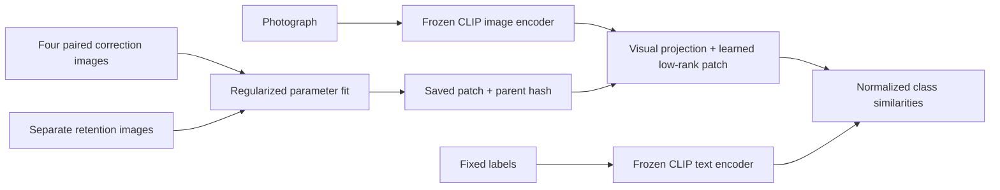

# VisionPatch

**Targeted visual model editing with measured generalization and exact rollback.**

VisionPatch changes a learned visual association inside CLIP: a misleading printed
word can make the model misidentify an object. A small learned projection patch
repairs that behavior on new photographs without changing the frozen encoders.
Registered area: Knowledge Editing; specifically **visual model / concept editing**.

This branch contains a runnable, bounded research prototype and completed frozen
holdout evaluation. It does not generate captions or unrestricted visual answers.
The preserved customer-support EditGuard V1 remains at the `editguard-v1.0.0` tag;
its original instructions are saved in [the V1 README](docs/EDITGUARD_V1_README.md).

## Measured results

Fixed vocabulary: eight object categories. Printed distractor: `camera`.
Four cup/laptop support pairs fit the patch; 64 separate clean reference images
provide retention statistics. The final set contains 80 additional original
photographs, excluded by content hash from all 144 development images.

| Configuration | Final printed-label accuracy | Final clean accuracy |
| --- | --- | --- |
| Original CLIP | 49/80 | 80/80 |
| Learned projection edit | 80/80 | 80/80 |
| Projection fine-tuning | 80/80 | 80/80 |
| Oracle label masking | 80/80 | 80/80 |

The editor repaired 31/31 induced errors in this particular holdout and preserved
10/10 genuine camera predictions. **Fine-tuning and privileged masking tied it.**
These small, controlled results are not a guarantee for other words, fonts,
objects, candidate lists or deployment conditions. A development failure remains
in the report; test results were not used to modify the configuration.


Read [the beginner guide and website instructions](docs/visionpatch/README.md),
[measured results and limitations](docs/visionpatch/RESULTS.md), and
[the evaluation protocol](docs/visionpatch/PROTOCOL.md).

## Run the prepared demonstration

```powershell
.\scripts\run-visionpatch.ps1
```

Open http://127.0.0.1:8002. Approve **Apply learned patch**, inspect the gallery,
compare all baselines in the frozen-holdout dashboard, try an uploaded photograph,
and use **Rollback** to restore the original projection. API documentation:
http://127.0.0.1:8002/docs. Stop the server with Ctrl+C.

The gallery uses cached frozen-encoder features. Uploaded images run the actual
pinned encoder. The eight candidate similarities are uncalibrated scores; an
unknown object still receives one of those candidates. Activation history is
session-local. This loopback demo has no production authentication.

## Prepare a fresh checkout

The image archive and model weights are downloaded separately, not stored in Git.
CPU is sufficient. The original measured environment used Python 3.14.3,
PyTorch 2.9.0, Transformers 5.16.1, NumPy 2.4.2 and Pillow 12.3.0.

```powershell
py -3.14 -m venv .venv-vision
.\.venv-vision\Scripts\python.exe -m pip install torch==2.9.0 --index-url https://download.pytorch.org/whl/cpu
.\.venv-vision\Scripts\python.exe -m pip install -r requirements-vision.txt
.\.venv-vision\Scripts\python.exe -m visionpatch.prepare --allow-download
.\.venv-vision\Scripts\python.exe -m visionpatch.profile --device cpu --allow-download --output reports/visionpatch/profile-local.json
.\.venv-vision\Scripts\python.exe -m visionpatch.pilot --device cpu --report reports/visionpatch/pilot-local.json
.\scripts\run-visionpatch.ps1
```

Use unused report/artifact paths for repeat experiments. The pilot stops after
one closed-form solve and 25 small projection fine-tuning steps. Completed
artifacts are never overwritten. The application reads the matching report saved
beside its generated patch. Fresh-machine measurements may differ.

The final evaluation has two phases: `python -m visionpatch.finalize --prepare-only`
seals the data, code and trained-artifact hashes before inference; running without
that flag consumes the seal. Recorded final outputs are immutable. Reproduction
on a different checkout needs distinct `--dataset`, `--artifacts`, `--seal` and
`--report` paths; do not overwrite the published evidence.

## Architecture



This is an adaptation of associative-memory editing, not a novel editing algorithm
or a faithful reproduction of the original spatial classifier editor. Only the
final visual projection changes. [Research foundation](https://arxiv.org/abs/2112.01008).

## Validation and deployment

Run `python -m unittest tests.test_visionpatch_editor tests.test_visionpatch_data
tests.test_visionpatch_metrics tests.test_visionpatch_api tests.test_visionpatch_finalization`
in the ML environment. The 45 tests cover fitting, data separation, denominators,
approval, API behavior, artifact integrity, sealing and exact rollback.
`python -m visionpatch.verify_http` exercises real image inference and restoration;
`python -m visionpatch.plot_results` regenerates scientific PNG/SVG figures.

The measured CPU HTTP sample has p50 243 ms and p95 327 ms, from 12 serial requests
for one development image. First model loading took 11.74 seconds in that check.
This is a small latency sample, not a concurrency benchmark.

A CPU container recipe is provided in `Dockerfile.visionpatch`; see
[container instructions](docs/visionpatch/DEPLOYMENT.md). GitHub Actions checks the
original application and the new visual components. Large data/model files stay
outside the image and are mounted for inference.

Caltech101 images: Li, Andreeto, Ranzato and Perona,
[DOI 10.22002/D1.20086](https://doi.org/10.22002/D1.20086), CC BY 4.0.
Source-label and split audits are automated; no independent human or
pretraining-contamination review is claimed.
