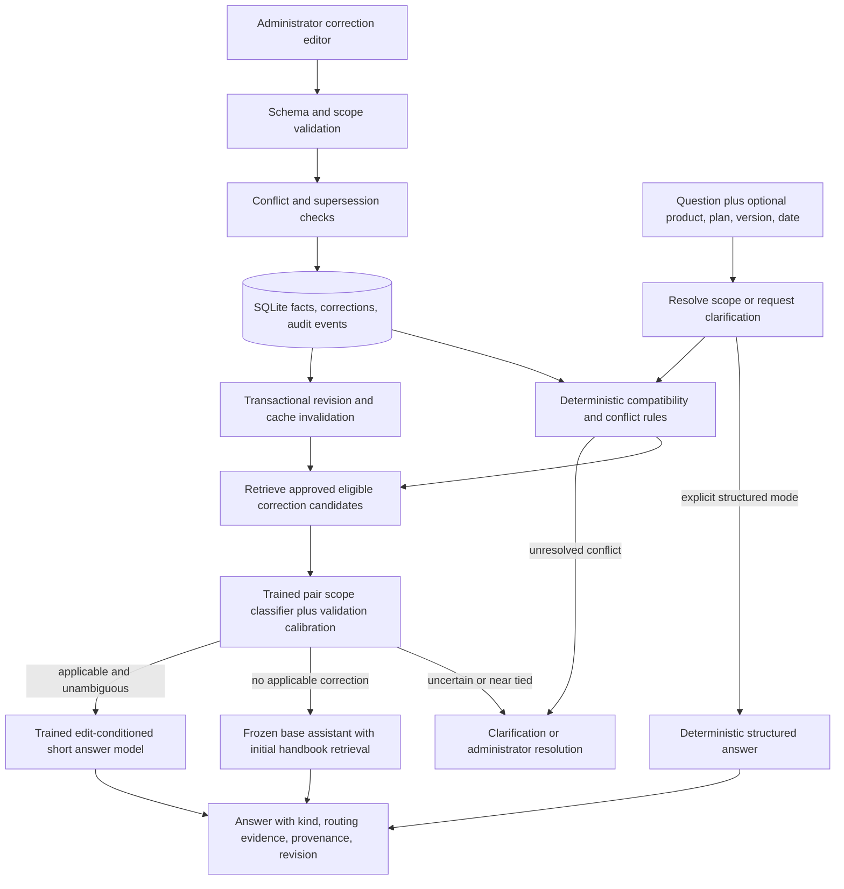

# EditGuard architecture

EditGuard targets short factual support questions in a bounded fictional product
domain. An administrator changes approved facts; two trained auxiliary models
learn when to apply a new correction and how to answer from it. Adding a correction
after training changes memory, without a separate fit for that correction. The base
assistant remains frozen. This is a behavioral knowledge editing system with
external memory, not a claim to change knowledge inside base-model parameters.

## Implemented paths

Both auxiliary models have completed user-executed training, exported checkpoints,
and independent artifact audits. The selected learned configuration is
[`configs/inference-final.json`](../configs/inference-final.json): a trained
DistilBERT scope cross-encoder and a separately fine-tuned FLAN-T5-small answer
model. The frozen base uses its original FLAN-T5-small weights and initial
handbook. New administrator-approved edits change external memory without a
per-edit training run. The application also offers a separately labeled
deterministic structured path; its correct answers provide no evidence of
learned generation accuracy.



## What comes from SERAC

SERAC stores edit descriptors in external memory, keeps the base model fixed, and
uses a scope model to route relevant inputs to a counterfactual model. The paper
trains its scope model with binary classification and the counterfactual model
with conditional generation. It examines embedding and cross-attention scope
architectures and reports component errors separately. Its routing equation uses
a 0.5 threshold. These concepts inform EditGuard; the original experiments and
their reported performance are not results for our dataset.
[Mitchell et al., ICML 2022, sections 3–5 and appendix C](https://proceedings.mlr.press/v162/mitchell22a/mitchell22a.pdf)

## Our adaptations and their implications

| Adaptation | Reason and implication |
|---|---|
| Structured edit descriptor with entity, relation, tier, version, interval and provenance | Makes administrator intent explicit; evaluates a narrower support task than arbitrary dialogue. |
| Transactional memory, approval, conflict blocking and rollback | Adds application governance; these rules are engineering controls and cannot be claimed as neural learning. |
| Candidate retrieval before compact cross-encoder scoring | Bounds inference work; retrieval can lose relevant edits, so candidate recall is measured independently. |
| Validation-selected calibration, threshold and ambiguity margin | Enables explicit abstention; reduces coverage and must be scored in fixed-denominator results. |
| Deterministic compatibility gates before model routing | Enforces selected product/version/tier/date boundaries; raw classifier tests and gate ablations distinguish learned scope behavior. |
| Entity-neutral literal preprocessing for the scope model | Replaces matching product/plan/version literals with neutral tokens, while preserving mismatches, properties and quantities. This is a deterministic adaptation; scope accuracy does not prove learned identity resolution. |
| Weighted first-token loss for answer comparisons | Gives both Yes and No first tokens weight 8, with remaining valid tokens weight 1. This addresses a measured polarity error but does not guarantee numerical reasoning. |
| A frozen assistant that retrieves an initial fictional handbook | Gives the base access to controlled facts, without assuming pretrained factual knowledge of imaginary products. |
| Separate structured mode and learned mode | A deterministic answer can be reliable in supported cases; it provides no evidence of trained generator accuracy. |
| Independent entity-family dataset and truth-aware scoring | Tests unseen corrections and products within the controlled domain; template sharing remains an acknowledged limitation. |

These are deliberate adaptations. Use **SERAC-inspired**, not "a faithful SERAC
reproduction", in documentation and resume claims.

## Minimal stack and interfaces

The implementation uses Python, FastAPI/Pydantic, SQLite, and a same-origin HTML/CSS/JavaScript frontend.
SQLite provides transactions, a small deployment footprint and exportable state.
It uses isolated application and ML environments, PyTorch/Transformers for
training and learned inference, and Matplotlib for scientific plots. The structured
container requires no model weights or GPU. Local learned deployment additionally
requires the saved auxiliary exports and pinned pretrained models. There is no
separate vector database, task queue or experiment server.

Keep interfaces narrow:

```text
CandidateRetriever.retrieve(question, request_scope, revision, top_k) -> candidates
ScopePredictor.score(question, correction, request_scope) -> calibrated_probability
AnswerGenerator.generate(question, correction, supporting_context) -> model_text
FrozenBase.answer(question, initial_handbook_context) -> model_text
TruthResolver.resolve(fact_id, as_of, revision) -> value, lineage, conflicts
```

Learned mode records candidate scores, chosen edit ID, model IDs, threshold,
question scope, memory revision and latency. Never rewrite a failed generated
answer with a structured value while retaining `model_generated` classification.
If structured fallback is added, log its distinct mode and evaluate it separately.

## Exact governance semantics

The first slice contract is in [IMPLEMENTATION_CONTRACT.md](IMPLEMENTATION_CONTRACT.md).
Facts use exact `(entity_id, relation, plan, version)` scopes and half-open date
intervals `[effective_from, effective_to)`. Server-side validation checks date
order, relation-specific values and that original values match the state being
changed. Approval requires the administrator token; customer questions cannot
activate corrections.

No latest-write-wins rule resolves contradictions. Overlapping, incompatible
values in the same scope require explicit resolution. Supersession requires an
approved predecessor in the same scope, a later effective start and matching
original value. Earlier date queries retain their earlier applicable fact.
Withdrawal restores applicable ancestors and records an event; an active descendant
must be withdrawn first. Draft conflicts block the affected scope and interval
until an administrator resolves them. This conservative rule is a documented
product choice.

Every successful state mutation and revision increment belongs to one database
transaction. Future retrieval and response caches key on revision, model IDs and
request scope; changing revision invalidates stale entries. Tests cover failed
approvals, predecessor restoration, historical queries and unrelated fact scopes.

## Selected backbones and measured resources

The inspected machine has an RTX 4050 laptop GPU with approximately 6 GB VRAM,
12 logical CPU threads and 23.71 GiB RAM; free RAM was about 11 GiB at inspection.
CUDA is available to PyTorch 2.9.0+cu130; Transformers 5.16.1 was detected.
The selected runs were profiled before release and then executed by the user.
Their recorded training loops took 112.546 seconds for scope and 264.537 seconds
for answers. Peak allocated GPU memory was 1.318 and 1.504 GiB respectively;
peak reserved memory was 1.410 and 1.656 GiB. These are measurements on this
machine, exclude full startup/final export wall time, and do not predict another
machine's requirements. Exact evidence is in the
[986-check training artifact audit](../reports/targeted-training-audit.json).

The frozen embedding model is
[all-MiniLM-L6-v2](https://huggingface.co/sentence-transformers/all-MiniLM-L6-v2),
whose official card describes 384-dimensional sentence embeddings. A compact
[DistilBERT](https://huggingface.co/distilbert/distilbert-base-uncased) encoder plus
a binary head is the trained scope backbone. The trained answer backbone is
[FLAN-T5-small](https://huggingface.co/google/flan-t5-small), an encoder-decoder
text-to-text model. Exact pretrained revisions, export hashes and selected states
are recorded in the [model card](MODEL_CARD.md) and frozen final protocol.

The scope representation is `entity_neutral_v1`. Calibration selected temperature
1.0, threshold 0.97 and ambiguity margin 0.025 using development validation data.
Runtime applies approval, identity, plan, version, date and conflict rules before
eligible candidate routing. Low-confidence or near-tied decisions clarify.
Model scores do not validate dates or approval status. The answer model receives
the full applicable correction and supporting context; it generates text without
a hidden deterministic answer replacement.

## Genuine implementation risks

| Risk | Control and finite decision |
|---|---|
| Template shortcuts and correlated examples | Family split before augmentation, counterfactual values, a separately reported agent-authored challenge set, transformed-input overlap audit and grouped uncertainty. There is no independent human challenge-review claim. |
| Six GB VRAM and package/runtime compatibility | Bounded forward/backward profile with actual token lengths, CUDA synchronization, peak allocation and wall time before selecting batch sizes or estimates. |
| Similar names, implied tiers and historical wording | Hard negatives plus explicit selectors; unresolved context requests clarification. |
| A generator copies a value but changes subject or polarity | Score subject, relation, unit and endorsed value; oracle routing isolates generation failure. |
| Candidate retrieval misses the edit | Report recall before filtering and after filtering; do not attribute all misses to the classifier. |
| Conflicting or stale administrator changes | Transactions, original-value preconditions, explicit lineage and revision-aware cache keys. |
| Small frozen generator performs poorly on fictional facts | Measure its initial-handbook performance; retain diagnostic errors and fairly update RAG. |
| Machine audit can miss semantic ambiguity | Record automated development/final review explicitly; preserve flagged rows and raw outputs. Automated consistency checks do not replace independent human semantic validation. |

## Evaluation boundaries

The selected models trained on four entity families and used two different
families for development validation. The original 80-family draft was not all
used for training. The frozen final packet contains 12 further families: 720 scope
pairs, 288 oracle answer examples and 96 challenges. Raw entities and lineages
are disjoint. Literal abstraction creates nine same-label test inputs also
present in scope training; report these separately from the other 711 inputs.
Shared templates remain a broader limitation.

The frozen protocol compares the unchanged base, properly updated RAG,
prompt-only correction, similarity editor and trained scope editor under matched
corrections, generation settings and answer budgets. Component diagnostics
separate retrieval, pair classification, oracle answer generation and end-to-end
behavior. The matched comparison is sealed with zero runtime errors. Updated
RAG leads the standard request-bound metric at 649/720, compared with the trained
editor's 613/720. The editor's raw scope accuracy is 701/720, while challenge
coverage falls to 48/96; good standard routing does not establish unrestricted
language understanding. Original oracle inference has 319/384 CUDA runtime
errors and remains an incomplete generation measurement. Separate recovery
stopped before generation because CUDA is currently unavailable; its 319 cases
remain not attempted. A fresh closure verifies unchanged files/fresh weights but cannot
reconstruct the failed GPU instance's final memory state. See
[FINAL_EVALUATION.md](FINAL_EVALUATION.md) for results and execution disclosures.
No final measurement was used to revise models, thresholds or scoring rules.

## Evidence boundaries

An approved fact is authoritative within the defined domain and scope. Retrieved
source evidence does not certify arbitrary generated prose. The interface should
say "supporting facts" and show source/history; reserve "verified" for a precisely
defined deterministic check. Open-domain dialogue, arbitrary reasoning and unknown
products remain outside initial acceptance criteria.
