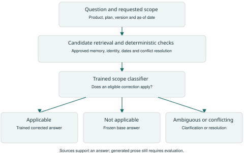
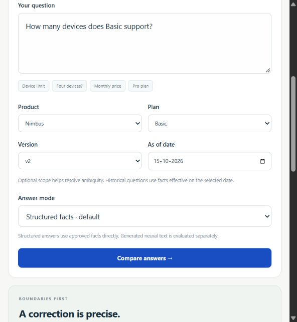
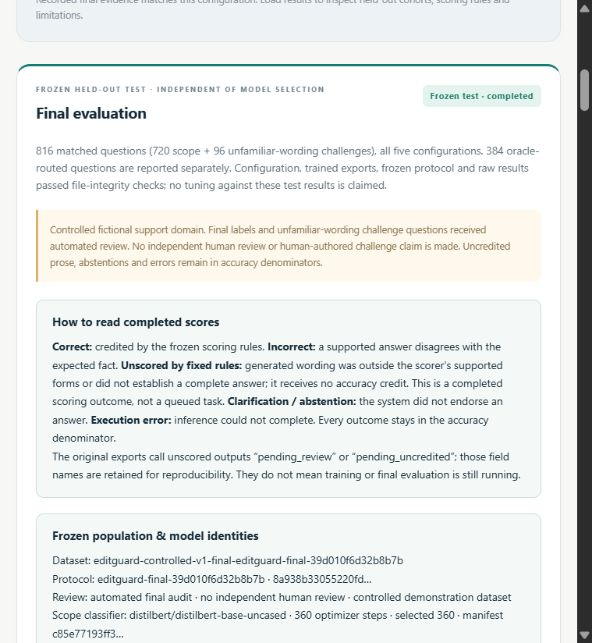

# Understanding EditGuard from the Ground Up

A complete learning guide and website walkthrough for the project team

Prepared 20 October 2026. Development chronology is based on the repository and recorded experiments from 11 to 15 October 2026.

This guide assumes no background in machine learning or web development. Read chapters 1 to 9 in order, then follow the website demonstration in chapters 12 to 14. The later chapters explain the graphs, files, commands and questions a panel may ask. You do not need to memorize long model identifiers or file hashes.

We built a working, locally deployable knowledge editing platform, trained its two auxiliary models, compared five approaches and completed the planned evaluation. Some generated answers were wrong and some could not receive automatic scoring credit. Those are measured outcomes of the completed project. They are explained here rather than removed from its history.

## 1 The whole project in one example

Imagine a company called Nimbus selling Basic and Pro subscriptions. Its original handbook says Basic version v2 allows five devices. Later the company changes that limit to three. A support assistant using the old handbook may continue answering five.

Our administrator records a correction: Nimbus, Basic, v2, device limit, old value 5, new value 3, effective from 1 October 2026, with a release notice as its source. The correction becomes authoritative only after approval.

When a customer asks how many devices Basic supports, the system should use the applicable correction. A differently worded question should receive the same information. A question about Basic's price should still use its separate price fact. Pro should keep its own limit. Questions about v1 or dates before the change should use the appropriate old fact.

The difficult part is deciding exactly when to use an edit and then producing a correct answer. Similar words do not always mean the same question. Also, copying the number three is insufficient when the question asks whether four devices are allowed: the answer must endorse No.

Our project is called EditGuard because it combines controlled edits with boundaries, provenance, conflict handling and evaluation. The initial domain is a fictional support handbook with short numeric questions. It is a controlled demonstration dataset, so we know the correct facts without relying on a real company's private data.

**A useful explanation to remember:** We trained one model to decide whether an approved correction applies, and another to answer using that correction. New approved corrections go into memory; they do not require another training run. The original assistant's model weights stay unchanged.

## 2 Completion pending and failure mean different things

The earlier statement that the project was complete referred to the agreed implementation and experiment stages. It did not mean that every model answer was correct. That distinction should have been made clearer alongside the report's numbers.

### The five evaluation outcomes

| Outcome | Meaning | Does it earn accuracy credit |
|---|---|---|
| Correct | The applicable scoring rule confirms the requested answer | Yes |
| Incorrect | The rule detects a wrong value, identity, relation or endorsed answer | No |
| Unscored | The generated text or question is outside the fixed rule's supported forms | No |
| Clarification | The system asks for more information instead of giving an answer | No |
| Execution error | The program or device could not produce the answer | No |

The word `pending` in older score exports usually means **unscored by the fixed rules**. It does not mean training is still running, a file is still downloading, or an evaluation job is waiting. The scoring pass has finished. Its conservative result is that it cannot award credit automatically. The interface now uses clearer labels while retaining the original raw field names and results.

For example, the question may request a device limit, and the model may answer only `6`. That can correctly answer the question but does not state the full product, plan, version and property. The complete-assertion scorer leaves it unscored. The separate request-bound scorer may credit it if that controlled question form is supported.

Another recorded output says a product "includes 4 devices" when its truth is four. It appears reasonable to a reader, but that exact device wording is outside the frozen accepted assertion forms. It remains unscored. We did not expand the scorer after seeing the final test answers.

An actual wrong response is different: the question asks whether five devices can connect to a four-device plan, and the model answers "Yes" while repeating the four-device limit. That is a contradiction, not a missing evaluation job. Our tests deliberately detect it.

### Other uses of the same word

A source dataset row can retain an original draft `review_status` of `pending` while a separate, row-hash-bound review registry contains the accepted automated review. Keeping the original draft unchanged preserves its history. It does not mean the final registry was never completed. Neither registry claims independent human review.

Older development notes also describe the status at the time they were written. "Final evaluation pending" in an early pilot note is historical. Use the current project plan and final evaluation document for the release status.

A correction draft awaiting administrator approval is a real workflow state. That draft is intentionally not authoritative. An unresolved conflict is also an intentional blocked state: it needs an administrator's decision before a disputed fact can be used. These are different from unscored benchmark outputs.

### What has been finished

The five-way matched evaluation produced 4,080 observations with zero execution errors. The original separate oracle run encountered 319 GPU errors; its declared operational recovery later produced all 319 missing answers with zero new execution errors. Both records are retained. The trained generator still makes factual or comparison mistakes, and some language remains outside the fixed scoring rules.

We can fix misleading labels, broken application behavior and unfinished jobs. We cannot honestly promise zero model errors on arbitrary future language. Deleting the recorded mistakes or treating unscored answers as correct would make the report less reliable. The completed release includes these limitations as part of its scientific result.

## 3 The basic ideas you need first

### A fact and its scope

A **fact** is one claim we can store explicitly: Nimbus Basic v2 has device limit 5. The product is the **entity**. Device limit is the **relation**, meaning the property being discussed. Five is the **value**. Devices is the **unit**. Basic, v2 and the effective dates specify the **scope**, meaning the exact circumstances where that fact applies.

The product, property, plan, version and date matter together. A number with no subject is not enough to update knowledge safely. A three-device Basic correction must not change Pro's limit or Basic's monthly price.

An **alias** is another approved name for the same entity. A **lineage** connects versions of the same underlying fact or correction. **Provenance** records where the information came from. An approval authorizes use of a correction; it does not prove that a neural model will always express that information correctly.

### A model and its weights

A machine learning **model** is a program containing many adjustable numbers called **weights** or parameters. It learns patterns by adjusting those numbers using examples. In our scope model, the desired output is an applicability decision. In our answer model, the desired output is a short answer.

**Pretraining** means another organization has already taught a model general language patterns on large datasets. We started with compact pretrained models. **Fine-tuning** means training them further on our particular task. We did not train a language model from nothing.

**Inference** means using a trained model to make a prediction. Training changes weights; inference reads them. Inserting an approved correction into our external memory changes the information supplied at inference time. It does not fine-tune the models again.

### Retrieval and generation

**Retrieval** finds relevant stored material for a question. An **embedding** turns text into a vector, which is a list of numbers representing aspects of its meaning. Similar vectors help identify candidates. Our frozen MiniLM embedding model provides this representation.

Retrieval is a shortlist, not a guarantee. "Basic device limit" and "Pro device limit" can look similar while referring to different facts. Compatibility rules and the trained scope classifier decide whether a retrieved edit is usable.

**Generation** means producing answer text. The generator can use a correct source and still produce an incorrect sentence. That is why displaying a source is useful evidence but does not automatically verify every word of generated prose.

### Knowledge editing and our approach

Knowledge editing aims to change an assistant's behavior for a correction while preserving behavior outside its intended scope. Some methods directly modify a model's weights. Our semi-parametric design combines learned weights with an external correction memory.

The original SERAC research uses explicit edit memory and learned components to modulate a base model's behavior. We use that central idea, with adaptations for a small support domain. We call our implementation **SERAC-inspired**, because we did not establish a faithful reproduction of every original algorithmic and experimental detail. The paper is listed in chapter 19.

## 4 The timeline of what we built

The dates below are repository milestones, not claims that every activity began and ended on a particular day. Each step explains the problem it resolved and the concrete result it produced.

### Step 1 Define a bounded problem on 11 October

**What:** We limited the first system to short questions about fictional products, plans, versions, prices and numeric limits.

**Why:** An unrestricted assistant would make ground truth and evaluation too uncertain for a manageable project. A controlled handbook lets us check which fact should answer each question and test exact boundaries.

**How:** We defined explicit fact and correction records, administrator approval, effective dates, lineage and expected behaviors. We separated deterministic governance from learned answering from the beginning.

### Step 2 Build one correction and rollback workflow on 11 October

**What:** We created the first runnable application, fact store, correction editor, source display, history and rollback behavior.

**Why:** Before training, we needed to prove that the basic product worked: a draft must not silently become truth, neighboring facts must survive an edit, and rollback must restore the previous applicable state.

**How:** FastAPI exposes the backend, SQLite stores facts and events, and HTML, CSS and JavaScript provide the website. State changes use transactions. Revision numbers change when knowledge changes so old cached answers are not reused incorrectly. Structured answers made the state transitions directly testable.

### Step 3 Inspect hardware and profile small runs on 11 October

**What:** We inspected the available laptop and profiled short training runs before committing to the selected compact backbones.

**Why:** Model size, GPU memory and actual runtime determine whether a plan is feasible. Guessing training speed from model names would have been unreliable.

**How:** The recorded hardware was an RTX 4050 laptop GPU with about 6 GiB VRAM and 23.71 GiB host RAM. Small update/validation/checkpoint measurements informed finite run plans. The app environment and ML environment were isolated so the lightweight website did not need the full training stack.

### Step 4 Establish the base and comparison system on 11 October

**What:** We defined a frozen base assistant using the initial fictional handbook and implemented five configurations under one harness.

**Why:** The pretrained model could not be assumed to know our made-up company's facts. We also needed fair comparisons, including a RAG assistant whose knowledge really was updated.

**How:** A frozen FLAN-T5-small base receives retrieved handbook facts. Updated RAG receives materialized approved changes. Prompt correction receives eligible correction information. Similarity editing and learned scope editing route to the same trained edit-conditioned answer model. Matching generation settings and answer budgets reduce avoidable comparison differences.

### Step 5 Build data and review the pilot on 12 October

**What:** We prepared independent fictional data, split by entity families before wording augmentation, and created a small development pilot.

**Why:** Randomly scattering paraphrases of the same fact across training and test would make the model appear to generalize more than it did. A small pilot let us verify the entire training pipeline before scaling it.

**How:** The selected pilot used four training families and two validation families. Its 504 task rows received automated development review with row identity checks. You authorized machine review; we do not call those labels independently human-reviewed. The larger generated catalogue was available but was not all used to train the selected models.

### Step 6 Train and inspect initial models by 13 October

**What:** We ran compact scope and answer training, saved exports and measured generated validation answers.

**Why:** Having a training script is insufficient. We needed actual trained artifacts, reproducible checkpoint recovery, held-out validation predictions and an honest account of errors.

**How:** You executed the substantial GPU commands. Run cards specified inputs, finite step caps and resume behavior. We recorded losses and free-generation outputs. Initial results exposed routing weaknesses and a generator tendency to give the wrong Yes or No on capacity questions.

### Step 7 Make bounded development revisions on 14 October

**What:** We made targeted changes to scope training inputs and answer training, then selected the release models using validation.

**Why:** We wanted to address diagnosed problems without an endless model search. The scope model could rely on superficial name cues, and copying a limit did not reliably produce the correct comparison polarity.

**How:** Scope development balanced existing negative question forms and introduced declared entity-neutral preprocessing. Matching explicit identity selectors are normalized, while incompatible names, properties, plans or versions remain meaningful differences. The answer revision increased the training weight of the opening Yes and No tokens equally. These changes had finite training caps. Some comparison mistakes remained after the revision.

These were separate scope revisions. Initial negative examples all used direct-question wording, creating an unintended shortcut: direct wording could look like a negative label. The initial diagnostic missed all 12 applicable direct development questions. Revision 1 balanced negative question forms; after 360 updates its validation loss was 0.4857 and raw accuracy 98/120. A diagnosis with the unfamiliar Nimbus demo identity still showed stale-answer routing. Revision 2 used the declared entity-neutral inputs, reached raw 119/120 and selected loss about 0.0433. We chose it using development evidence, before final testing.

### Step 8 Audit the selected models on 14 October

**What:** We selected `pilot-v3-neutral2` for scope and `pilot-v2-polarity1` for answers and audited their artifacts.

**Why:** A plausible filename does not prove a model was trained or that runtime loads the selected checkpoint. We needed to tie saved tensors, configuration and training records together.

**How:** Manifests, model/tokenizer files, run cards and checkpoint state checks produced 986 artifact/state audit checks. Validation selected the scope threshold and uncertainty policy. Training stopped; adding ordinary new administrator corrections now updates memory rather than rerunning training.

### Step 9 Freeze final data and rules on 14 October

**What:** We prepared a separate final packet and locked models, configuration, question/truth files and scoring rules before final inference.

**Why:** Repeatedly adjusting the model or scoring rules after looking at test answers would turn the test into another development set.

**How:** The final registry contains 1,104 accepted automated audit decisions across the task files. A protocol and test lock bind file hashes. A startup dependency guard mismatch was fixed before any final model predictions; the amended question and truth files remained byte-identical. This was an engineering startup repair, not selecting a better model from test results.

### Step 10 Run final comparisons and preserve interruptions on 14 and 15 October

**What:** We completed all five matched configurations and recorded the separate oracle diagnostic. The original GPU process later lost its CUDA context during oracle work.

**Why:** The final run must retain unsuccessful observations and its fixed denominators. Otherwise apparent accuracy could rise simply by dropping inconvenient cases.

**How:** Each observation was durably journaled. A narrowly declared finite retry handled mutable progress-file write collisions without changing predictions. The 4,080 matched observations completed with zero execution errors. Of 384 original oracle observations, 65 had answers and 319 had execution errors. We retained those errors in the original result.

### Step 11 Recover the declared oracle cases on 15 October

**What:** After GPU availability was restored, a separately named operational supplement generated answers for the 319 original CUDA-error cases only.

**Why:** Recovering unavailable outputs is useful, but it must not silently replace a failed experiment or rerun difficult successful cases until a better answer appears.

**How:** The declared selection used execution status, preserved the original 65 answers exactly, checked reconstructed input bytes and allowed at most one new generation per selected case. All 319 recovered cases answered without new execution errors. The combined view contains 384 answers. No model, threshold or scoring rule changed. The lost original GPU memory state cannot be reconstructed by later file checks.

### Step 12 Publish evidence and verify deployment on 15 October

**What:** We produced the final dashboard, six scientific figures, report, failure analysis, cards, API documentation, local application and CI evidence.

**Why:** A panel should be able to inspect how the project works and distinguish engineering checks from ML performance. Source and outputs must also be reproducible.

**How:** We verified application workflows, numeric checkpoint tests, clean-source data/figure reproduction and the structured container's lifecycle/restart behavior. A finite isolated HTTP benchmark measured warm response times and separate cold model loading. All three release CI jobs passed on the measured release source.

### Step 13 Explain the project and repair confusing labels on 20 October

**What:** We created this learning guide and changed misleading website score labels from pending to unscored by fixed rules. We also corrected stale loading/structured-mode descriptions and aligned form limits with the API.

**Why:** Readers were interpreting completed-but-unscored results as unfinished implementation. Some old interface wording also described models as untrained even when trained artifacts existed.

**How:** These are presentation and input-validation changes. The frozen scoring code, model files, thresholds, questions, truth and recorded scores are preserved. Current UI checks are recorded separately from the original release test counts.

## 5 How the architecture works

### The four central parts

**Frozen base assistant:** The original generator answers using the initial support handbook. Frozen means its weights are not edited. Its retrieved context can differ in a baseline such as updated RAG, but the generator weights still remain fixed.

**Versioned correction memory:** A database of approved corrections with identifiers, scope, dates, sources and lineage. This is external information, not a new collection of neural weights for every edit.

**Trained scope model:** A DistilBERT question-correction pair classifier. It reads both pieces of text together, which is why it is called a cross-encoder. It scores whether the correction applies to the question. Separate deterministic rules check approval and metadata compatibility; raw classifier measurements do not include those rules.

**Trained answer model:** A fine-tuned FLAN-T5-small sequence-to-sequence model. Sequence-to-sequence means it receives input text and generates output text. Its input includes the applicable correction, question and necessary support context. The target is a short corrected answer.

### One customer question from beginning to end

1. The website sends the question, selected product/plan/version/date and answer mode to the backend.
2. Deterministic checks resolve identity, approval, effective dates and incompatible scope. An unresolved contradiction or ambiguity blocks a confident answer.
3. Embedding retrieval finds candidate facts and corrections. Raw retrieval quality is measured separately from whether a candidate survives eligibility checks.
4. In learned editing, the trained scope model scores eligible question-correction pairs. The configured uncertainty policy can request clarification.
5. If an edit applies, the trained answer model generates using it. If no edit applies, the frozen initial-handbook assistant supplies the answer. The base fallback can itself be wrong.
6. The interface shows the route, answer kind, before/current comparison and supporting sources. A generated answer remains model-generated even when a correct source is visible.



### The adaptations that make this our implementation

We use a controlled numeric support domain, explicit metadata compatibility checks, a family-split fictional dataset, entity-neutral scope preprocessing, finite compact-model training and conservative clarification behavior. The base uses retrieval because the fictional handbook is not assumed to be in its pretrained knowledge. These adaptations are documented; our result is not claimed to reproduce the original SERAC benchmark faithfully.

## 6 How our data gives us ground truth

**Ground truth** is the answer determined by our explicit approved facts and scenario. It is the reference used to check a prediction. We control it by writing a fictional catalogue and describing edits structurally.

The larger controlled catalogue has 80 entity families, 1,280 initial facts and 480 edit scenarios. A family groups related product identities so related variants stay together during splitting. We assigned 56 families to training, 12 to validation and 12 to test before generating paraphrases and counterfactual variants.

The selected pilot used only four training and two validation families. This modest start was intentional: establish a working training/evaluation pipeline and diagnose failures before increasing the data. Do not tell the panel that the selected models trained on the entire 80-family catalogue.

| Selected pilot task | Training rows | Validation rows |
|---|---:|---:|
| Scope question and correction pairs | 240 | 120 |
| Answer input and target examples | 96 | 48 |
| Total reviewed task rows | 336 | 168 |

The total is 504 task rows, not 504 independent products or human reviewers. Some task files concern related underlying facts. The final set comes from 12 held-out families and is not used for model selection.

### Positive and difficult negative examples

A positive scope pair asks about the edited property in its applicable scope. A negative pair should not use that edit. We included negatives about another property of the same product, the same property on a different product, a similarly named product, a wrong subscription tier and an incompatible version.

For example, the correction changes Nimbus Basic v2 devices from five to three. "How much is Basic?" is a same-product different-property negative. "How many devices does Pro allow?" is a wrong-tier negative. "How many devices does Basic v1 allow?" is a wrong-version negative. A similar product name is not automatically an alias.

### Leakage and the limit we disclosed

**Data leakage** happens when training or development has access to information that should be reserved for the test. Splitting individual paraphrases randomly would leak almost identical fact examples between sets. We split entity families and lineages first.

However, normalizing matching entity selectors can make different raw pairs produce identical model inputs. Nine final scope inputs match training inputs with the same labels. None matches validation and none has contradictory labels. We report the other 711 scope pairs separately: 692/711 correct. Raw held-out entities alone do not prove that every processed input or language template is novel.

Review was automated and explicitly authorized. Checks validate consistency against structured truth and row identities. They do not become independent human semantic review simply because an agent inspected them. The 96 challenge questions were agent-authored and machine-audited, not manually authored by people.

## 7 How training actually works

### The training loop in plain language

A tokenizer converts text into tokens, which are pieces a model can process. A batch groups examples for efficient computation. The model predicts; a loss function measures disagreement with the target; backpropagation calculates how weights contributed to that loss; an optimizer updates weights. An optimizer step is one such update, not one customer question and not one second.

An epoch means one pass through the training data. Our finite run plans use maximum optimizer steps and validation checkpoints rather than an unlimited number of epochs. Small datasets may be visited repeatedly during training. That is why performance on unseen validation examples matters.

A **checkpoint** saves enough state to resume: model, optimizer, scheduler, random-number state, data sampling position, global step and model-selection information. An exported **model artifact** is the saved model/tokenizer/configuration used at inference. A checkpoint and an inference export serve different purposes.

### Scope training and calibration

The scope model learns from labeled question-correction pairs. Its selected release completed 360 optimizer steps, with checkpoint 360 selected by validation loss. The selected validation loss was approximately 0.0433. On the 120-pair development set, its raw predictions were correct on 119 pairs.

Earlier you saw a scope validation loss around 0.4857. **A loss of 0.48 is not 48 percent accuracy and does not mean 52 percent accuracy.** Classification cross-entropy penalizes the probability assigned to the correct label. As an illustration, a correct-label probability of 0.9 gives a loss near 0.105, while 0.6 gives about 0.511. Loss also reacts strongly to confident mistakes. These illustrative probabilities are not measurements from our run.

Validation loss helps select a checkpoint; it is not a substitute for precision, recall, calibration or end-to-end answer quality. We inspected those additional outcomes before selecting the release.

The runtime policy uses temperature 1.0, threshold 0.97 and uncertainty margin 0.025, selected on validation. A threshold determines how strong a model score must be to apply an edit; the uncertainty policy can ask for clarification near ambiguous decisions. The exact decision is implemented in the routing code, so the three numbers must be interpreted together. A score above 0.97 is not a guarantee that 97 percent of all future answers are correct.

### Answer training and the polarity revision

The answer model receives an applicable edit and question, plus supporting context, and learns the corrected short answer. It is trained across many corrections, so a new edit can be supplied without another fit. Held-out entities and edits test whether that behavior transfers beyond the training catalogue.

The selected release completed 240 optimizer steps. The revision gave the opening Yes and No tokens equal 8x loss weight on comparison targets, with other valid tokens weighted one and padding zero. This made the consequence of the comparison decision more visible during training. It did not hardcode the correct response for each question.

Its weighted validation loss of approximately 0.1682 is not comparable to the earlier uniformly weighted loss. With a common unweighted objective, validation token loss worsened from 0.04441 to 0.06173, while generated development negative comparisons improved from 0/12 to 5/12. Seven remained wrong. This is a useful example of why both objective values and actual generated answers must be inspected.

Across all 48 development oracle questions, complete-answer credit improved from 31/48 to 34/48. That measured generation tradeoff helped justify selecting the revision despite its worse comparable token loss. It did not eliminate the remaining mistakes.

The selected models' recorded training-loop times were 112.55 seconds for scope and 264.54 seconds for answers. GPU reserved peaks were 1.410 GiB and 1.656 GiB respectively. These are measured loops and reserved allocations, not complete command startup/export times or universal hardware requirements.

### Messages shown while loading a pretrained model

The DistilBERT load table listed old pretraining-head tensors as unexpected and new classification-head tensors as missing. We were replacing a language-modeling head with a classification head, so those new classification parameters needed task training. That table alone was not evidence of a failed training command. A completed run manifest, changed trained tensors and held-out predictions provided the relevant evidence.

## 8 How we compared five approaches fairly

A **baseline** is an alternative used for comparison. It tells us whether the proposed method adds value and where it costs something. We used five configurations on the same questions.

| Configuration | Information and behavior |
|---|---|
| Unchanged base | Frozen generator with the original handbook; diagnostic reference for outdated answers |
| Updated RAG | Frozen generator retrieves from knowledge containing approved corrections |
| Prompt only | Frozen generator receives eligible correction information in its prompt |
| Similarity editor | Embedding similarity routes to the same trained answer model used by our editor |
| Learned scope editor | Trained scope classification, eligibility policy and uncertainty route to that trained answer model |

RAG means retrieval-augmented generation: retrieve information, then generate using it. We did not make RAG artificially stale. Updated methods received the same approved corrections and supporting information. They used compatible deterministic generation settings and a 48-token output budget.

The unchanged base is deliberately the initial-handbook reference; it is not evidence that updated RAG must fail. Also, the similarity editor baseline is not wholly untrained: its routing is similarity-based, but its answer generator is the trained answer model. The comparison isolates the value of learned scope selection.

Questions were evaluated in separate correction scenarios with one focal edit and at most eight foreign-product distractors. That does not establish reliability for a huge memory with many overlapping same-product corrections. Conflicts and multi-edit governance have separate engineering tests.

### The four places an answer can go wrong

Retrieval can miss the correct edit. Scope classification can choose the wrong edit or reject the right one. Generation can say something wrong even with the correct edit. Finally, an automatic scoring rule can leave text unscored because its supported grammar is narrower than ordinary language.

We evaluate these parts separately. **Oracle-correct routing** supplies the applicable correction directly to the answer model. Oracle means an experimental helper that knows which edit to choose, not an extra product component and not feeding the target answer into the model. It isolates generation from retrieval and routing errors.

The final test was frozen before inference. We did not repeatedly optimize against it. A separate future development cycle could use new training and a new independent test, but it would not rewrite this release's result.

## 9 The populations behind the numbers

Always ask "out of how many, and which cases?" A percentage without its population can be misleading.

| Count | What it refers to |
|---|---|
| 720 | Standard final scope questions per compared configuration |
| 288 | Applicable questions within that standard scope cohort; also the standard oracle task size |
| 432 | Out-of-scope questions in the 720 standard cohort |
| 96 | Separate unfamiliar-wording challenge questions |
| 816 | 720 standard plus 96 challenge questions per configuration |
| 4,080 | Five configurations multiplied by 816 matched observations |
| 384 | 288 standard oracle plus 96 oracle challenge observations |
| 4,464 | 4,080 matched plus 384 original oracle observations |
| 1,104 | Final data task rows across scope, answer and challenge files; not 1,104 unique products |

The 288 standard applicable questions comprise 72 direct questions, 72 paraphrases and 144 comparisons. A paraphrase asks about the same fact using different wording. A comparison asks whether a proposed quantity is within the limit. The other 432 standard questions should not apply the focal edit.

The standard oracle file and scope file serve different component measurements. Never add 288 oracle cases to 720 scope cases and describe the result as one end-to-end accuracy denominator. Likewise, the original 319 error cases do not mean 319 errors occurred in the five-way matched comparison: that comparison had zero execution errors.

## 10 Every important metric in plain language

### Accuracy and the five way result

Accuracy is credited correct answers divided by all relevant questions. Clarifications, unscored cases and execution errors remain in that denominator. The main standard request-bound result is:

| Configuration | Credited correct out of 720 | Percentage |
|---|---:|---:|
| Unchanged base | 500 | 69.44 percent |
| Updated RAG | 649 | 90.14 percent |
| Prompt only | 533 | 74.03 percent |
| Similarity editor | 632 | 87.78 percent |
| Learned scope editor | 613 | 85.14 percent |

For our editor, 613 divided by 720 times 100 is 85.14 percent after rounding. Updated RAG leads on this population. The proposed model does not need to win every baseline for the trained, evaluated project to be complete.

### Two answer scores that answer different questions

The **primary complete-assertion score** asks whether the generated text makes a full, endorsed, scoped fact assertion with the correct subject, property, plan, version, unit and value. Rejected alternatives, examples and target-number mentions do not count as endorsement.

The **secondary request-bound QA score** can accept a short quantity or Yes/No for twelve explicit controlled question forms when it correctly answers the requested predicate. It does not claim the short answer contains a complete fact assertion. It never overrides a primary verdict that already detected an incorrect answer.

This explains the initially surprising primary zero for RAG: its short answers are often outside the complete-assertion format and remain unscored there. It does not have zero factual correctness. Its 649/720 request-bound score is the relevant controlled short-QA comparison. The complete-assertion format also favors wording the trained generator saw in its targets, which limits claims of superiority from that metric.

All 96 challenge forms are unsupported by the fixed secondary question grammar. A secondary zero there does not establish that every answer is wrong. The learned editor generated 48 responses and clarified 48; primary scoring left those 48 generated responses unscored. General-language accuracy is therefore not established.

### Where the learned standard score comes from

| Standard group | Correct | Other outcomes | All cases |
|---|---:|---|---:|
| Direct applicable questions | 72 | None in this cohort | 72 |
| Applicable paraphrases | 39 | 33 unscored | 72 |
| Applicable comparisons | 97 | 47 incorrect | 144 |
| Out of scope | 405 | 23 clarifications and 4 incorrect | 432 |
| Total | 613 | 33 unscored and 51 incorrect and 23 clarifications | 720 |

The 72/72 result is a bounded test result, not a promise of perfect accuracy on every future direct question. The 47 wrong comparisons explain why knowing a corrected number is insufficient for reliable Yes/No reasoning.

### Retrieval recall

Applicable-edit retrieval recall asks how often the correct edit appears in the retrieved shortlist when an edit should apply. At rank 1, we inspect the first candidate; at rank 3, we inspect the first three.

On standard applicable questions, rank-1 retrieval found 283/288 and rank-3 found 288/288. Including challenges, the corresponding results are 368/384 and 384/384. Finding the edit somewhere in the first three does not prove the model chose it or generated the correct answer.

### Scope precision and recall

A true positive is an applicable pair predicted applicable. A false positive is an inapplicable pair predicted applicable. A true negative is correctly rejected. A false negative is an applicable pair incorrectly rejected.

On the 720 standard raw pairs, the scope model had 288 true positives, 19 false positives, 413 true negatives and zero false negatives. Raw accuracy is (288 + 413) / 720 = 701/720, approximately 97.36 percent.

Precision is 288 / (288 + 19), approximately 93.81 percent: among its positive predictions, how many really apply? Recall is 288 / 288 = 100 percent: among truly applicable pairs, how many did it detect? These standard-only figures differ from the dashboard's combined 816-pair precision 360/379 and recall 360/384, which include harder challenge wording.

### False correction application

This asks how often the complete routing system selects a focal correction for an out-of-scope question. Our standard recorded result is 0/432. It includes deterministic metadata/approval guards and the learned policy. It does not mean the raw classifier made no mistakes: its 19 raw false positives are a separate measurement.

It also does not mean every out-of-scope answer is correct. The frozen base can answer incorrectly even when the focal edit is appropriately not used.

### Preservation and factual correctness

Out-of-scope factual correctness is 405/432. Baseline-correct retention is 405/428, approximately 94.63 percent. The second denominator contains only questions the base had answered correctly already. Preserving an already wrong base answer is preservation of behavior but not truth. That is why we report the two measures separately.

### Coverage and clarification

Answer coverage is answered questions divided by all questions. Across the 816 matched cases, the learned editor answered 745 and clarified 71, giving 91.30 percent coverage. Within the 720 standard cases it answered 697 and clarified 23. Across 96 challenges it answered 48 and clarified 48.

Coverage measures willingness to answer, not correctness. A system can raise coverage by answering recklessly. A conservative threshold can reduce wrong edit applications while increasing clarification. Graphs of performance versus coverage show this tradeoff.

### Calibration Brier score and calibration error

Calibration asks whether predicted confidence is consistent with observed frequencies. If many decisions are assigned about 80 percent applicability probability, roughly 80 percent should actually apply on a well-calibrated population. This is about scope applicability, not automatically about final answer truth.

The Brier score averages squared probability errors; lower is better. Expected calibration error groups probabilities into bins and measures the gap between average confidence and observed outcomes. Bins and population affect it. Neither number should be read as a direct accuracy percentage.

On all 816 final raw scope pairs, the dashboard reports Brier about 0.0574 and calibration error about 0.0548. Challenge wording degrades calibration relative to easier development data. Validation calibration does not guarantee calibration on new domains.

### Oracle recovery scores

The original oracle record contains 65 answers and 319 execution errors out of 384, with 45 primary credits. The operational supplement preserves the 65 answers and recovers 319 errors. The combined oracle view has 247 primary-correct, 90 unscored and 47 incorrect out of 384, with zero execution errors.

Thus 247 + 90 + 47 = 384. On its 288 standard oracle questions, the separate request-bound rule credits 208, leaves 33 unscored and detects 47 incorrect. The other 96 oracle challenges have 40 complete-assertion credits and 56 unscored. These are component diagnostics, not an improved replacement score for the five-way comparison.

### Latency and resources

Latency is response time. One millisecond is one thousandth of a second. The p50 is the median: about half the measured requests are no slower. The p95 marks a high-end point in the measured distribution: about 95 percent are no slower. It is not a guaranteed maximum for future requests.

The learned serial CLI route across 816 questions had p50 about 231.9 ms and p95 about 896.5 ms. That excludes model loading, HTTP transport, scoring and journal writes. It also excludes the website API's extra generation of a before answer. Do not call that a complete website latency measurement.

The separate HTTP benchmark timed 30 warm requests from the client, including the API comparison work: p50 230.42 ms and p95 372.04 ms. Its three repeated development questions and warm caches differ from the 816-question CLI workload, so the two timing distributions are not directly interchangeable. Three warmups were excluded and first-request loading took 68.78 seconds. Thirty HTTP answers with no runtime error do not mean thirty correct neural answers; one repeated comparison remained wrong.

VRAM is GPU memory; RAM is system memory. GiB and MiB are binary memory units. Allocated tensor memory and memory reserved by PyTorch's allocator are different. A post-load snapshot is not a measured whole-run peak. We disclose the full original inference peak as unavailable rather than invent it.

### Uncertainty and percentage points

The editor's 85.14 percent minus RAG's 90.14 percent is a difference of minus 5.00 **percentage points**. It is not a five-percent relative reduction.

We used paired bootstrap resampling: repeatedly sample entity families with replacement and recompute the difference while keeping both systems' answers paired on the same questions. There were 2,000 resamples, 12 final families and a fixed seed of 42. The 95 percent interval for learned minus RAG is minus 6.67 to minus 3.06 percentage points.

This interval describes family sampling variation within our controlled benchmark and chosen method. It does not include every uncertainty about retraining, new products or real customers. We used one training seed and did not establish broad production performance.

## 11 How to read each scientific graph

Open the six figures from the final report or `reports/final/figures-v2`. Read the title, axes, cohort and denominator before comparing heights or colors. A graph is another view of the recorded data, not a separate experiment.

### Answer quality

The answer-quality graph compares the five configurations and their credited/unscored/incorrect or nonanswer outcomes under the named scoring rule. A larger credited region is better for that defined measure. Read the separate request-bound result when comparing short answers, because the complete-assertion grammar leaves many useful baseline fragments unscored. Our editor does not beat updated RAG on standard request-bound QA.

### Calibration and coverage

The calibration/coverage figure concerns scope scores and the consequences of different confidence operating points. Look for whether confidence agrees with observed labels and what happens when the system answers fewer questions. A threshold sweep shown for analysis does not authorize choosing a better final-test threshold afterward. The released operating point stays fixed from validation.

### Cohort accuracy

The cohort graph separates direct, paraphrase, comparison and out-of-scope cases. It shows where an overall number hides different abilities. Our direct standard cases are strong, paraphrases often remain unscored, and comparison polarity has real errors. Never average group percentages equally when group sizes differ; use the underlying counts.

### Latency

The latency figure compares distributions or percentiles of the serial CLI route. Lower times indicate faster measured responses for that workload. It is separate from the later 30-request HTTP benchmark. Check its exclusions and remember that cold loading can be much slower than warm inference.

### Retrieval and routing

The retrieval/routing figure separates getting the right candidate, making raw pair predictions and the complete guarded decision. High retrieval recall does not guarantee correct answers. Zero actual false correction applications includes the explicit scope rules and cannot be attributed to learned reasoning alone.

### Uncertainty and failures

The uncertainty/failure figure shows paired comparison uncertainty and categories of unsuccessful outcomes. An interval entirely below zero for editor-minus-RAG favors RAG on that metric. Incorrect, unscored, clarification and runtime error are different categories. The original oracle failure is historical evidence; the separately named completed recovery is explained alongside it, not retroactively substituted into the original figure.

## 12 Open the website and understand the controls

The usual address is `http://127.0.0.1:8000`. The address points to a server on your own computer. It works while the Python server is running. A stopped server or a sleeping GPU does not change the already recorded final scores.

The navigation has five main areas: **Support assistant**, **Correction editor**, **Version history**, **Resolve conflicts** and **Evaluation lab**. **Export data** exports the live application's knowledge/history data. Evaluation-specific summary and CSV links export recorded measurements; those are different downloads.

The connection indicator tells you whether the browser can reach the API. The memory revision identifies the current knowledge-store state. It is not the number of training steps or the number of approved edits. The model banner distinguishes a validated trained artifact from whether neural weights have been loaded for this server process.

### Support assistant

Enter a short question, then choose Product, Plan, Version and As of date. In the demo use Nimbus, Basic, v2 and 15 October 2026. "Infer from question" lets the system try to resolve that field from the wording; it can require clarification if the scope is unclear.

The selected date determines which fact is applicable. A correction effective from 1 October must not change an answer requested for 30 September. The upper endpoint of an effective interval is exclusive: a fact valid to 1 October stops applying when 1 October begins.

Choose an Answer mode and press **Compare answers**. The result compares the original answer with the current answer for that mode, and exposes supporting facts, corrections, route and answer kind. The example-question buttons fill useful questions; they are not evaluation results by themselves.

**Structured facts** uses supported question handling and deterministic fact formatting. The five neural options correspond to the comparison configurations. The selected learned mode requires valid saved models and a working inference environment. Missing dependencies are reported; the server must not silently label a structured fallback as a trained answer.



### Correction editor

Enter the administrator token configured for this local server, choose an existing fact and inspect its product, property, plan and version. The localhost default token is `local-demo-only` if none was configured; a custom configured token takes precedence. This shared token is a demonstration authority boundary, not a production user-management system.

Fill the original value, corrected value, effective dates, source and required **Reason for change**. An optional explicit supersession link is for replacing the appropriate earlier correction in the same lineage. Use **Create correction draft** first. A draft is stored for review but does not update authoritative answers. **Approve correction** validates its compatibility and original value before activation. The entered administrator token is held for this page session and must be entered again after a refresh.

The source should identify a precise fictional notice in our demo. A customer saying "the limit is now four" in the chat cannot create or approve such a correction. The distinction between customer input and administrator authority is deliberate.

### Version history

This area lists correction records and their status, scope, dates and lineage. **Roll back / withdraw** removes a correction from active authority while retaining its record. It does not erase history. If later descendants depend on an edit, withdraw those descendants first; the store prevents an invalid lineage rollback.

Explicit supersession means a new approved correction replaces a predecessor in the appropriate scope. Withdrawal rolls back its effect. A withdrawn immutable record is not edited back into approval; restoration requires a new reviewed draft. Historical effective dates and the history of administrative actions answer related but different questions.

For example, edit A changes five to three from 1 October, and edit B explicitly supersedes A with four from 1 November. B must reference the same fact, an approved predecessor and compatible later dates. Withdrawing B restores A's three where A applies; withdrawing A afterward restores the original five. Withdrawal re-resolves future requests against the currently active correction history, even for past as-of dates. It is not a complete replay of what an administrator believed at a past moment.

### Resolve conflicts

This screen lists overlapping contradictory corrections. A later timestamp alone does not choose a winner. An approval attempt can be rejected and leave a disputed state visible. The affected answer then requires resolution rather than an invented fact.

Inspect the competing records and sources. The implemented resolution action withdraws the selected competing correction and lets the remaining valid approved state apply. When the intention is to publish a replacement, use the explicit supported supersession workflow instead of creating an unrelated contradictory edit.

### Evaluation lab

Press **Load results & regression**. It loads recorded development/final summaries and runs the isolated deterministic workflow checks. It does not train either model and does not rerun the locked final benchmark.

Read the frozen final section first for the reported model outcome. The development section explains how choices were made and must not be presented as a fresh final test. The oracle recovery panel is a separately named operational supplement. The regression checks concern state transitions and structured answers, not neural factual accuracy.

Expand cohort and provenance details to see denominators, review policy, sources and limitations. The visible Unscored labels explain the raw exports' older `pending` names. Download the final summary or metrics CSV when you need the original evidence.

Recorded evidence is bound to particular configurations and artifact identities. A lightweight structured-only server may correctly say the recorded final evidence is unavailable for that server's configuration. That does not mean the project was never evaluated. Use the documented selected neural configuration to load matching evidence, or read the exported report.



## 13 Follow the full demonstration yourself

Use a separate demonstration database so rehearsals preserve the normal database and history. Chapter 16 gives a command for an isolated structured demo. This first sequence intentionally uses Structured facts to make the governance behavior predictable. It does not count as evidence of correct neural generation.

### Show the original answer

Open Support assistant. Select Nimbus, Basic, v2, an as-of date of 15 October 2026 and Structured facts. Ask "How many devices does Basic support?" The initial handbook answer is five. Inspect the source and answer-kind badge.

### Publish one approved correction

Open Correction editor and enter the token for this server. Choose the Nimbus Basic v2 device-limit fact. Set original value `5`, corrected value `3`, effective from `2026-10-01`, and source `Fictional release notice EG-001`. Leave the end date empty if the notice has no known end.

Set **Reason for change** to `Basic device allowance changed in release EG-001`. Leave the supersession choice empty for this first correction.

Press **Create correction draft**. Ask the original question again to see that a draft is not authoritative. Return and press **Approve correction**. If the chosen original value conflicts with the current state, inspect history instead of bypassing validation. In a fresh isolated demo the initial value is five.

### Ask direct and differently worded questions

Return to Support assistant with the same scope/date. Ask the direct question, then "What is Basic's device limit?" Both supported structured questions use three. Ask "Can I connect four devices on Basic?" The structured comparison answers No. Point to the edit identifier, source and before/current values.

### Check the neighboring facts

Ask Basic's monthly price. It remains nine USD per month. Select Pro and ask its device limit: twelve. Select Basic v1 and ask its limit: five. Return to v2 but select a date before 1 October 2026 within the handbook's valid range: five. Each example changes one boundary so the audience can see which part of the correction's scope matters.

### Create and resolve a controlled conflict

First restore the assistant selectors to Nimbus, Basic, v2 and **15 October 2026** after the historical checks. Create a second draft for the same Basic v2 device-limit scope and overlapping date. Use current original `3`, proposed new value `4`, a distinct fictional source, a reason such as `Competing demonstration notice`, and no supersession link. Its competing approval should be rejected rather than silently overwriting the first correction. The affected question should expose the unresolved conflict.

Open Resolve conflicts, inspect the two records and use the withdrawal action for the competing draft. The approved three-device answer is available again. A visible conflict here is the intended demonstration of a guardrail, not a crashed program or an unfinished feature.

To demonstrate ambiguity, set Product to **Infer from question**, keep Basic and v2, and ask "How many devices does Basic support?" without a product name. Nimbus and Nimbus Mini make the product ambiguous, so clarification is appropriate. Restore the explicit Nimbus selection afterward.

### Roll back and inspect history

In Version history use **Roll back / withdraw** on the approved three-device correction. Ask the original question again with Nimbus, Basic, v2 and the current demo date: the applicable value returns to five. The withdrawn correction and audit events remain visible. Do not delete the database to make the history disappear.

### Then demonstrate the learned part honestly

Open the selected neural app configuration and choose Learned scope editor. Its database is separate from an isolated demo. After rollback, or in a database without an active edit, there is no three-device correction to select and the answer may route to the frozen base. To demonstrate an active learned edit, first create and approve a fresh five-to-three correction in that app's own database using the procedure above. Then use the clearly scoped question and inspect its actual generated answer and selected edit. A model can clarify or make a wrong comparison; do not substitute the structured response and call it a neural success.

Finish in Evaluation lab. Explain the trained scope and answer artifacts, show the fair RAG comparison and distinguish component diagnostics from end-to-end accuracy. A useful demonstration includes one successful edit and one recorded limitation so you can explain both the implementation and the evidence.

## 14 What the website proves and what it does not

| What you show | What it demonstrates |
|---|---|
| Structured correction and rollback | Authority, scope, transaction, history and supported deterministic answers |
| Learned answer and route | Actual trained inference on that particular request |
| A retrieved source | Evidence supplied to the system; not automatic verification of generated prose |
| 14 isolated workflow checks passing | Supported engineering behaviors; not 14 correct neural answers |
| Trained artifact badge | Verified selected training export; not universal correctness |
| Recorded final dashboard | Frozen benchmark evidence, not a new evaluation each time you open it |
| Zero observed false correction applications | A result on 432 cases under model plus guards, not a future guarantee |

The project does not automatically replace a wrong learned response with a structured answer and still count it as model generation. Structured mode is a useful real product path for supported facts, but its correctness cannot be used to inflate the trained generator's score.

## 15 The software and files behind the website

**Frontend:** HTML defines controls and text, CSS controls appearance, and JavaScript sends requests and updates the page. A build-free frontend keeps setup small. The source is in `editguard/static`.

**Backend and API:** Python implements the application. FastAPI exposes HTTP endpoints, and Pydantic checks request shapes and values. An API is the structured interface by which the browser asks the server to do something. `http://127.0.0.1:8000/docs` shows interactive API documentation.

**Database:** SQLite stores facts, correction status and history in a local file. A transaction commits a related state change together or leaves it uncommitted. Revision changes invalidate knowledge-dependent caches. Restarting the application does not intentionally clear approved or withdrawn history.

**ML tools:** PyTorch performs model computation and optimization. Transformers loads the pinned language backbones and tokenizers. CUDA enables NVIDIA GPU execution. Matplotlib produces scientific figures. These tools are dependencies, not separate services we built.

**Version and experiment records:** Git tracks source changes; GitHub stores pushed source and runs CI. JSON is structured text for configurations and results. JSONL stores one JSON record per line. CSV is a table format. A manifest lists artifact identities and hashes; a SHA-256 hash is a fingerprint used to detect changed bytes. A seed initializes random choices for repeatability.

| Location | What you find there |
|---|---|
| `editguard` | Application, governance, retrieval, inference and scoring code |
| `scripts` | Data preparation, review, training, audits, evaluation and report tools |
| `configs` | Fixed choices for backbones, training and inference |
| `data/final` | Frozen final packets, review records and source-data bundle |
| `artifacts/scope/pilot-v3-neutral2` | Local selected scope model and training metadata |
| `artifacts/answer/pilot-v2-polarity1` | Local selected answer model and training metadata |
| `reports/final/evaluation` | Original frozen final predictions, metrics and manifest |
| `reports/final/oracle-runtime-recovery` | Separate completed oracle operational supplement |
| `reports/final/figures-v2` | Six scientific figures and their source bindings |
| `reports/final/neural-http.json` | Finite HTTP latency and availability measurement |
| `tests` | Automated application, data, scoring and ML-state checks |
| `.github/workflows/ci.yml` | Regression, optimizer-resume and container/restart jobs |
| `docs` | Model/data cards, explanations, demo and deployment instructions |
| `output/pdf` | Final scientific report and this learning handbook |
| `runtime` | Local database, caches and operational logs |

CI means continuous integration: automated checks run after source changes. A passing container test checks the packaged structured app and persistence. It does not prove a production GPU service exists. Docker provides the lightweight container path; the learned application uses its separately configured local ML environment and saved weights.

The original release suite ran 534 tests: 516 passed and 18 optional checks were skipped in that lightweight environment. A separate 34-test CPU numeric/checkpoint group passed. Some checks overlap between groups, so do not add these numbers and claim that many unique independent tests. The 986 artifact audit checks are also not 986 model accuracy questions.

## 16 Start run and preserve the project

### Open the existing lightweight application

Open PowerShell in the repository. If the existing `.venv` and requirements are installed, run:

```powershell
cd "C:\Users\shiva\OneDrive\Desktop\projekt-KE"
Remove-Item Env:EDITGUARD_INFERENCE_CONFIG -ErrorAction SilentlyContinue
.\scripts\run.ps1
```

Open `http://127.0.0.1:8000`. The lightweight mode needs no GPU for its structured workflow. The terminal must remain running. Stop that process normally before starting a different server on the same port.

For a new machine, follow the README's environment and requirements installation first. A Git clone alone does not install Python packages, copy local model weights or recreate the live SQLite database.

### Open the selected learned application

The separate `.venv-ml` environment, pinned cached backbones, selected exports and a functioning CUDA GPU are required for the documented selected configuration. These commands use existing local files; they do not train the models:

```powershell
$env:HF_HOME = (Resolve-Path runtime/hf-cache).Path
$env:HF_HUB_OFFLINE = '1'
$env:EDITGUARD_INFERENCE_CONFIG = 'configs/inference-final.json'
$env:EDITGUARD_EVALUATION_REPORT = `
    'reports/targeted-selected-development-evaluation.json'
$env:EDITGUARD_FINAL_EVALUATION_REPORT = 'reports/final/summary.json'
.\.venv-ml\Scripts\python.exe -m editguard
```

The first neural question can load models and take much longer than a warm question. Missing artifacts, incompatible configuration or unavailable CUDA need a real setup fix; changing an error label cannot make inference available. A CPU alternative would require its own configuration and timing measurement rather than pretending it is the frozen CUDA run.

### Rehearse in an isolated database

Start this in a separate PowerShell session after choosing a local demo token. It creates a fresh named database without deleting the normal one:

```powershell
cd "C:\Users\shiva\OneDrive\Desktop\projekt-KE"
Remove-Item Env:EDITGUARD_INFERENCE_CONFIG -ErrorAction SilentlyContinue
$env:EDITGUARD_ADMIN_TOKEN = 'choose-your-local-demo-token'
$editGuardDemoName = 'panel-demo-' + [guid]::NewGuid().ToString('N')
$env:EDITGUARD_DB = Join-Path 'runtime' ($editGuardDemoName + '.sqlite3')
.\.venv\Scripts\python.exe -m uvicorn editguard.api:create_app `
    --factory --host 127.0.0.1 --port 8001
```

Open `http://127.0.0.1:8001` and use that chosen token in Correction editor. This lightweight session is for the structured workflow. The source-bound final dashboard should be read in the matching selected application or from the report.

### Preserve what Git does not store

Large model binaries, virtual environments, caches and runtime databases are ignored by Git. Keep verified copies of the two selected model directories and their tokenizer/configuration/manifest files, or reproduce training from the recorded inputs. Copy the normal SQLite database only with an appropriate consistent backup method, preferably while the server is stopped. Do not delete its history to reset a demo.

Reproducing training, regenerating graphs from saved results and rerunning a frozen test are different operations. The final runner refuses a silent new final experiment. Use the documented source bundles and report tools for reproduction rather than launching all old training or evaluation commands indiscriminately.

## 17 Explain the project to the panel

### A short introduction you can say aloud

"EditGuard studies how a support assistant can use newly approved facts without changing its original model weights. An administrator stores a scoped correction with dates and a source. We trained a compact classifier to decide when an edit applies and a compact answer model to answer using it. We also built approval, conflict handling and rollback, and evaluated five approaches on a controlled held-out support dataset."

### The result statement

"On 720 standard held-out questions, the learned editor received 613 request-bound correct answers, or 85.14 percent. Properly updated RAG was stronger at 649, or 90.14 percent. Our editor had no observed false correction selections in 432 out-of-scope cases under the combined rules and model, but paraphrase handling and comparison polarity remained limitations."

### Questions you should be ready to answer

**Where is the machine learning?** We fine-tuned a DistilBERT pair classifier and an edit-conditioned FLAN-T5-small generator. Their saved artifacts and training/evaluation records exist. The deterministic database workflow is separate.

**Why is this knowledge editing if the base weights stay frozen?** Our chosen semi-parametric method changes behavior through explicit correction memory and learned routing/generation. Direct weight modification is one possible editing family, not a requirement of our registered topic. We state the exact method rather than claiming a different kind of edit.

**How is it different from ordinary RAG?** RAG retrieves updated facts for a generator. Our editor additionally learns edit applicability and conditions a trained answer model on the correction while falling back to the frozen base outside scope. We compared against properly updated RAG and it won this standard overall metric.

**Do you retrain for each new edit?** No. The auxiliary models learn across edits beforehand. An administrator's new approved correction updates memory. The question and correction are supplied to the trained models at inference.

**Why use fictional data?** It gives precise controlled truth, edit scope and historical facts without relying on a pretrained model knowing a company catalogue. It supports repeatable experiments, while limiting external-validity claims.

**Did people review all labels?** No. The user authorized automated review. We disclose the review registries and agent-authored challenges. We do not claim independent human semantic review.

**Why not remove the failed answers?** Those outputs are the evidence about the method. Dropping mistakes or changing the test scorer after seeing them would make the claimed result misleading. Completion means the experiment and application are delivered, not that every prediction succeeded.

**Does verified mean every sentence is true?** The fact store, artifact hashes and supported structured checks are verifiable within their scope. Retrieving a source does not automatically verify arbitrary generated prose. The UI therefore labels generated and deterministic answers separately.

**What did the GPU recovery fix?** It recovered answers that were unavailable because of a runtime failure. It did not train a better model, rewrite successful answers or erase the original error record.

**What can you put on a resume?** Describe the editor, two trained auxiliary models, versioned approval/conflict/rollback memory, five-way controlled evaluation, scientific evidence and structured container deployment. If quoting a number, name the metric and population. Do not claim production readiness, arbitrary-language perfection or superiority over updated RAG.

### Five person preparation

One teammate can explain data and evaluation rules; one can explain API/database governance; one can explain retrieval and scope training; one can explain answer training and frozen baselines; one can run the UI, report and deployment demonstration. These are suggested responsibilities, not proof that five people independently reviewed every label. Each person should also understand the short project explanation and the difference between correctness, unscored outcomes and runtime errors.

## 18 What is complete and what remains a limitation

The agreed engineering and experiment stages are complete: schemas, correction/rollback workflow, frozen base and fair baselines, two trained models, integrated application, frozen evaluation, separate operational recovery, scientific graphs, report, documentation and release CI evidence.

The interface audit on 20 October found misleading wording and form-limit mismatches, which were corrected without altering the frozen experiment. Historical artifacts retain their original wording and outcomes. Current score labels explain unscored results explicitly.

Real limitations remain: a small training pilot; shared controlled templates; nine normalized scope-input overlaps; machine review rather than independent human adjudication; weak unfamiliar-wording coverage; wrong generated comparison polarity; a conservative scoring grammar; one training seed; a limited edit-memory scenario; and a shared-token local demo rather than production identity management.

These are not hidden jobs waiting for a completion command. A future research iteration could address them with a separately planned dataset, training and independent evaluation. It must preserve the current release as evidence. There is no defensible command that guarantees zero model failures on all future natural-language questions.

Before presenting, retain the local model files, rehearse the correction/conflict/rollback sequence and prepare any slides or university-specific submission formatting you need. Those handoff tasks do not change the reported ML results.

## 19 Glossary and where to check the evidence

| Term | Plain meaning |
|---|---|
| Applicability | Whether a correction should affect this question |
| Artifact | Saved output such as a trained model export or result file |
| Audit | Explicit checks of an object against stated rules |
| Baseline | A comparison method under matched conditions |
| Calibration | Agreement between predicted confidence and observed outcomes |
| Checkpoint | Saved training state that supports resuming work |
| Cohort | A defined group of evaluated questions |
| Correction memory | External records of authorized changes |
| Cross encoder | Model reading the question and correction together |
| Deterministic | Follows fixed rules/settings rather than an uncontrolled sampled choice |
| Embedding | Numeric representation used to compare text candidates |
| End to end | The combined retrieval, routing and answering pipeline |
| Entity | The product or subject a fact describes |
| Fine tuning | Further training a pretrained model for our task |
| Frozen | Kept unchanged during the stated experiment or use |
| Ground truth | The explicitly determined reference fact and expected answer |
| Inference | Using model weights to predict without training them |
| Leakage | Reserved evaluation information influencing development |
| Lineage | Links between versions of an underlying correction or fact |
| Loss | A training objective measuring prediction disagreement |
| Manifest | Metadata and fingerprints identifying saved artifacts |
| Oracle routing | Supplying the correct edit to isolate generator quality |
| Paraphrase | Different wording asking about the same fact |
| Polarity | Whether the answer endorses Yes or No |
| Provenance | Where information came from |
| Relation | The property requested about a product |
| Rollback | Withdrawing an edit's effect while preserving its history |
| Scope | The identity, property, plan, version and date boundaries |
| Token | A text piece used as a model input/output unit |
| Unscored | No credit because fixed rules cannot establish the required verdict |

For exact project evidence, start with these repository documents. Relative paths are for navigation within the project, not files to run by double-clicking.

- `docs/PROJECT_PLAN.md` records the finite milestones and completion boundaries.
- `docs/ARCHITECTURE.md` explains implementation and adaptations.
- `docs/DATASET_CARD.md` describes data, review, splits and normalized overlap.
- `docs/MODEL_CARD.md` identifies selected models and known limitations.
- `docs/FINAL_EVALUATION.md` defines metrics, denominators and incidents.
- `docs/FAILURE_ANALYSIS.md` preserves diagnosed errors and their interpretation.
- `docs/DEMO.md` gives the six-part demonstration and isolated setup.
- `reports/final/summary.json` and `results.csv` expose the original bound final summary.
- `reports/final/oracle-runtime-recovery/manifest.json` binds the completed separate recovery.
- `reports/final/engineering/github-ci-recovered.json` records the passing measured-source CI run.
- `output/pdf/EditGuard-Report.pdf` is the formal scientific report; this handbook explains how to understand it.

Background primary references are [Mitchell et al 2022 on SERAC](https://proceedings.mlr.press/v162/mitchell22a.html), the [official DistilBERT documentation](https://huggingface.co/docs/transformers/model_doc/distilbert) and the [official T5 documentation](https://huggingface.co/docs/transformers/model_doc/t5). Those sources describe the original method and model families. All project-specific counts, training decisions and results come from our own repository evidence.
