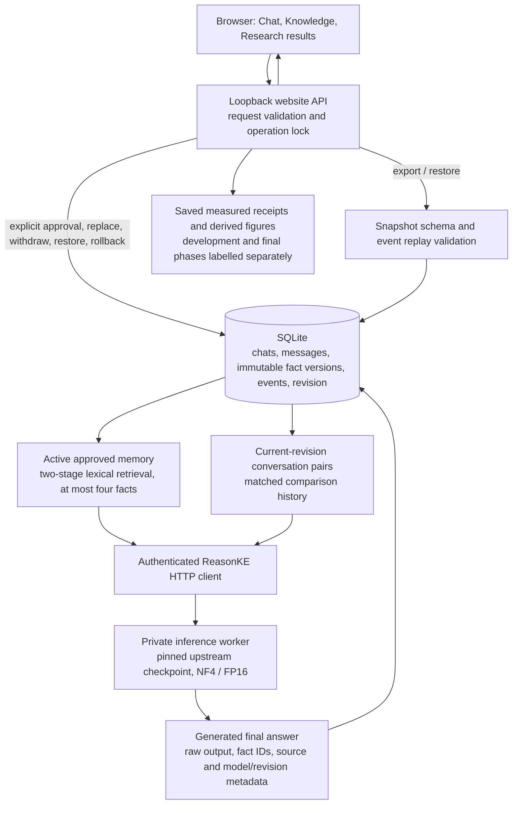
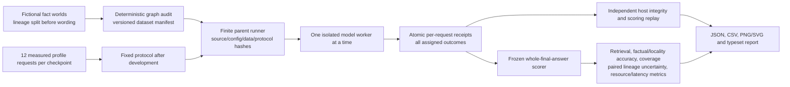

# Current architecture and correctness boundaries

This document describes the implemented ReasonKE application and operations
evaluation on `codex/reasonke-integration`. It is an implementation reference,
not a claim that every possible edit or conversation succeeds. The earlier
SERAC-inspired support editor and visual experiments retain separate models,
data and results; they are not components silently relabelled as the current
ReasonKE deployment.

## The question this system addresses

A service can change owners while both the old and new teams keep their own
on-call contacts. An assistant must use the new owner to select the right contact,
preserve other properties and historical releases, and make the update reversible.
This requires connected factual answering as well as controlled maintenance of
the information supplied to the model. The demonstration handbook is fictional.

The current editing method is **learned in-context editing with versioned external
memory**. The attributed ReasonKE checkpoint was trained upstream to use updated
information. Publishing a correction changes memory, not model weights. This
deployment does not contain the earlier project's separately trained binary scope
classifier; it must not be described as a faithful SERAC reproduction.

## Online application

The website and GPU worker are separate processes. The lightweight website can
serve its controls and saved evidence without loading weights. It reports an
unavailable model explicitly and refuses to replace a failed neural call with a
template answer. An absent worker is therefore distinguishable from an answer
that the model generated incorrectly.

| Component | Implemented responsibility | Main source |
| --- | --- | --- |
| Browser application | Conversation history, correction editor, canonical IDs, conflict choices, historical comparison, library search, audit timeline, workspace and evidence exports | [HTML](../editguard_chat/static/index.html), [JavaScript](../editguard_chat/static/app.js), [CSS](../editguard_chat/static/style.css) |
| Application API | Validate requests, serialize model/memory operations, select historical/current contexts, persist messages with evidence | [server.py](../editguard_chat/server.py) |
| Durable memory | Fact identity, version lineages, active-state transitions, audit events, revision replay and transactions | [store.py](../editguard_chat/store.py) |
| Portable restore | Strict schema, digest, references, bounds and history/state agreement before transactional import | [workspace.py](../editguard_chat/workspace.py) |
| Context policy | Full-memory or retrieved-memory bounds, explicit conflict refusal and worker transport | [reasonke_backend.py](../editguard_chat/reasonke_backend.py) |
| Shared retrieval | Question-only lexical first pass and answer-text query expansion; no hidden target answer or gold support in normal retrieval | [retrieval.py](../editguard_benchmark/retrieval.py) |
| Neural worker | Pinned safe checkpoint loading, token/input limits, greedy generation, answer extraction and measured resources | [runtime.py](../editguard_reasonke/runtime.py), [worker API](../editguard_reasonke/server.py) |
| Example handbook | Explicit approval of nine fictional initial facts and a draft ownership replacement; never automatic customer-message approval | [examples.py](../editguard_chat/examples.py) |
| Evidence dashboard | Current text-study selection, phase checks and allowlisted report/figure delivery; earlier visual results remain an archive | [results.py](../editguard_chat/results.py) |

The CLI defaults to retrieved context. This policy was selected from the matched
development comparison before final inference: ReasonKE retrieved context had
24/24 correct answers versus 21/24 with full memory. Qwen with the same retrieval
also had 24/24, so that choice is not evidence of ReasonKE superiority. The
selection and its limits are recorded in
[deployment-policy.json](../configs/deployment-policy.json).

Retrieved mode accepts at most 200 active records and selects at most four;
full-memory mode accepts at most 20. Supplied context remains bounded by 12,000
characters and the worker's 4,096-token input budget. These are software limits.
The operations study measures nine-fact worlds, not model accuracy at 200 facts.

## Fact identity and state transitions

A canonical fact key is `(entity_id, relation_id, scope_id)`. All three IDs are
required together and normalized; optional aliases are metadata, not a learned
entity resolver. Without canonical IDs, legacy records use a case/whitespace-
normalized question and scope key. Separate properties or releases have separate
keys. Free-form descriptions alone do not guarantee semantic non-overlap.

Approved versions retain question, answer, source, scope, canonical identity,
lineage/version, approval metadata, timestamps and supersession links. Their
current status can change while events preserve the history. The store has a
partial unique index allowing **at most one active version per key**.

| Operation | Preconditions | Committed result |
| --- | --- | --- |
| Publish first fact | Valid fields and no active competing version | Active version, approval event and new revision |
| Replace active fact | `supersedes` identifies the current active version in the same key | Old version superseded and new version active; both events share one revision |
| Withdraw | Fact exists | Active version becomes withdrawn; repeating withdrawal changes nothing |
| Restore | Fact exists and no active competing version | Selected version becomes active at a new revision; a conflicting restore is rejected |
| Atomic rollback | Active replacement has a direct predecessor in the same key | Replacement withdrawn and predecessor restored in one transaction/revision, with two audit events |
| Historical read | Integer revision from zero through current revision | Replay events to return then-active facts without changing live state |

Atomic rollback does not publish a new value or silently choose among unrelated
records. A repeated rollback is idempotent when its predecessor is already active.
An obsolete replacement that has since been superseded cannot roll back the newer
state. A failed transaction restores fact states, revision and audit writes
together. The injected late-event failure test checks this boundary.

The application lock prevents a chat, comparison, edit or workspace export from
capturing a partially completed application operation. SQLite uses explicit
transactions, foreign keys and a thread-safe connection. This is a local
single-operator design, not a distributed transaction service.
The generated user/assistant pair and conversation title/timestamps also commit
in one transaction. An injected failure after the second insert leaves neither
message or metadata change. This is separate from factual answer correctness.

## History, rollback and comparison consistency

Stored messages stay visible after a fact changes. New ReasonKE requests retain
complete current-revision user/assistant pairs within the bounded history budget;
old-revision pairs are excluded. Comparisons also exclude correction-conditioned
pairs from **both** sides so the newer fact cannot leak through an old generated
answer into the reference side.

The comparison dialog can generate from either empty correction context or an
approved historical revision, followed by the current context. Both sides use
the same checkpoint and matched pre-question history. They are fresh generations,
not two weight snapshots or replacements for stored messages. Revision zero is
empty approved memory. The server rejects invalid or future revisions.

Memory changes invalidate the retriever interface cache. The current ReasonKE
context selector has no persistent embedding or answer cache; it reads approved
state for each operation. This avoids serving a previously cached correction
after withdrawal. It does not guarantee that the model will reason correctly.

## Export, restore and access boundaries

Text snapshots contain the four data tables, revision, timestamp and SHA-256
digest. Validation checks exact columns, finite JSON, identifiers, timestamps,
references, lineages, unique active facts, ordered revision events and agreement
between replayed history and final statuses. Bounds are 6 MiB and 10,000 rows per
table. Import inserts data, never executable SQL, in one transaction and refuses
to overwrite a nonempty target. Image conversations require a private database
and image-directory backup; JSON export refuses their local image paths.
Export enforces the same portable limits as restore. Lineage edges must remain
within the same root and move monotonically through version numbers, so a
recomputed checksum cannot authorize a cyclic predecessor chain.

A digest detects corruption, not factual truth, authorship or protection against
someone deliberately recomputing a digest. Restore and fictional-handbook loading
are explicit operator approvals. Handbook approval can preserve chats only when
knowledge history is empty; the public restore endpoint cannot use that internal
exception to overwrite work.

The website binds to loopback and protects mutation requests with a session token,
JSON content type and origin checks. Colab access requires one exact configured
HTTPS proxy origin. The private model worker uses a bearer token. These controls
do not implement hosted user accounts, separate administrator roles or multi-user
authorization. Session tokens are not evidence exports and must not be published.

## Offline evaluation and evidence lineage

The independent fictional dataset has 48 lineages, nine facts per world and eight
question categories. The seed-42 partition assigns 16 development and 32 final
worlds **before** generating wording variants. Service/team/person names are
disjoint across splits; templates and some simple values repeat. The deterministic
audit is automated review, not independent human semantic review. See the
[dataset card](OPERATIONS_DATASET_CARD.md).

The five main conditions are ReasonKE with initial facts (`R0`), ReasonKE with
updated retrieval (`R-RAG`), ReasonKE with full current memory (`R-ALL`), and the
corresponding updated-retrieval/full-memory official Qwen conditions (`G-RAG`,
`G-ALL`). Updated configurations receive the same approved information. Retrieval
supplies identical fact IDs to both generators. R0 is scored against updated
truth and therefore diagnoses staleness; it is not the untouched pre-SFT model.

The completed development comparison has 120 requests: the same 24 questions per
main condition across three predetermined development lineages. The
[completed frozen final study](../reports/reasonke/operations-final/README.md)
records all 1,312 requests: five 256-question conditions from 32 held-out lineages
plus sixteen oracle-support questions per model. Source identities and scoring
were [independently replayed on the host](../reports/reasonke/operations-final/host-audit.json).
Profiles, development and held-out results remain distinct. The original
[frozen protocol](../reports/reasonke/operations-final/protocol.json) is preserved.

R-RAG answered 256/256, G-RAG 241/256 with fifteen abstentions and no wrong
nonabstaining answers, R-ALL 231/256, G-ALL 241/256, and the initial-fact diagnostic
R0 136/256 against updated truth. Both oracle diagnostics answered 16/16. No final
record was an execution error or unexecuted. The retrieved-condition difference
is an observed accuracy/coverage tradeoff under the fixed prompts, not a causal
ablation of model training; Qwen was faster, and full-memory Qwen scored higher
than full-memory ReasonKE. These outcomes describe frozen short-answer scoring
on this bounded dataset. The [failure analysis](../reports/reasonke/operations-final/FAILURE_ANALYSIS.md) separates
abstentions, factual mistakes and strict-format mismatches instead of treating
every score mismatch as an entirely false response.

The runner uses isolated spawned workers and local interprocess communication,
not the website HTTP path. Each request has a hard 240-second parent watchdog;
loading has a hard 1,800-second watchdog and the finite per-model budget is eight
hours. The worker's Transformers 120-second generation setting is soft. Resume
requires identical source/data/configuration/protocol identities and executes
only unexecuted records. Wrong answers and completed execution errors are never
retried to improve the score.

Primary accuracy divides strict whole-endorsed-answer matches by **every assigned
question**, including abstentions, execution errors and unexecuted cases. Coverage
and answered-only precision are separate. Locality accuracy checks truth on all
out-of-scope questions; preservation checks the subset R0 already answered
correctly. False edited-value endorsements are a narrower metric than every
possible incorrect application. Retrieval recall and oracle-support generation
diagnostics help distinguish missing support from generation mistakes. Paired
bootstrap intervals resample whole lineages, not correlated wording variants.

Pipeline p50/p95 includes context selection, local worker communication and
generation, excluding cold loading and browser/network time. The separate
[HTTP workload](../scripts/verify_operations_http.py) measures website requests
including storage and worker HTTP; its fixtures are software checks, not neural
accuracy. Raw model output, extracted answers, model revision, token counts,
supplied fact IDs, prompt digest, errors and CUDA resources remain in the receipts.

The operational supplement also completed with real ReasonKE generations:
[twelve HTTP answers](../reports/reasonke/operations-final/http-acceptance.json)
matched 12/12 targets, and the
[four history/rollback answers](../reports/reasonke/operations-final/history-acceptance.json)
matched 4/4 with all eleven consistency checks passing. There were no execution,
unexecuted or cleanup errors. An
[independent host audit](../reports/reasonke/operations-final/operational-host-audit.json)
replayed all sixteen records without new model calls. The twelve-request HTTP
p50/p95 was 15.42/18.78 seconds. These reused development-world requests validate
the serving and revision workflow separately; they are not extra independent
held-out lineages and do not change the primary study's denominator. A fresh demo
was started ready at release completion; runtime availability remains separate
from those durable recorded results.

## Source and validation map

| Concern | Implementation | Verification / recorded evidence |
| --- | --- | --- |
| Dataset split and ground truth | [data.py](../editguard_benchmark/data.py), [dataset packet](../data/reasonke/operations-v1) | [benchmark tests](../tests/test_operations_benchmark.py), [dataset card](OPERATIONS_DATASET_CARD.md) |
| Model identity and generation budgets | [model manifests](../configs/reasonke-model.json), [runtime](../editguard_reasonke/runtime.py), [instruction adapter](../editguard_benchmark/models.py) | [runtime tests](../tests/test_reasonke_runtime.py), [real profiles](../reports/reasonke/operations-profiles-v1/README.md) |
| Routing and matched history | [website controller](../editguard_chat/server.py), [context adapter](../editguard_chat/reasonke_backend.py) | [ReasonKE contracts](../tests/test_chat_reasonke.py) |
| Identity, conflict and rollback | [store](../editguard_chat/store.py) | [store tests](../tests/test_chat_store.py), [real HTTP/SQLite deployment receipt](../reports/reasonke/engineering/workspace-deployment-3.json) |
| Snapshot atomicity and event replay | [workspace validation](../editguard_chat/workspace.py) | [workspace tests](../tests/test_chat_workspace.py) |
| Finite evaluation and scoring | [runner](../editguard_benchmark/run.py), [scorer](../editguard_benchmark/scoring.py), [metrics](../editguard_benchmark/metrics.py) | [benchmark tests](../tests/test_operations_benchmark.py), [development raw evidence](../reports/reasonke/operations-development-v1/README.md) |
| Independent evidence replay | [host audit](../scripts/audit_operations_evidence.py) | [tamper tests](../tests/test_operations_evidence.py), [completed development audit](../reports/reasonke/operations-development-v1/host-audit.json) |
| Deployable package | [container](../Dockerfile.chat), [container allowlist](../Dockerfile.chat.dockerignore), [pinned notebooks](../notebooks) | [CI workflow](../.github/workflows/ci.yml), [deployment checker](../editguard_chat/check_deployment.py) |

## Attribution and practical limits

The research algorithm, ReasonKE checkpoint training, foundation weights and
frameworks are upstream contributions. Our work is the governed editing product,
its bounded deployment adaptation, controlled data, fair comparison machinery,
independent evidence replay and analysis. The earlier project also trained its
own auxiliary models; their model card and scores remain separate. Exact ancestry
between the two current checkpoints is unverified, so their comparison does not
isolate the causal effect of ReasonKE training.

Correct answers can have unsupported explanations. A retrieved source documents
supplied input, not verification of all generated prose. There is no calibrated
current scope-confidence probability, arbitrary semantic-conflict detector,
unrestricted multihop guarantee or universal accuracy promise. Shared templates,
automated labels, a small fictional population, short-answer matching and bounded
memory constrain conclusions. Current checkpoint provenance and distribution
limits are in the [model card](REASONKE_MODEL_CARD.md).
