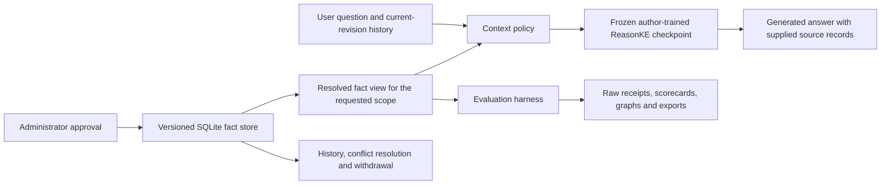

# EditGuard: project journey and finite finish plan

Status: proposed finish plan, written 25 October 2026. The final ReasonKE
experiment described here has **not run**. Dataset sizes below are planned
denominators, not measured results. This document explains the current project;
[PROJECT_PLAN.md](PROJECT_PLAN.md) preserves the earlier support-editor release.

## 1. The goal that connects the work

**Build and evaluate a reversible knowledge-maintenance platform for conversational
assistants: approved updates should transfer to paraphrases and two-hop questions,
preserve unrelated information, and remain traceable and reversible.**

Suggested final title:

> **EditGuard: Auditable Knowledge Editing for Multi-Hop Conversational Assistants**

The current technique is learned, in-context editing using versioned external
memory. The model's weights remain fixed when an administrator publishes a fact.
ReasonKE's training and algorithm are upstream contributions. Our project includes
earlier auxiliary-model training, the maintenance platform, deployment adaptation,
controlled evaluation and analysis. Those contributions must remain distinguishable.

Use a controlled **internal operations handbook** as the final demonstration
domain. For example, a service has an owning team, a team has an on-call contact,
and ownership changes between releases. “Who is on call for this service?” then
requires following two facts, applying the correct update and respecting release
boundaries. All organizations, people and services in the dataset are fictional.

A changed webpage or database is a sensible source of truth. The research problem
is whether a conversational model uses that changed information correctly when
answering related questions. Updated RAG is therefore a strong baseline in our
study. We do not assume knowledge editing must beat it or replace source documents.

### The questions we will answer

1. How accurately does the deployed editor answer direct, paraphrased and two-hop
   questions using approved changes?
2. When answers fail, did retrieval omit supporting facts, or did generation fail
   despite receiving the necessary facts?
3. How often does an update disturb unrelated or differently scoped knowledge?
4. Can approval, replacement, withdrawal, history and restoration behave
   consistently, including after a restart?

These are present project objectives. We should not claim that every earlier
decision was planned around the final architecture from the beginning.

## 2. The real development journey

This is a retrospective account supported by source history and saved evidence.
The report can follow this clear progression without reproducing every
conversation, abandoned idea or implementation detail.

| Actual phase | What we did | Why it matters to the final project | Evidence |
| --- | --- | --- | --- |
| 11 October: build the correction lifecycle | Defined explicit facts, approval, transactions, conflicts and rollback; built the first vertical slice. | A neural answer alone cannot establish which information is authoritative or make an update reversible. | Commit `18de83e`; [earlier plan](PROJECT_PLAN.md) |
| 13–20 October: train and evaluate a support editor | Trained a DistilBERT applicability classifier and FLAN-T5 conditional answer model; evaluated controlled support questions and five configurations. | Established actual ML training experience and showed that training an editor does not automatically make it the strongest system. | Commits `2df9b8c`, `18db8d4`, release `9cf884c`; [model card](MODEL_CARD.md), [evaluation](FINAL_EVALUATION.md) |
| 21–22 October: explore visual editing | Built visual correction prototypes and studied what a visible prediction change actually demonstrated. | Recognition examples alone were insufficient evidence for selective factual editing. | Commits `e73de6b`, `56111d0`; preserved `visionpatch-preserved-2026-10-22` tag |
| 24 October: run a comparative visual study | Evaluated 20 edit units, five methods and five question categories: 500 generated-answer records. | Exposed a real tradeoff between matching edited targets and preserving neighboring answers. | Pretest `460a91c`, results `e0324c3`; [visual results](VLKEB_RESULTS.md) |
| 25 October: make the workflow conversational | Added ordinary chat, approval/source controls, comparison and version history; handled stale conversation context after an update. | Made corrections usable in a continuing conversation and gave withdrawal an observable effect. | Commits `77b50f7`, `1e4bba9`; [chat documentation](CHAT_STUDIO.md) |
| 25 October: integrate a released reasoning editor | Deployed the author-trained ReasonKE checkpoint with pinned revisions, bounded authenticated inference and a T4 adaptation. | Provided a working learned model for text questions and connected facts without attempting multi-GPU SFT/PPO training. | Commits `3bbca19`, `7d3bfb3`; [integration](REASONKE_INTEGRATION.md) |
| 25 October: verify the product workflow | Repeated a cold start, recorded real website generations, and demonstrated chat, correction, paraphrase, comparison, withdrawal and a two-hop answer through the UI. | Established a functioning core that we can now evaluate more broadly. | Commits `7dfc798`, `54e1049`; [receipts](../reports/reasonke/t4-restart-1/README.md), [live demonstration](../output/reasonke-live-demo/README.md) |

Two earlier results belong in the design discussion, with their limits:

- In the support study's stated request-bound metric, updated RAG scored
  **649/720**, compared with **613/720** for our trained editor. These numbers
  concern that earlier dataset and pipeline, not the current ReasonKE website.
- In the small visual study, adapted fine-tuning matched **60/60 edited targets**
  but **0/40 locality questions**. It broke all five answers that the baseline
  had answered correctly in those locality categories. This motivates reporting
  correction success and preservation separately; it is not a ReasonKE result.

The honest explanation is: **we built, measured, identified limitations, and refined
the system**. We can organize the report around that logic without backdating a
plan, inventing unsuccessful experiments, or presenting upstream work as our own.

## 3. What is already established

The current product has ordinary text chat; explicit correction approval with
scope and source; stored history; replacement and withdrawal controls; matched
comparison; revision-aware conversation handling; and a pinned, bounded model
worker. A fresh T4 deployment and real generated answers have been recorded.

The five predefined development questions matched their final-answer targets.
The separate website check completed six matching factual cases and one nonempty
ordinary-conversation case. Repeating the same fixtures does not create new
independent test facts. The manual UI demonstration also answered the fictional
MiraQuay → Tovan Vale → Lyris two-hop question.

These establish **working integration**, not general accuracy. Saved raw outputs
also contain unsupported explanatory claims. An earlier contradictory source
note defeated an intended correction. Current conflict handling checks the same
normalized question/scope; it is not a general semantic contradiction detector.
The current model supplies no calibrated answer-confidence probability.

Our own DistilBERT/FLAN-T5 training remains a valid earlier experiment, documented
in its model card. It does not mean we trained ReasonKE or performed its RL stage.
No new model training is required in this finish plan. If a presentation discusses
our training, it must identify those earlier models and their separate results.

## 4. The final product, beyond a model wrapper

Keep the existing Python server, SQLite database, web interface and isolated
Transformers deployment. Do not introduce another framework or new model family
to make the architecture appear larger.

Four remaining product tasks have a direct purpose:

| Task | Concrete acceptance condition |
| --- | --- |
| Portable workspace backup and restore | Export facts, versions, sources and chats; validate schema and references before transactional import into an isolated workspace. Compare restored state with the exported snapshot. Recover after runtime termination from a snapshot exported beforehand; unsaved VM state cannot be recovered this way. |
| Canonical fact identity for the bounded catalogue | Approved records use explicit entity, relation and scope identifiers, with aliases and an explicit version/tier scope. Conflicting active values for the same canonical key are blocked until the operator resolves them. Historical records remain inspectable. Free-text similarity alone must not determine authoritative identity. |
| A current-backend evaluation dashboard | Show only results belonging to the selected experiment/model manifest. Display counts, category denominators, abstentions, execution errors and resource measurements; allow JSON/CSV download. Clearly separate the preserved visual study. |
| Reproducible release | Source-pinned launcher, documented model/data revisions, regression/CI checks, fresh restore rehearsal, architecture diagram, report and recorded demonstration. |

Canonical keys will address known catalogue aliases and scopes. Arbitrary
natural-language contradictions, arbitrary temporal reasoning and unrestricted
multi-user production hosting remain outside this release. New scope controls
must exist and pass development checks before final evaluation is frozen.

### Architecture to explain to the panel

The context policy is explicit: bounded full memory for the current product, or
retrieval for the declared comparison condition. The interface must distinguish
supplied provenance from verification of generated prose. A structured database
answer is never counted as a neural answer.

## 5. A small, defensible new evaluation dataset

Create **48 independent edit lineages** before paraphrase augmentation: **16
development** and **32 final**. Each lineage is an isolated fictional fact graph
with an initial view, an approved change, required supporting facts and explicit
old/current truth. Entities, aliases, versions and counterfactual variants from
one lineage stay together. Split assignments are fixed before writing variants.

Every lineage has eight assigned questions:

| Category | Final questions | Intended behavior |
| --- | ---: | --- |
| Direct edit | 32 | Return the newly approved value |
| Direct paraphrase | 32 | Return the same value using different wording |
| Two-hop edit | 32 | Use the changed fact and a necessary supporting fact |
| Two-hop paraphrase | 32 | Follow the same dependency with different wording |
| Same entity, different relation | 32 | Preserve the separate property |
| Similar entity, same relation | 32 | Respect entity boundaries |
| Wrong version or tier | 32 | Use the fact for the requested scope |
| Unrelated question | 32 | Preserve unrelated factual correctness |
| **Total per configuration** | **256** | **128 applicable; 128 outside the edit's scope** |

There are 64 applicable two-hop questions and 64 paraphrase questions; these
subsets overlap on the two-hop paraphrases and must not be added together as
disjoint categories. The independent sample size is **32 edit lineages**, not
256 independent facts.

Every row records its requested entity/relation/scope, required fact IDs,
endorsed answer and accepted aliases. Keep each complete world, including
distractors, within the existing 20-fact and 12,000-character memory limits.
Hard distractors include similar names, another property and another scope.
Missing-data and conflict workflows are separate lifecycle cases, not secretly
removed factual questions.

Audit against the explicit truth graph. Generated wording still needs review.
Record automated audit provenance; do not claim independent human review unless
people actually perform and sign it. Existing demonstration questions belong to
development and do not enter this final sample.

## 6. Five comparisons with a clear reason for each

The unchanged reference uses the **same ReasonKE checkpoint and initial fact
view** as the product, before the update. This supports a meaningful within-model
preservation comparison. The four updated conditions form a two-model,
two-context-policy experiment.

| ID | Configuration | Question it resolves |
| --- | --- | --- |
| R0 | ReasonKE + complete initial catalogue, no approved change | What does this assistant answer before the edit, including which locality answers are already correct? |
| G-RAG | Generic instruction model + properly updated RAG | How does a strong conventional system perform with current knowledge? |
| G-ALL | Generic instruction model + all current facts | What can full-context prompting accomplish without the released reasoning checkpoint? |
| R-RAG | ReasonKE + exactly the same retrieved fact IDs as G-RAG | How do the deployed model configurations compare when retrieval is held fixed? |
| R-ALL | ReasonKE + all current facts | How does the current product perform, and what changes when retrieval is removed? |

The generic baseline candidate is Qwen/Qwen2.5-7B-Instruct. Verify and pin its
official checkpoint and profile it before committing a long run. It is a
same-size instruction-model comparison, not automatically the exact parent of
the released ReasonKE weights. Without verified lineage, the difference cannot
be attributed solely to ReasonKE's training.

All methods have access to the same initial handbook and supporting information.
Updated views resolve superseded values before retrieval. RAG must not be made
artificially stale. Retrieve using the question, never the hidden target answer
or gold supporting-fact IDs. Only the explicitly labelled oracle diagnostic may
receive the gold support set.

Hold greedy decoding, precision, input/output budgets, scopes, questions and
scoring rules compatible across configurations. Use each model's documented chat
template and a development-checked prompt. Record actual supplied fact IDs and
prompt digests. Do not silently truncate one method's context.

The website's “without correction context” button remains a useful live demo.
It is not this study's sole fictional-catalogue reference: an assistant cannot
be expected to know our invented facts unless we supply the initial catalogue.

### Separate retrieval from generation

Evaluate required-fact recall and whether the **entire** necessary two-hop
support set was retrieved. Shared retrieval is measured once per question;
running two generators does not double the independent retrieval sample.

Before inference, select 16 final two-hop questions by a fixed, recorded rule.
Run each of the two models with its gold supporting facts: **32 additional
oracle-support generations**. These diagnose generation with complete evidence;
they are not added as new independent benchmark questions or used for tuning.

## 7. Metrics and exactly what the numbers mean

Primary score: **correct final answers / all assigned questions**. An abstention,
execution error or unexecuted case receives zero primary credit. Retain each as
a separate outcome instead of calling all of them “wrong generated answers.”

| Metric | Definition and interpretation |
| --- | --- |
| Direct corrected-answer accuracy | Correct direct-edit answers / 32 assigned direct questions |
| Paraphrase accuracy | Correct answers / 64 assigned paraphrase questions; also show the two paraphrase categories separately |
| Two-hop accuracy | Correct answers / 64 assigned applicable two-hop questions |
| Out-of-scope factual accuracy | Correct answers / all 128 locality questions |
| Baseline-correct retention | R-ALL correct locality answers among those R0 answered correctly / number of R0-correct locality questions. Report that denominator. It is not overall factual accuracy. |
| False correction application | Locality answers endorsing the inapplicable edited value / 128 locality questions, using predeclared nonoverlapping aliases. Other wrong answers remain factual failures. |
| Answer coverage | Substantive answers, correct or wrong / all assigned questions |
| Answered-only precision | Correct / substantive answers. Always show coverage beside it; report undefined if no answers. |
| Retrieval recall | Required supporting facts retrieved / all required supporting facts; report complete-support-set recall separately for the 64 two-hop questions |
| Oracle-support accuracy | Correct / 16 preselected questions for each model; a diagnostic under supplied gold support |
| Conflict and rollback consistency | Successful declared state checks / all assigned lifecycle checks; report model answers after transitions separately |
| Latency | Client-measured end-to-end p50/p95, including retrieval and generation. Separate cold startup, warm requests and failed requests. |
| Resources | Model revisions, quantization, tokens, CUDA allocated/reserved peaks and measured loading/inference time |

Score the **endorsed final answer**, not a value mentioned in a rejected option
or generated explanation. For this short-answer task, whole-final-span matching
against fixed canonical aliases is the primary rule. Bind every score to the
requested entity, relation, scope and truth-graph path. A bare correct name is a
valid short answer; a sentence containing that name is not automatically correct.
Keep semantic-review decisions separate, with reasons and provenance. Do not
retune aliases after reading final outputs.

Store outcomes as correct, wrong, abstain, execution error or unexecuted, with a
separate generation/structured-answer kind. Report both generated answer quality
and request completion. Do not invent ECE, confidence calibration or scope-model
precision/recall for a backend without those probability/classifier outputs.

Use paired bootstrap intervals grouped by the 32 edit lineages, with a fixed
seed and 10,000 resamples. Pair configurations on the same questions. These
intervals describe this small controlled study, not all real-world questions.

Preselect 32 generated two-hop explanations for an explicit-claim audit. Label
claims supported, contradicted, unsupported or unassessable against the supplied
graph. Disclose automated review. Do not call this proof of faithful internal
reasoning, and do not infer explanation correctness from final-answer correctness.

### Scientific outputs

Produce five main figures from exported records: category accuracy with grouped
uncertainty; applicable accuracy versus locality accuracy; correct/wrong/abstain/
error/unexecuted composition; paired configuration differences; and latency
distributions. Add a retrieval-support/oracle diagnostic table and an openly
documented failure catalogue. No decorative benchmark numbers or hand-entered bars.

## 8. Five finite workdays

These are work packages, not a promise that Colab will supply uninterrupted GPU
time. The scope stops growing when a result is disappointing.

| Workday | Work | Exit condition |
| --- | --- | --- |
| 1: Protocol and data | Create the 48 lineage graphs, split before augmentation, audit labels/aliases, implement scoring and receipts; profile both checkpoints. | Dataset audit passes; representative and longest-memory profiles exist; long-run forecast uses those measurements. |
| 2: Product and development | Complete portable restore, canonical-key conflict controls and current results display; run at most 120 balanced development generations. | Regression checks pass; model/prompt/retrieval/scoring settings chosen using development only. |
| 3: Freeze and evaluate | Freeze source, data, aliases, model revisions and settings. Run five configurations over 256 questions and the separate oracle diagnostic. | 1,280 main assigned records plus 32 oracle records, with completion/error accounting and immutable raw outputs. |
| 4: Analyze and write | Generate scorecards/figures, paired intervals, explicit-claim audit and failure analysis; populate the current dashboard and report. | Every numerical claim traces to a record, denominator and configuration. No tuning from final results. |
| 5: Release and rehearse | Check CI, clean relaunch and transactional workspace restore; finish architecture/report/slides, tag the release and record a demonstration. | Reproducible package and a complete demonstration including correction, paraphrase, two-hop, unaffected fact and withdrawal. |

### Compute and stopping rules

- Profile at most 12 representative/long-context requests per checkpoint:
  **24 profiling generations**. Existing five short fixtures are useful evidence
  but do not justify a firm runtime for the longer final workload.
- Cap development at **120 generations** across balanced categories and conditions.
  Do not run all possible development combinations merely to fill a table.
- Main final run: **1,280 assigned generations**. Separate oracle diagnostic:
  **32 assigned generations**. This is 1,312 final-stage requests, not 1,312
  independent edits. Save after each request and resume only unfinished work.
- Total declared profile/development/final request cap: **1,456**. Functional
  transaction tests are counted separately; they are not neural generations.
- Load the two large checkpoints sequentially on the T4. Do not assume they fit
  together. Preserve model identity and resource evidence for both.
- Before a substantial run, provide inputs, output paths, profile-grounded
  runtime/memory forecast, resume behavior, per-request limits and a finite total
  stopping condition. The existing 120-second setting is a soft generation
  stopping budget, not a hard wall-clock guarantee; a separate request watchdog
  and a measured total workload budget are still required.
- Wrong answers are completed observations, not retry candidates. Preserve
  execution failures too. Any operational recovery must be named separately and
  cannot overwrite the original result or silently select a better answer.
- No new backbone search, PPO replication, visual branch, larger dataset or
  new hop depth after the freeze. If a baseline is unavailable, disclose it and
  narrow claims; do not substitute unequal conditions without a declared revision.

## 9. The report and presentation story

Use a problem → investigation → design → evaluation → product structure:

1. **Problem:** changed facts must propagate through a conversational assistant
   without contaminating other answers, with visible authority and an undo path.
2. **Investigation:** our trained support editor and visual comparisons showed
   that efficacy, generalization and locality are separate properties. Include
   their real findings in a bounded development-study section.
3. **Design:** integrate an attributed learned reasoner with governed memory,
   revision-aware history, explicit context policies and reproducible deployment.
4. **Evaluation:** compare the five frozen configurations on the new controlled
   catalogue; separate retrieval, generation and application lifecycle evidence.
5. **Product:** demonstrate ordinary chat, a changed fact, a paraphrase, two-hop
   propagation, an unaffected question, conflict handling, withdrawal and restore.

An accurate present-tense pitch is:

> We built EditGuard to make factual updates to conversational assistants
> explicit, inspectable and reversible. Our earlier experiments trained and
> compared compact knowledge-editing models and examined editing/locality
> tradeoffs. The current product integrates an author-trained ReasonKE checkpoint
> with versioned approvals, context isolation and a reproducible T4 deployment.
> Its live workflow works; we are completing a controlled evaluation of factual
> generalization, locality and operational reliability.

After the final run, replace the last sentence with the **actual** dataset size,
counts and comparison findings. Do not prewrite a victory over RAG. A negative
comparison can still support a useful product and a clear empirical contribution.

The completion claim will be: **we delivered the auditable platform and answered
the declared evaluation questions with reproducible evidence**. It will not be
“we invented ReasonKE,” “we planned every pivot in advance,” “we retrained the
current model,” or “all natural-language edits are guaranteed to work.”

## 10. Evidence and primary references

- [Current integration and adaptations](REASONKE_INTEGRATION.md)
- [Own trained auxiliary models](MODEL_CARD.md)
- [Earlier support evaluation](FINAL_EVALUATION.md)
- [Visual comparison and locality tradeoffs](VLKEB_RESULTS.md)
- [T4 cold-restart and website receipts](../reports/reasonke/t4-restart-1/README.md)
- [Mouse-operated website demonstration](../output/reasonke-live-demo/README.md)
- [Author's Reason-KE repository](https://github.com/YukinoshitaKaren/Reason-KE)
- [Reason-KE++ paper](https://arxiv.org/abs/2511.12661)

The paper describes SFT plus process-aware RL for updating answers with supplied
facts. Those research contributions and published scores belong to its authors.
The exact released checkpoint's association with the published score is not
established by its model card; our deployment receipts remain separate.
