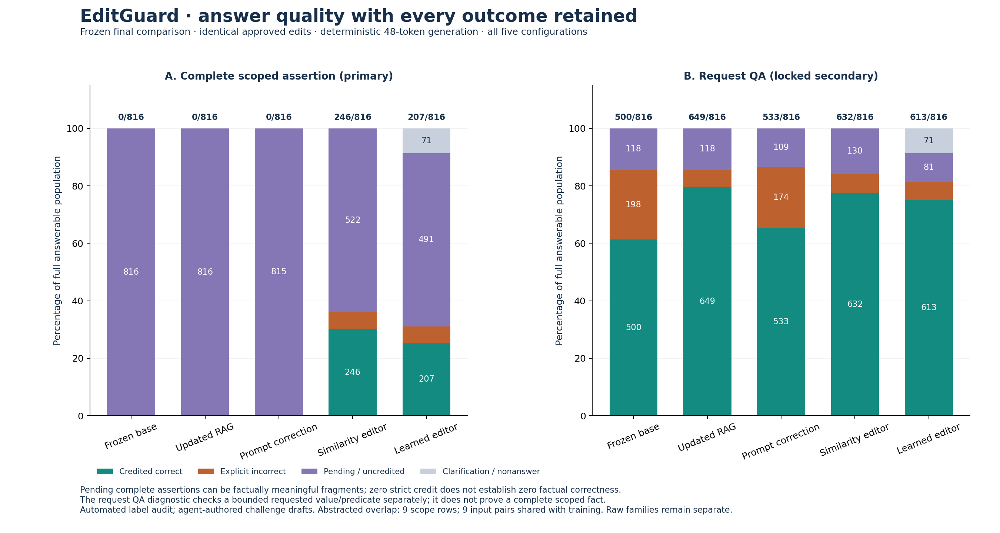
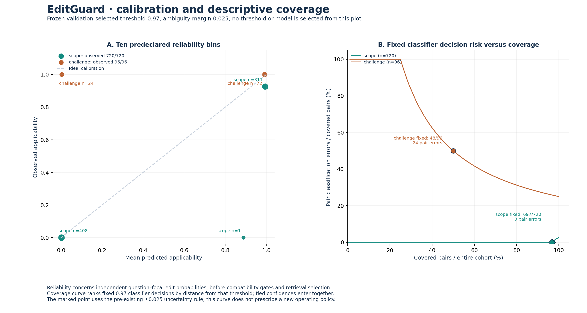
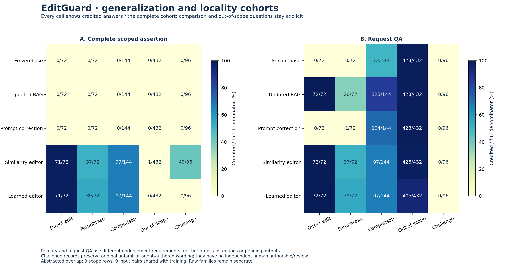
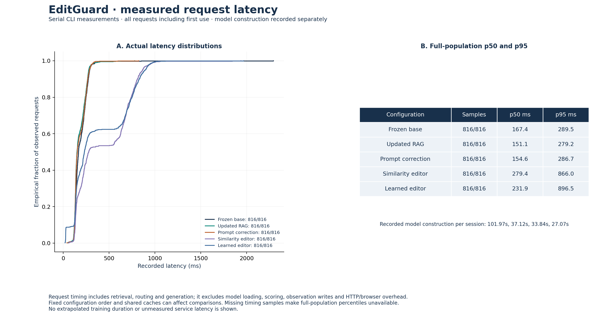
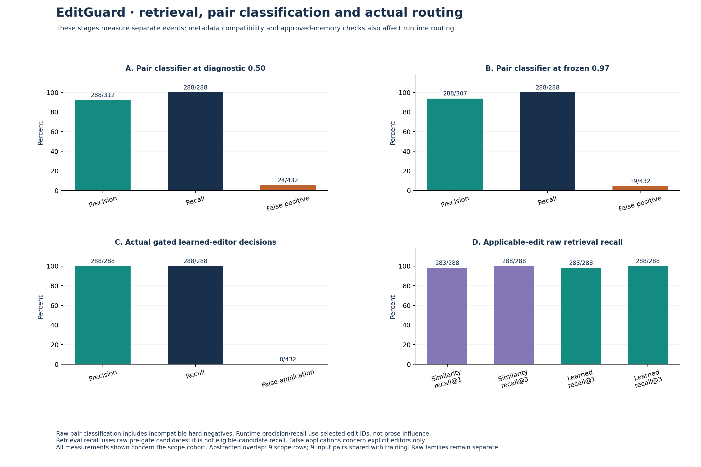
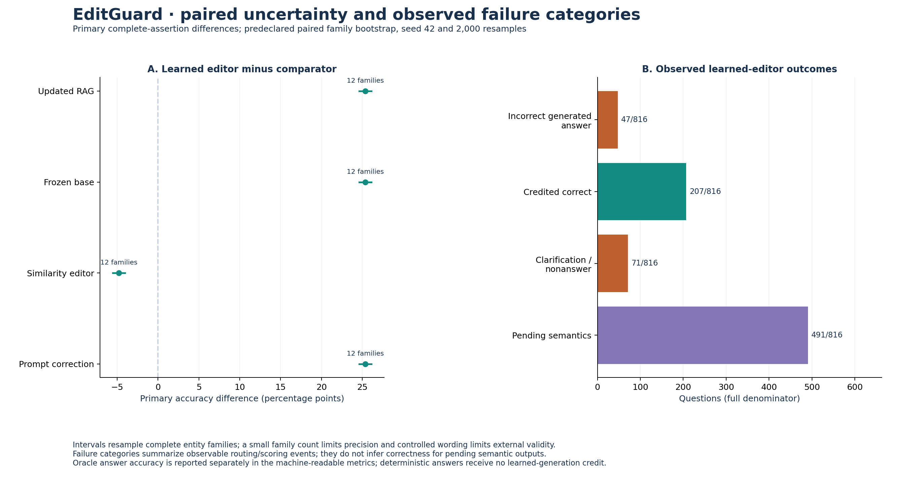

# EditGuard: final measured project report

Controlled demonstration dataset. Automated final audit; no human-review claim.

## Problem and contribution

Product limits and policies change while deployed customer-support models remain static. EditGuard addresses short factual questions about a fictional product catalogue. An administrator publishes an approved correction; subsequent questions can use it without retraining for that individual edit. The registered topic is Knowledge Editing.

The delivered platform combines two actually trained auxiliary models, approved versioned memory, a frozen handbook assistant, transactional conflict and rollback controls, five matched comparisons, a leakage-controlled benchmark and a locally deployable application. Generated answers remain fallible. No arbitrary-language accuracy guarantee or production-company claim is made.

The frozen evaluation contains 816 matched questions and 384 separate oracle-generation records. On the 720 controlled scope questions, request-bound QA credits the learned editor on 613/720 and updated RAG on 649/720. These are supported short-question forms; unfamiliar challenge wording has a separate result.

The learned editor receives complete-assertion credit on 207/816 (25.4%). The original oracle diagnostic was interrupted by a CUDA runtime fault: its 45/384 (11.7%) includes 319 execution errors and cannot be read as a complete generator-quality measurement. A separately named operational supplement, when available, preserves the original record. Complete-assertion and request-bound results are separate evidence.

## Related work and architectural adaptations

SERAC wraps a fixed base model with edit memory, a scope classifier and a counterfactual generator. Its auxiliary components are trained separately; deployment stores new descriptors and routes relevant requests to conditional generation. Mitchell et al. compare embedding and cross-attention scope architectures and evaluate edit success and preservation. We use these ideas, rather than claim a faithful reproduction of their experiments or algorithm.

Our adaptations are structured product/plan/version/date descriptors, mandatory administrator approval, SQLite transactions, explicit overlapping-conflict resolution, retrieval before pair scoring, calibrated abstention and deterministic compatibility gates. The frozen base retrieves the initial fictional handbook; it does not rely on pretrained knowledge of imaginary products.

The selected DistilBERT classifier uses the versioned entity_neutral_v1 input transform. Only selectors literally referenced by a correction are canonicalized; incompatible selectors and properties remain. Approval, dates, original names and provenance remain in authoritative metadata. This engineered normalization is disclosed separately from learned entity reasoning.

The selected FLAN-T5-small answer model conditions on the question, applicable correction, date and necessary unchanged support context. It produces the original short answer text. A deterministic structured response is a distinct mode and never earns evidence of trained generation. Unknown scope, uncertainty and unresolved conflicts request clarification.

Primary reference: [Mitchell et al., ICML 2022](https://proceedings.mlr.press/v162/mitchell22a/mitchell22a.pdf).

## Dataset, review and split controls

The controlled handbook has 80 fictional entity families, 1,280 initial facts and 480 edit scenarios. Families were assigned before paraphrases and counterfactual values. The modest training pilot uses four training and two validation families: 240/120 scope pairs and 96/48 answer examples. Training did not use the entire generated catalogue.

Scope data contains applicable pairs, ordinary negatives, different properties on the same product, the same property on another product, similar names, wrong tiers and incompatible versions. Pilot-v3 balances existing negative question forms without changing facts, labels or family assignments. Targets and example labels received a separately typed automated audit; human review is not claimed.

The final packet preserves all 720 scope, 288 answer and 96 challenge rows. Its 1,104 labels passed independent deterministic consistency checks against structured truth. Every source question, fact, label, split and lineage remains unchanged; current input formatting and explicit oracle metadata are derived separately. Original draft flags are retained and the separate machine registry authorizes only final evaluation.

The twelve final families are disjoint from selected training and development entities and edit lineages. Entity normalization creates nine identical same-label scope pairs shared with training, zero shared with validation and no contradictory pairs. The other 711 scope rows are reported separately. Shared controlled templates still limit linguistic generalization.

The 96 unfamiliar-wording/unseen-value challenges were agent-authored drafts, independently machine-audited. They are not manually authored or human-reviewed questions. The user explicitly authorized this automated final audit. Machine consistency checks do not establish external validity or broad natural-language truth.

## Training and finite model selection

Training used one fixed seed and compact backbones after measured four-update CUDA profiles. The selected scope run stopped at 360 updates; the selected answer run stopped at 240. Both were executed by the user. Data, reviews, pretrained revisions, configurations, selected tensors, optimizer/scheduler/sampler/RNG state and exact training source are recorded. The completed exports passed 986 artifact/checkpoint audit checks.

On the common 120-pair development population, raw scope accuracy rose from 98/120 to 119/120. Validation selected temperature 1.0, threshold 0.97 and uncertainty margin 0.025: 48 correct edit applications, zero of 72 false applications and one clarification. This selection-data result is not an independent final-test estimate.

The answer revision gives equal 8x weight to the opening token of both Yes and No comparison targets. Remaining valid tokens have weight one and padding zero. Its weighted selection loss of 0.16824 cannot be compared with the earlier uniform loss. On a common unweighted objective, validation token NLL worsened from 0.04441 to 0.06173.

Generated development negative comparisons improved from 0/12 to 5/12 correct; seven still failed. Oracle complete-answer credit improved from 31/48 to 34/48 with identical revised scope routing. A reviewed complete storage wording alias increased scoring coverage equally for every configuration; original scores are preserved. No threshold, model or scorer was tuned against final outputs.

Recorded training-loop times were 112.55 seconds for scope and 264.54 for answer; complete command startup/export wall times are unavailable. CUDA reserved peaks were 1.410 and 1.656 GiB. Measurements are from an RTX 4050 laptop with 6 GiB VRAM and 23.71 GiB host RAM. Short profiling estimates and actual loop measurements are distinguished.

## Frozen fair comparison and scoring

All five configurations answer the same 816 questions: 720 scope questions and 96 challenges. Unchanged base is a diagnostic reference; updated RAG materializes approved corrections, prompt-only receives eligible descriptors, similarity editing uses validation-selected embedding routing, and learned editing uses the trained scope classifier. Both editors use the same trained answer model.

Every updated baseline has the same approved memory and supporting facts. Questions are evaluated in separate mutually exclusive correction scenarios, each with one focal edit and at most eight foreign-product distractors. This is not a dense same-product multi-edit stress test. Deterministic generation uses the same 48-token answer budget and compatible context settings.

Oracle generation uses 288 answer examples plus 96 challenges, separately from the matched end-to-end population. It supplies the applicable correction but not the target answer. Retrieval, raw classifier pairs, actual guarded routes and oracle generation remain separate measurements so failures can be attributed.

Primary scoring checks complete endorsed subject, relation, product/plan/version, value, unit and requested polarity. A target mention, example, rejected possibility or correct database response is insufficient. Unsupported prose stays pending and uncredited; all abstentions/errors remain in fixed-denominator accuracy. Zero complete-assertion credit for a short baseline fragment does not prove that fragment factually wrong.

The frozen secondary rule accepts whole quantities or Yes/No for twelve explicit controlled question forms, after independently checking the requested scope and predicate against truth. It never overrides a primary incorrect verdict. Bare responses do not prove a complete scoped assertion. Unsupported challenge wording remains pending. No LLM judge substitutes for ground truth.

The full-assertion metric favors outputs that restate a scoped fact, a format the trained generator saw in its targets. Baseline fragments can correctly answer a question while receiving no complete-assertion credit. Therefore primary credit differences do not establish superiority in factual QA; use the separately locked request-bound comparison on its supported cohort and disclose unsupported challenge cases.

Paired uncertainty uses 2,000 entity-family bootstrap resamples, seed 42 and 95% intervals. Twelve clusters and one training seed limit precision; these intervals describe family sampling in this controlled benchmark, not uncertainty over retraining or deployed customers.

## Measured results and their limits

On the fair controlled request-bound metric, the learned editor credits 613/720 (85.14%), updated RAG 649/720 (90.14%), similarity editing 632/720, prompt correction 533/720 and the frozen base 500/720. Updated RAG is the strongest of these configurations. The learned editor does not beat it overall.

The learned editor credits 72/72 direct corrections, 39/72 held-out paraphrases and 97/144 comparisons on the request-bound metric. Thirty-three paraphrases remain pending; 47 comparison answers are wrong. Out-of-scope factual credit is 405/432, with 23 clarifications and four wrong base answers. Retention on the distinct baseline-correct subset is 405/428. Preserving an incorrect initial answer is not factual correctness.

The 96 challenge questions remain a separate population. The learned editor has zero complete-assertion credits, 48 clarifications and 48 pending outputs. The secondary grammar cannot score these unfamiliar forms, so no secondary semantic correctness claim follows. Similarity editing has 40/96 complete-assertion credits. This challenge exposes limited linguistic generalization.

Actual false correction application is 0/432 (0.0%). Classifier precision/recall and calibration below are raw-pair diagnostics; metadata-gated routing is not evidence that every boundary was learned. The oracle diagnostic removes retrieval and routing errors but retains generation failures and incomplete answers.

Outcome tables distinguish credited answers, observed incorrect assertions, pending uncredited prose, clarification, errors and unavailability. Cohort figures distinguish direct questions, held-out paraphrases, comparisons, out-of-scope questions and unfamiliar wording. Updated RAG is assessed honestly; the project does not require beating every baseline.

Serial CLI latency includes retrieval, routing and generation, retaining first-use requests. It excludes model construction, scoring, journal writes, HTTP transport and the application's extra before-answer generation. Fixed ordering and shared caches can bias comparisons. Separate HTTP engineering measurements must not be relabeled as model-route timings.

The existing secondary verdicts were aggregated with the same frozen 2,000-resample paired family bootstrap: learned minus updated RAG is -5.00 percentage points, 95% interval [-6.67, -3.06]. Every one of the 720 standard questions remains included. This is a descriptive aggregation of locked verdicts, with no rescoring, inference or test-guided selection.

A separately declared, status-only recovery of the 319 oracle runtime errors was attempted. It stopped during model loading because CUDA was unavailable, before any of its 319 permitted generations: 0 durable attempts, 319 not attempted. No recovered answer accuracy or full neural HTTP latency is claimed. The original sealed observations remain unchanged; restoring GPU access is an operational prerequisite for these remaining measurements.

Available resource snapshots record 933.1 MiB CUDA peak allocated and 1,002 MiB reserved immediately after model construction. The original inference sessions did not retain a successful end-of-run memory snapshot, so these loading measurements are not presented as the full final-inference peak. A fresh closure-only session is likewise not an inference-memory benchmark.

| Configuration | Primary credit | Request QA | Pending | Coverage |
|---|---|---|---|---|
| Frozen base | 0/816 (0.0%) | 500/816 | 816 | 816/816 (100.0%) |
| Updated RAG | 0/816 (0.0%) | 649/816 | 816 | 816/816 (100.0%) |
| Prompt correction | 0/816 (0.0%) | 533/816 | 815 | 816/816 (100.0%) |
| Similarity editor | 246/816 (30.1%) | 632/816 | 522 | 816/816 (100.0%) |
| Learned editor | 207/816 (25.4%) | 613/816 | 491 | 745/816 (91.3%) |

## Reliability, engineering and deployment

The authoritative key is entity, relation, plan, version and a half-open effective interval. Corrections require a source, matching original value and administrator approval. Same-scope contradictory intervals do not use latest-write-wins. Explicit supersession links an approved predecessor; withdrawal restores applicable ancestors, and descendants must be withdrawn first. Mutations and revision increments are transactional; revision keys invalidate caches.

The isolated actual learned workflow passed 31 governance/integration assertions across 33 API requests. These checks validate authority, conflict blocking, historical boundaries and rollback, not representative model accuracy. Development demonstrations still include wrong negative polarity, unsupported paraphrase prose and an unaffected price question that clarifies.

Regression/CI covers the app, scoring, data review, checkpoint recovery, source/model bindings and container persistence. The structured Docker deployment and optional locally configured neural application are documented separately. The minimal stack is Python, FastAPI/Pydantic, SQLite and build-free HTML/CSS/JavaScript, with PyTorch/Transformers and Matplotlib for ML experiments.

The final runner uses an OS-released exclusive session lock, atomic per-observation journal and exact-bound recovery. Completed configurations cannot be silently rerun. A dependency-inventory startup rejection occurred before loading models or predictions; its source and log are archived. The amended protocol preserves byte-identical question/truth files and fixes only the guard mismatch.

Windows access-denied collisions interrupted two mutable progress writes; the lock owner and underlying cause are unknown. A declared finite retry wrapper changes only those writes. A later CUDA unknown error occurred after all 4,080 matched predictions had completed: 319 of the separate 384 oracle attempts were execution errors. All original errors remain uncredited in the original denominator.

The failed GPU instance's final parameter fingerprint was unavailable. Fresh-process closure confirmed unchanged serialized sources and model files and the expected loaded base fingerprint, with zero new predictions. It cannot reconstruct the lost GPU memory state. This distinction limits the original run's end-state integrity measurement and is disclosed rather than inferred away.

## Panel demonstration and reproducibility

Demonstrate the initial handbook answer, a sourced administrator correction, direct and paraphrased questions, neighboring property/tier/version questions, explicit ambiguity or conflict, then withdrawal and restored history. Show the answer-kind badge and supporting fact alongside generated text. Include a documented model failure rather than implying every generated response is verified.

The repository supplies immutable data bundles, review registries, pinned run cards, training/evaluation scripts, recorded model metadata, local saved model exports, scientific figure sources, regression tests, CI, API documentation and deployment instructions. Large checkpoint binaries remain local artifacts rather than Git source. Offline result reaggregation and fresh training reproduction are distinct from rerunning the locked final test.

A defensible resume claim describes the SERAC-inspired editor, two trained auxiliary models, transactional correction memory and rollback, and evaluation across five matched configurations on a controlled held-out benchmark. Numerical claims must identify the metric, denominator and dataset. This release does not establish unrestricted dialogue, multi-hop reasoning, large edit memories or guaranteed arbitrary-language accuracy.

Answer: google/flan-t5-small | revision 0fc9ddf78a1e988dac52e2dac162b0ede4fd74ab | selected artifact artifacts/answer/pilot-v2-polarity1

Scope: distilbert/distilbert-base-uncased | revision 12040accade4e8a0f71eabdb258fecc2e7e948be | selected artifact artifacts/scope/pilot-v3-neutral2

## Evidence and version record

- `reports/final/evaluation/manifest.json`: `22fb7652e9cd878e79434cd572480b2e69f2fcad9e2a3deaba12b1fa071c3f23`
- `reports/final/evaluation/metrics.json`: `8f5ce9c0ce61927450cd82b0c6662a763286da061e61fdd4027e71bc033fec3e`
- `reports/final/evaluation/short_qa_metrics.json`: `5b0db725fecf1cd698c45c976e926b8b7617d26a1bbe3d5a07844bfbe1b105e1`
- `reports/final/protocol-v2.json`: `8a938b33055220fdb24fa86ed056405f186dc9b6c4b72fe136c76ff0dc3d86ab`
- `reports/final/test_lock-v2.json`: `9900b81a2b9aa41b0dd40e19d3cfb04e9ab000ae90507ff3a406453f1af85e99`
- `reports/final/figures-v2/manifest.json`: `f37e22c35cf10dff0a64057927980aa100fd954d3a926461301f8e4e2d77ebb0`
- `reports/targeted-training-audit.json`: `9c286b67e1415ac2fc02f9564e5454bc3ff5174b998c864e320b788f39303e20`
- `reports/final/runtime-failure-disclosure.json`: `5c67d8483d8d634fef745d1ec2396773a2f361eeac83e98462cce493f5b7e67a`
- `reports/final/secondary-paired-uncertainty.json`: `46cdf88058c10a71c652bf1cac1732f4cb2e92961f190d7c85f6bb4a8c729caa`
- `reports/final/oracle-runtime-recovery/interrupted_manifest.json`: `2eeba76f8ffa18a3d3348af753a5f6781abe5764435da1adf6bff55764cdbbba`
