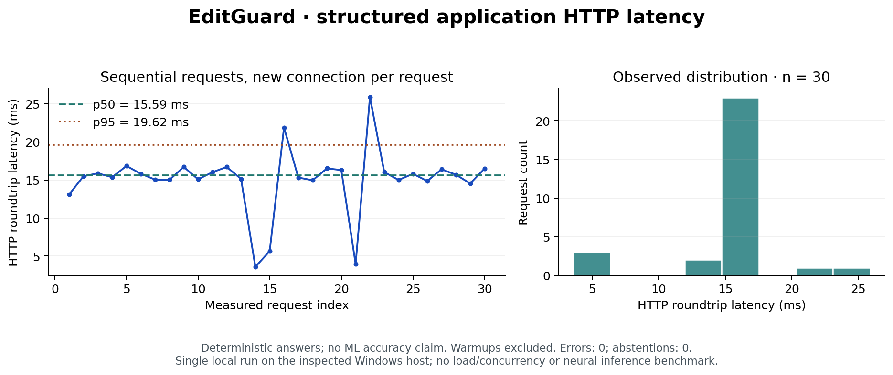
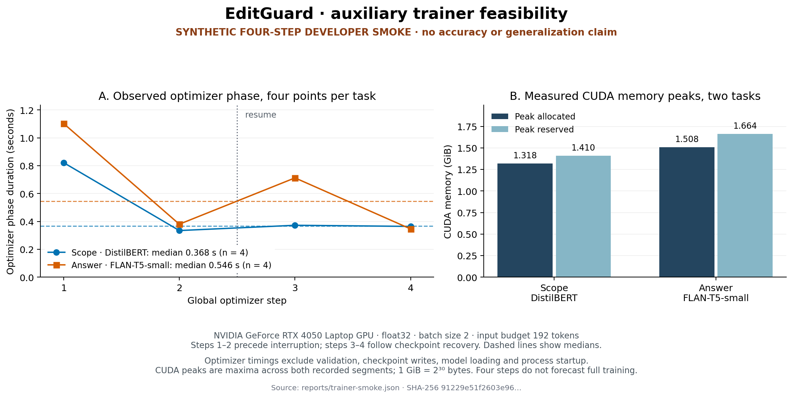
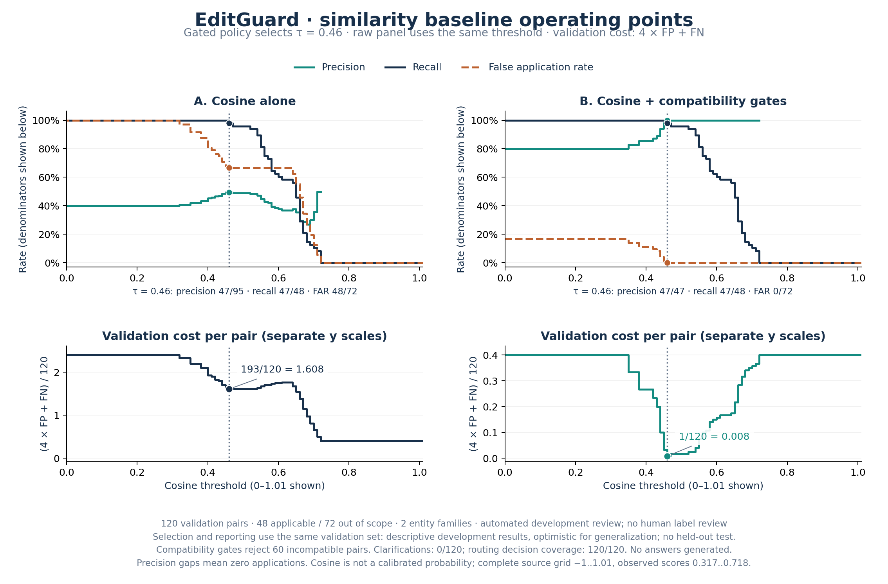
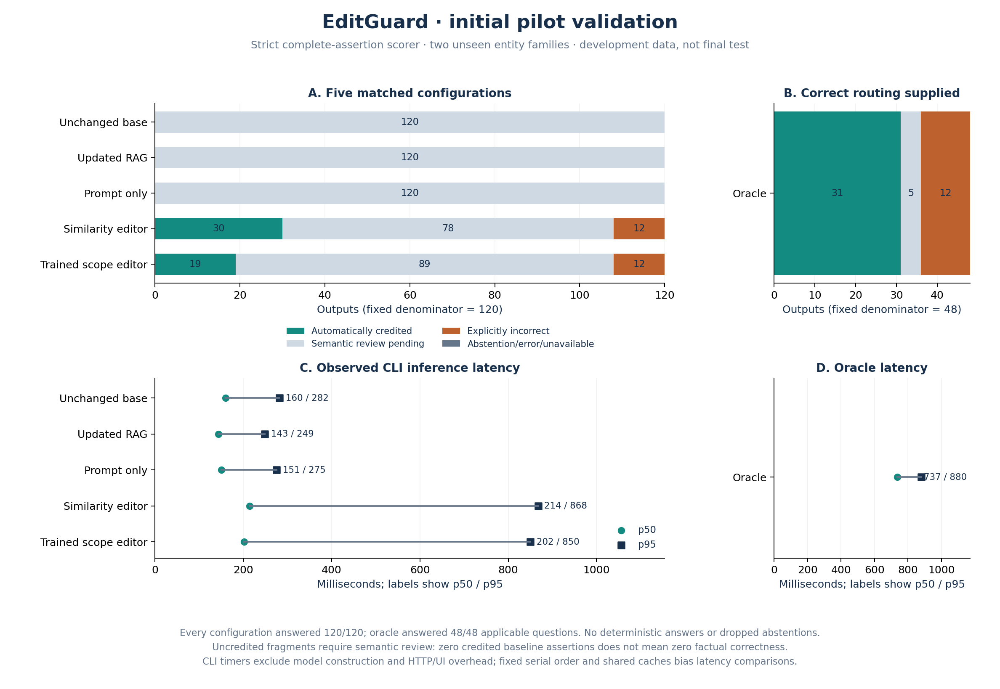
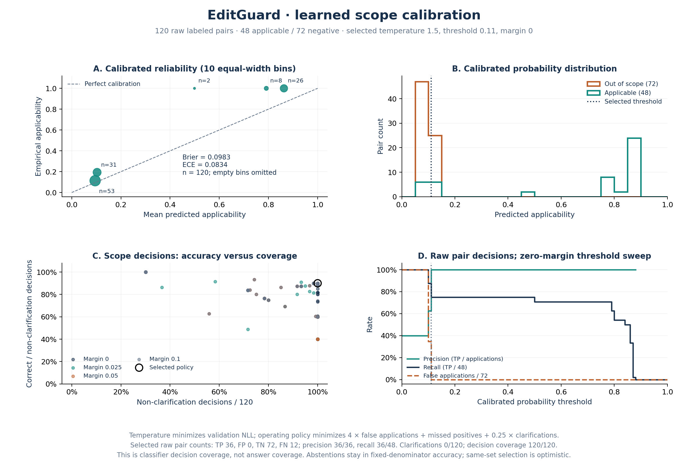
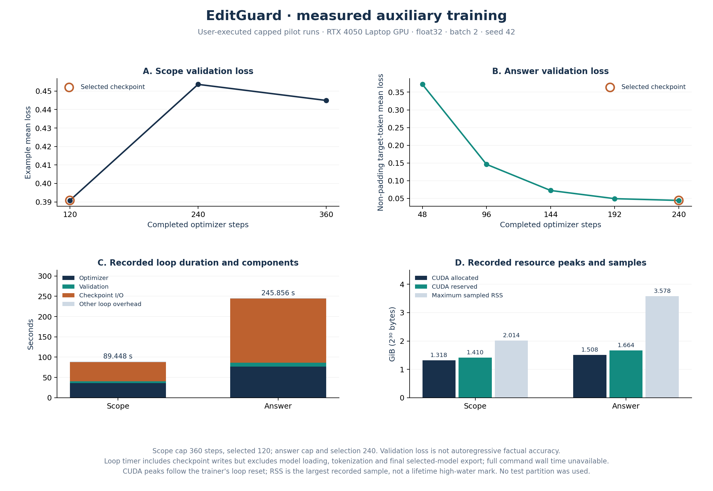

# EditGuard: interim project report

**Status: both auxiliary models trained, integrated and evaluated on a controlled
development pilot. Final independently reviewed evaluation remains pending.**

## Problem and registered topic

Knowledge Editing is the registered topic. Product support systems become stale
when limits or policies change. EditGuard aims to publish corrections without
per-correction retraining while maintaining precise scope, provenance and rollback.
The initial task is short factual English questions over a controlled fictional
product catalogue; unrestricted dialogue and dependency reasoning are deferred.

## Technical approach

The architecture is SERAC-inspired: a frozen base assistant is wrapped by approved
external memory, a learned applicability classifier and a correction-conditioned
generator. Our governance and temporal compatibility rules are adaptations. See
[architecture](ARCHITECTURE.md) for the primary-paper reading and full diagram.
The prototype exercises those governance rules with separately labeled structured
answers and real trained neural editing. Updated RAG applies approved facts before
retrieval; prompt-only correction receives the same approved descriptors.
[Comparison contracts](COMPARISONS.md) disclose routing and benchmark boundaries.

## Data and protocol

The independent fictional training catalogue is separate from the ten-fact Nimbus
UI fixture. Entity families are partitioned before questions and counterfactual
values are augmented. Typed, hash-bound review controls eligibility; human review
is the default. The user authorized an independent automated development review
of the corrected 504-row pilot: 504 accepted, zero flagged, with an additional
144-target assertion check. The immutable source flags remain pending human
review; the separate registry explicitly discloses machine review. The test
partition is not frozen. See [dataset card](DATASET_CARD.md),
[per-row review](PILOT_V2_REVIEW.md) and [evaluation protocol](EVALUATION_PROTOCOL.md).

## Engineering evidence

Regression covers approval, conflicts, half-open dates, explicit supersession,
rollback, neighboring scope retention, persistence, authority checks and coherent
concurrent reads. The live dashboard exposes validated trained-artifact metadata,
automated-review provenance and read-only recorded validation results. It retains
separate isolated workflow checks, denominators and fixture service latency.
Engineering checks demonstrate database/API behavior; they are not learned-model
accuracy. Changing loaded model or calibration dependencies requires restart
rather than silently associating stale inference with new artifact metadata.

The new trainer implements both pretrained auxiliary tasks, fixed stopping caps,
validation-loss selection and atomic full-state resume with data, configuration,
environment, source-code and pretrained-state identities. The scorer rejects
wrong subjects/relations/polarity, contradictory assertions and unendorsed target
mentions. Unsupported fragments enter a blinded hash-bound review queue and remain
uncredited until adjudicated. [Scorer rules](SCORER.md) retain abstentions and
missing predictions in denominators and separate structured from generated evidence.

The UI provides customer questions, scoped before/after comparisons, an approval
workflow, history, conflict resolution and exports. Minimal infrastructure consists
of FastAPI, Pydantic, SQLite and build-free static assets. The core regression and
CPU optimizer/resume CI jobs passed for commit `c89e528`; the source record is
`reports/ci-c89e528.json`. Deployment CI execution is recorded separately.
All three jobs also passed for `6f32ee4`, including container lifecycle and restart
verification; [that CI run](https://github.com/ShivamRaghav7/verity/actions/runs/38149158719)
is distinct from the current local changes.

The complete workflow was exercised in a separate browser fixture, including
conflict rejection and restoration. Mobile layout had no horizontal overflow and
the browser reported no console errors. Docker Desktop's Linux engine later started
successfully. The structured image passed 23 isolated HTTP workflow checks and
three checks after restart, preserving revision 7 and both withdrawn corrections.
It ran as UID 1000 on Python 3.12.15 with a dedicated volume. See
[deployment records](DEPLOYMENT.md); these checks make no neural-deployment claim.

## Initial profiling observations

Real DistilBERT and FLAN-T5-small checkpoints completed one warmup and three
measured float32 optimizer steps at batch 2/input length 192 (answer length 48).
Peak allocated GPU memory was 1.274 and 1.462 GiB respectively. Synthetic shapes
and short runs establish feasibility only; no checkpoint or accuracy result was
produced. [Raw profiling and limitations](PROFILING.md) include resolved revisions.

A separate 30-request engineering benchmark of the structured app observed
HTTP p50 15.592 ms and p95 19.616 ms, with zero errors/abstentions in the selected
supported forms. This result includes HTTP/JSON overhead and excludes ML inference.

Both actual auxiliary trainers subsequently completed four real CUDA steps through
an interrupted two-step segment and resumed two-step segment. The separate CPU
regression matched uninterrupted/resumed parameters, losses, selection and RNG.
These synthetic checkpoints are explicitly rejected by the runtime. Actual
timings, memory and checkpoint I/O are in [TRAINER_SMOKE.md](TRAINER_SMOKE.md).
They do not establish a full-training runtime estimate.

The frozen neural smoke completed six questions across the three available
baselines, preserving explicit unavailability of the two editors. Base parameter
fingerprints remained identical. [NEURAL_SMOKE.md](NEURAL_SMOKE.md) records wrong
answers and uncredited fragments, with all raw inputs and outputs retained.
No result in that engineering fixture is a final accuracy claim.

Actual four-step pilot profiles now include the full reviewed validation partitions
and checkpoint writes. Peak allocations were 1.318 GiB (scope) and 1.508 GiB
(answer); checkpoint operations took 8.22–9.62 and 10.27–17.07 seconds.
[Finite run cards](PILOT_TRAINING.md) stop at 360/240 updates, with conditional
planning estimates of 441/432 seconds. These are estimates, not measured full
training times. Profile artifacts remain ineligible for deployment.

The frozen MiniLM baseline selected cosine threshold 0.46 using all 120 reviewed
validation pairs: 48 positive and 72 negative. Without compatibility gates it
applied 47 correct and 48 incorrect corrections; with gates it applied 47 correct
and zero incorrect corrections, missing one positive. Sixty incompatible pairs
were rejected by metadata. This is validation selection on single focal pairs,
not test performance, full-memory retrieval or generated-answer accuracy. Raw
score/grid artifacts are in `reports/similarity-pilot-v2`; no trained-auxiliary
superiority claim follows from this result.

[The baseline result record](SIMILARITY_RESULTS.md) documents the missed
paraphrase, raw/gated behavior and selection limitations. It makes no generated
answer or final-test claim.

## Experiments and results

| Required result | Current evidence |
|---|---|
| Trained auxiliary weights | User-executed scope/answer runs completed at 360/240 updates; selected steps 120/240; verified local exports and checkpoints |
| Training time and memory | Loop durations 89.448/245.856 s, allocated GPU peaks 1.318464/1.508413 GiB; complete command wall time unavailable |
| Applicable-edit retrieval recall | Recorded 47/48 at rank 1 and 48/48 at rank 3 on applicable development questions |
| Raw calibrated scope | Precision 36/36, recall 36/48, false positives 0/72; all 12 misses are direct-form questions |
| Oracle generation | Strict and exploratory QA credit 31/48; 12 incorrect comparison endorsements and five pending answers |
| Five matched configurations | 120 questions each, 600 generated records; primary full-assertion scores and separate exploratory short-QA diagnostic |
| Out-of-scope retention/correctness | Strict factual adjudication pending; exploratory requested-QA credit 72/72 for all configurations on this small slice |
| Latency and uncertainty | Serial CLI p50/p95 recorded; two-family cluster bootstrap is insufficient for precise population claims |
| Conflict/rollback consistency | Separate deterministic/deployment checks and isolated learned-workflow evidence |
| Final frozen-test results | Not available; final review and configuration/scorer/test freeze remain pending |

These measurements establish real training and a reproducible development
comparison. They do not establish superiority or final-project completion.
[Training results](PILOT_TRAINING_RESULTS.md) disclose run identities, resources,
selection and the 87-check artifact audit.
[Validation results](PILOT_VALIDATION_RESULTS.md) disclose the matched inputs,
calibration, raw records, denominators and failure attribution.

The primary scorer requires a complete factual assertion. It credits 19/120
learned-editor and 30/120 similarity-editor outputs; incomplete baseline
fragments remain pending and uncredited. Zero baseline credit is not evidence
of zero baseline factual correctness. An explicitly
[post-hoc short-QA diagnostic](SHORT_QA.md) binds supported fragments to the
requested subject/relation and credits properly updated RAG on 110/120 questions
and the trained scope editor on 91/120. Updated RAG leads that exploratory
comparison; learned superiority is not claimed. Structured/database answers
are never credited as learned generation.

The answer model makes 12 `No` → `Yes` mistakes even with oracle-correct routing,
despite including the correct limit. Routing cannot explain these polarity
failures. All 12 raw scope misses use direct wording. The original pilot gives
negative labels only to direct questions, creating a wording shortcut. The first
[bounded revision](SCOPE_DATA_REVISION.md) rotates those existing negatives
across direct, paraphrase and yes/no comparison forms without adding rows or
changing facts, splits or lineages. It prepares pilot-v3 with new review identities;
there is no v3 training or accuracy result yet. This validation-informed repair
does not alter the archived v2 results or read the test/challenge corpus.

An [isolated learned-workflow check](LEARNED_WORKFLOW.md) exposed another locality
failure: Nimbus's price question selected a device correction and generated
`Nimbus Basic version v2 costs 3 devices.` A four-device comparison also produced
yes when no was expected. These actual generated failures remain separate from
passing governance/integration checks. The pilot's 0/72 out-of-scope edit selections
cannot be generalized to unseen products, properties or questions.

The figure manifest binds all plotted inputs and output hashes. The dashboard
renders a hash-bound summary against the configured model identities and permits
JSON export; refresh loads recorded evidence rather than rerunning inference.
The final report still requires independent final review, fixed configuration
and scoring rules, manually authored unfamiliar-wording challenges and a single
matched held-out test evaluation with honest uncertainty and failure disclosure.

## Limitations and next acceptance gates

Current language coverage is deliberately narrow. A correct source does not
guarantee a generated answer endorses it. Scope ambiguity, unfamiliar wording,
token shortcuts and temporal errors need component diagnostics. See
[failure analysis](FAILURE_ANALYSIS.md) for concrete findings.

The finite [A–H plan](PROJECT_PLAN.md) lists ownership, run-card requirements,
maximum development revisions and full completion criteria. This interim artifact
does not mark the ML-focused project complete.
