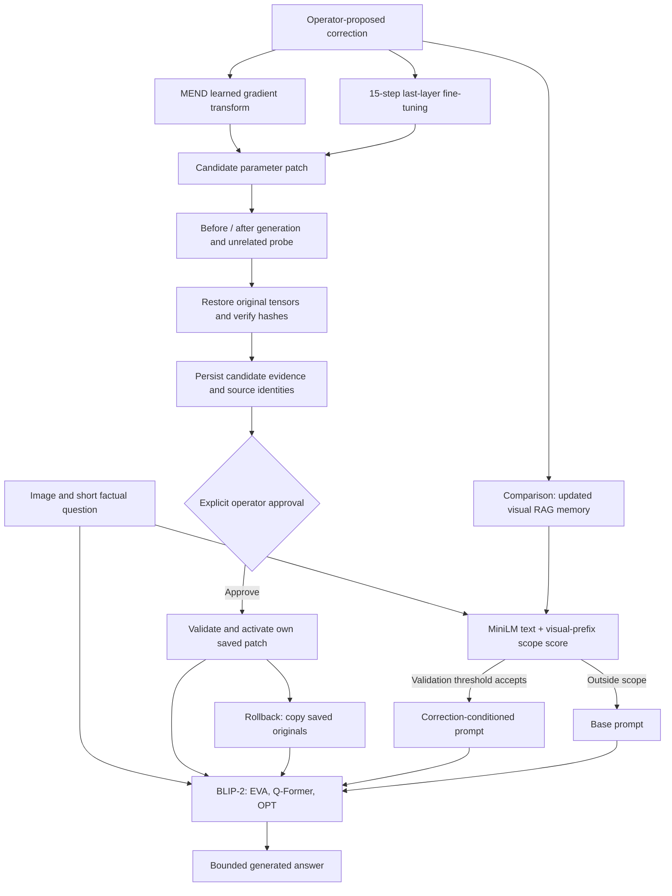

# Architecture

MEND and FT change model parameters; RAG and prompt-only comparisons leave them
unchanged. The RAG score is a validation-thresholded cosine combination, not a
calibrated probability. The evaluation always starts each parameter-editing
method from the same original weights and checks restoration between methods.

The stdlib loopback HTTP server serializes model operations. Uploaded images are
validated, file paths cannot be supplied by clients, POST requests require a
per-session token, and activation only accepts application-created patches.
Assets and history are external files; no additional database or queue is needed.

The experiment worker records complete generated continuations, fixed scores,
retrieval decisions, timing and resources. The read-only dashboard displays those
saved measurements. It cannot replace them with paper numbers or count a
structured lookup as a model-generated correct answer.

Preview checks are deliberately limited. A correct direct answer and unchanged
single probe cannot establish universal locality. Approval and exact rollback
are engineering controls around uncertain learned behavior.
