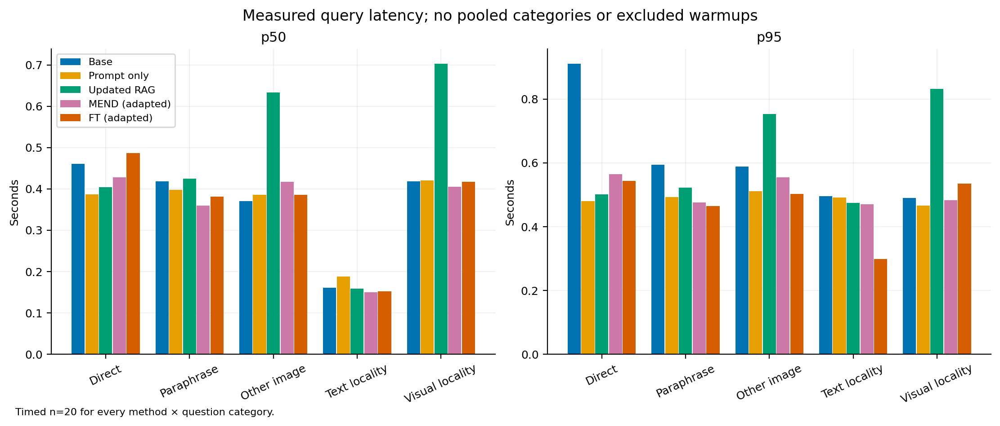

# EditGuard: measured visual editing results

The completed, sealed Tesla T4 experiment shows a sharp tradeoff: **adapted FT
matches all 60 edited-question targets, but answers none of the 40 locality
questions correctly and breaks all five baseline-correct locality answers.**
MEND matches fewer edited targets while retaining those five correct answers.
Updated RAG and prompt-only correction achieve the same 54/60 edited-target
matches; RAG preserves the two correct text-only baseline answers by rejecting
visual-memory use for text-only queries.

These are our measured generated-answer results on **one small, nonrandom
20-edit benchmark slice**. They do not establish arbitrary-edit reliability,
production readiness, or reproduction of the authors' full benchmark results.
No model, threshold, template or scorer was tuned after viewing these outputs.

## Completed final experiment and evidence

The [evaluation receipt](../reports/vlkeb/t4-eval20-1/artifacts/vlkeb/eval20/evaluation.json)
records 20 completed edit units and **500 answer records**: five cases for each
of five methods. There were **zero execution errors or unexecuted cases**. This
means the experiment executed, not that every answer was correct. Both parameter
methods restored the original editable tensors exactly between episodes.

The pretest source commit was `460a91c`; the
[seal](../reports/vlkeb/t4-eval20-1/artifacts/vlkeb/eval20/seal.json) SHA-256 is
`73c303fd260977f624bf39de1d4f58fb8d9f9e2a8ae70f9aeca2fab72292a32f`.
The transported evidence archive SHA-256 is
`cab539240af3d030e370a6e66dfa7bda221ed0c7c7a781a55a335b4fb8cd8ddf`.
The [host verification receipt](../reports/vlkeb/t4-eval20-1/host-verification.json)
checks transported identity, frozen source and selection, all 500 scorer
outcomes, aggregate arithmetic and recorded restoration. It does not rerun the
model, verify image semantics or certify author-provided factual labels.

The [protocol](VLKEB_EVALUATION_PROTOCOL.md) fixed greedy decoding, a 24-token
maximum and normalized whole-answer matching before inference. Each source
entity has a direct question, paraphrase, alternate photograph, unrelated text
question without an image, and unrelated visual question. The selection excludes
source image-directory entities present in any upstream training image slot;
it does not establish absence from foundation-model pretraining or unseen target
names. Every method receives the correction appropriate to its declared design.

## Generated-answer accuracy

Each cell is strict complete-answer matches out of **20 assigned cases**. Missing,
erroneous and abstained answers stay in the denominator.

| Method | Direct | Paraphrase | Other photograph | Text locality | Visual locality |
| --- | ---: | ---: | ---: | ---: | ---: |
| Base | 0/20 (0%) | 0/20 (0%) | 0/20 (0%) | 2/20 (10%) | 3/20 (15%) |
| Prompt only | 19/20 (95%) | 15/20 (75%) | 20/20 (100%) | 1/20 (5%) | 2/20 (10%) |
| Updated RAG | 19/20 (95%) | 15/20 (75%) | 20/20 (100%) | 2/20 (10%) | 2/20 (10%) |
| MEND (adapted) | 7/20 (35%) | 4/20 (20%) | 4/20 (20%) | 2/20 (10%) | 4/20 (20%) |
| FT (adapted) | 20/20 (100%) | 20/20 (100%) | 20/20 (100%) | 0/20 (0%) | 0/20 (0%) |

The base's 0/60 edited-target matches are a diagnostic against **counterfactual
replacement targets**, not its accuracy on the original factual associations.
Those original associations are a different question. FT's 60/60 target matches
also must be read alongside its 0/40 locality matches. A single overall average
would conceal that tradeoff. MEND's 6/40 locality matches include one newly
correct visual answer as well as the five retained baseline-correct answers.

Abstentions are counted as failures; each category below has 20 opportunities.
All method/category execution-error or unexecuted counts are zero.

| Method | Direct | Paraphrase | Other photograph | Text locality | Visual locality | Total /100 |
| --- | ---: | ---: | ---: | ---: | ---: | ---: |
| Base | 1 | 0 | 1 | 0 | 2 | 4 |
| Prompt only | 0 | 0 | 0 | 0 | 0 | 0 |
| Updated RAG | 0 | 0 | 0 | 0 | 1 | 1 |
| MEND (adapted) | 0 | 0 | 0 | 0 | 2 | 2 |
| FT (adapted) | 0 | 0 | 0 | 0 | 0 | 0 |

Across 100 assigned questions per method, strict failures including abstentions
were 95 for base, 43 for prompt only, 42 for RAG, 79 for MEND and 40 for FT. Zero
execution failures must not be reported as zero quality failures.

## Locality: correctness and preservation

Only **2/20 text** and **3/20 visual** baseline locality answers were correct.
Consequently, perfect retention here means retaining just five answers, not
establishing broad locality. Factual retention uses normalized whole-answer
correctness; verbatim preservation separately compares the exact output text.

| Method | Factual text retention | Factual visual retention | Verbatim text preservation | Verbatim visual preservation |
| --- | ---: | ---: | ---: | ---: |
| Base | 2/2 | 3/3 | 2/2 | 3/3 |
| Prompt only | 0/2 | 2/3 | 0/2 | 1/3 |
| Updated RAG | 2/2 | 2/3 | 2/2 | 1/3 |
| MEND (adapted) | 2/2 | 3/3 | 2/2 | 3/3 |
| FT (adapted) | 0/2 | 0/3 | 0/2 | 0/3 |

MEND retains 5/5 baseline-correct locality answers; FT retains 0/5. RAG retains
4/5 and prompt only 2/5. RAG and prompt-only visual factual retention is 2/3,
while verbatim preservation is 1/3 because capitalization can change without
changing the strict normalized score. Unconditional completed-answer preservation
is separately recorded in the JSON and includes originally wrong answers; it
must not be substituted for factual correctness.

## Retrieval routing

RAG accepted all **60/60 applicable cases**, with **13/40 false applications**
(32.5%) and 27/40 correct rejections. Precision was **60/73 (82.2%)**, and routing
accuracy 87/100. There were no missing or erroneous routing records. Full routing
recall did not give full answer correctness: only 54/60 edited questions matched
the target after generation. A rejected correction also does not make the base
fallback answer factually correct. The cosine scope score is not a probability.

## Paired differences and uncertainty

These percentage-point differences compare methods on the same 20 edit units.
Intervals are the saved 95% paired bootstrap intervals, with 10,000 resamples and
seed 42; linked cases stay together. The full 50 comparisons are in the report
and [paired figure](../output/vlkeb-final-2026-10-24/paired_intervals.png).

| First minus second | Case | Difference (percentage points) | 95% paired interval |
| --- | --- | ---: | --- |
| MEND minus base | Direct | +35 | +15 to +55 |
| MEND minus base | Paraphrase | +20 | +5 to +40 |
| RAG minus MEND | Direct | +60 | +35 to +85 |
| RAG minus MEND | Paraphrase | +55 | +25 to +80 |
| RAG minus MEND | Other photograph | +80 | +60 to +95 |
| FT minus prompt only | Paraphrase | +25 | +10 to +45 |
| RAG minus FT | Paraphrase | -25 | -45 to -10 |
| MEND minus FT | Visual locality | +20 | +5 to +40 |
| RAG minus prompt only | All three edited categories, separately | 0 | 0 to 0 in each category |

These descriptive intervals concern the observed slice and are not corrected
for multiple comparisons. A 0-to-0 interval can occur when paired outcomes are
identical on every observed unit; it does not remove uncertainty about unseen
entities, selection bias or future runtime/model behavior.

## Actual failures in the final records

These are retrospective explanations of saved outcomes, not newly selected
confirmatory demonstrations. Targets are the dataset's controlled counterfactual
labels, not independently established real-world facts.

| Saved case | Observed behavior | What it reveals |
| --- | --- | --- |
| [Football club edit](../reports/vlkeb/t4-eval20-1/artifacts/vlkeb/eval20/edits/0051675ae507dd14cf8c6d17f91c530d6aa7898758e024d6098a994345e9001f.json) | Target `Wellington Phoenix FC`: FT matches direct/paraphrase/other photograph, while MEND's direct output is `FC Darmstadt 98`. For the unrelated logo, base/MEND answer `SpVgg Unterhaching`; prompt/RAG output `Wellington Phoenix FC`, and FT repeats `Wellington`. | Direct success can coexist with collateral damage to a previously correct answer. |
| [Movie edit](../reports/vlkeb/t4-eval20-1/artifacts/vlkeb/eval20/edits/022ff831f6c47140113010c5df95ebbe0a43d99281194f7bf2e1644ee204eb09.json) | Target `Hudson Hawk`: RAG accepts the paraphrase route but generates `The Mask`. The unrelated `Jurassic Park` answer becomes `Hudson Hawk` under FT. | Correct applicability routing does not guarantee correct generation; FT can overwrite unrelated behavior. |
| [Text locality](../reports/vlkeb/t4-eval20-1/artifacts/vlkeb/eval20/edits/0392b4baabf3ab0f68f44c6ed883e21ee519e6bd5b35ff0aa13bef60cdde6d3a.json) | For the longest-running scripted US primetime series, base/RAG/MEND answer `The Simpsons`; prompt only gives `The Big Bang Theory`, and FT gives `Mark Goodson`. | An image-conditioned correction can affect an unrelated text-only query. |

## Measured final latency and resources

The T4 worker completed in **815.078 seconds (13.6 minutes)**, including the
**99.276-second shared model load**. It performed 20 MEND updates and 20 FT edits
of 15 steps each, totaling 300 FT optimizer steps; no editor meta-training ran.
This completed run stayed within the preregistered 1,800-second worker cap.

| Operation | Samples | p50 seconds | p95 seconds |
| --- | ---: | ---: | ---: |
| MEND edit application | 20 | 3.553 | 3.645 |
| FT edit application | 20 | 10.242 | 10.427 |
| RAG reference-index construction | 20 | 0.265 | 0.298 |

Query durations below are **p50 / p95 seconds**, each with **n=20**. RAG query
time includes retrieval and gating; index construction, editing and model loading
are separate. CUDA is synchronized before/after each call; there are zero
excluded warmups. p95 uses linear interpolation, with no cross-category pooling.

| Method | Direct | Paraphrase | Other photograph | Text locality | Visual locality |
| --- | ---: | ---: | ---: | ---: | ---: |
| Base | 0.460 / 0.911 | 0.418 / 0.594 | 0.370 / 0.588 | 0.161 / 0.495 | 0.419 / 0.490 |
| Prompt only | 0.387 / 0.479 | 0.398 / 0.492 | 0.386 / 0.510 | 0.188 / 0.491 | 0.420 / 0.467 |
| Updated RAG | 0.404 / 0.501 | 0.425 / 0.522 | 0.633 / 0.753 | 0.158 / 0.474 | 0.703 / 0.833 |
| MEND (adapted) | 0.428 / 0.564 | 0.360 / 0.476 | 0.417 / 0.555 | 0.150 / 0.470 | 0.405 / 0.483 |
| FT (adapted) | 0.486 / 0.543 | 0.382 / 0.464 | 0.386 / 0.503 | 0.152 / 0.299 | 0.417 / 0.535 |

Peak sampled host-process RSS was **7.867 GiB**; CUDA allocated and reserved peaks
were **11.152 GiB** and **11.711 GiB**. Host RSS sampling every 0.05 seconds can
miss short peaks, and CUDA allocator figures omit some driver allocations. One
GiB is 2³⁰ bytes. These are serial research-run measurements, not concurrent
serving benchmarks or hardware/runtime guarantees. Integrity verification,
sealing and evidence transport are outside the worker duration.

## Real-model application rehearsal

A separate [T4 workflow receipt](../reports/vlkeb/t4-workbench-1/workflow-evidence.json)
records **15/15 lifecycle checks passed** using application source `e0324c3`.
The scientific helpers still matched the pre-inference seal. This is actual
model/UI/API evidence on fixed author TRAIN fixtures, separate from the final
held-out comparison, the eight-check smoke runs and 11 fake-backend contract
tests. The 15 checks are not 15 accuracy benchmarks.

Both initial previews stayed inactive and restored all six editable tensor
hashes. MEND generated `depton, texas`, missing the `Albany, New York` target;
FT completed its 15 steps and generated the exact target. The complete preview
workflows took **19.223 seconds for MEND** and **20.740 seconds for FT**. These
include before/after generation, patch saving and restoration; they are not
edit-only latency or repeated-serving estimates.

Browser observations confirm explicit FT approval/activation and direct,
paraphrase, alternate-photo and unrelated queries. The paraphrase remained
`Albany`, while the unrelated answer repeated `Albany`. A second activation was
rejected with HTTP 409 without replacing the active patch. JSON export returned
HTTP 200. GUI rollback restored all six hashes and the original direct answer
`detroit, michigan`.

After reactivating the saved FT patch, the notebook-owned process stopped cleanly
with exit code 0. A fresh server retained history, marked the FT record inactive
after restart and loaded original weights without automatically applying the
patch. The original answer returned again. A new MEND preview verified the same
six original hashes as the final study base and restored them after preview.
The captured final state was model ready, no active patch and three saved records.

[Raw application snapshots](../reports/vlkeb/t4-workbench-1/application-snapshots.json)
and [browser observations](../reports/vlkeb/t4-workbench-1/browser-observations.json)
preserve the supporting states. One training fixture and one unrelated probe do
not verify label truth or establish general locality. This rehearsal validates
the tested Colab workflow; GPU Docker deployment and permanent public hosting
remain unclaimed.

## Evidence ledger

| Saved run | What it establishes | Primary receipt |
| --- | --- | --- |
| Real T4 application rehearsal | Fifteen lifecycle checks passed across actual preview, approval, activation, conflict rejection, export, rollback and restart. | [Workflow receipt](../reports/vlkeb/t4-workbench-1/workflow-evidence.json) |
| Final sealed five-method comparison | All 20 units and 500 answers executed; score arithmetic and exact restoration verified. | [Final report](../reports/vlkeb/t4-eval20-1/artifacts/vlkeb/eval20/evaluation.json) |
| First MEND, raw questions/release alignment | A weight update and same-process restoration; complete persistence gate failed when the reload process was killed. | [First smoke](../reports/vlkeb/t4-smoke-1/smoke-1/smoke.json) |
| Context-aligned MEND, VQA scaffold | Eight mechanical checks passed, including fresh-process reload; generated targets still failed. | [Context/VQA smoke](../reports/vlkeb/t4-context-vqa-1/run/smoke.json) |
| Loaded-patch diagnosis | Explicit tokenization, teacher forcing and free generation under paired question formats; no new edit was fitted. | [Diagnosis](../reports/vlkeb/t4-context-vqa-diagnosis-1/diagnosis/diagnostic.json) |
| Adapted last-layer FT | Eight mechanical checks passed; exact direct/alternate-image targets, incomplete paraphrase and changed unrelated behavior. | [FT smoke](../reports/vlkeb/t4-ft-last-layer-1/run/smoke.json) |
| Updated-RAG threshold validation | A fixed gate selected on eight training rows; 24/24 applicable routes accepted, with 4/16 false applications outside scope. | [RAG validation](../reports/vlkeb/t4-rag-calibration-1/artifacts/vlkeb/rag/calibration.json) |
| Complete five-method pipeline profile | All 25 development calls executed, one MEND update and 15 FT steps completed, and exact rollback passed. | [Pipeline profile](../reports/vlkeb/t4-pipeline-profile-1/artifacts/vlkeb/pipeline-profile/profile.json) |

Each run directory also preserves its declared plan and input preflight. The
completed MEND and FT directories contain separate edit and reload reports with
original, edited and restored matrix hashes. A report is a measurement receipt;
its patch hash alone cannot reconstruct a missing patch or model checkpoint.

## The concrete development edit

The fixed target is `Albany, New York`. The direct question asks for the city in
a photograph; a paraphrase and alternate photograph probe transfer. A separate
county question targets `Hidalgo County`. These are controlled benchmark labels,
not verified real-world corrections. The image/question fixture came from
upstream TRAIN rows 0 and 1 and may have been seen during editor training.

The table copies whole generated answers from the saved context/VQA MEND and FT
receipts. It describes individual cases, without estimating general accuracy.

| Case | Desired answer | MEND after update | FT after update |
| --- | --- | --- | --- |
| Direct city question | `Albany, New York` | `depton, texas` — strict failure | `Albany, New York` — strict match |
| Paraphrase | `Albany, New York` | `New York, New York` — strict failure | `Albany` — strict failure |
| Alternate photograph | `Albany, New York` | `denton, texas` — strict failure | `Albany, New York` — strict match |
| Unrelated county question | `Hidalgo County` | Empty — strict failure | Repeated `Albany` — strict failure |

The FT [edit report](../reports/vlkeb/t4-ft-last-layer-1/run/edit.json) records
the direct baseline as `detroit, michigan` and the edited answer as
`Albany, New York`. Its baseline unrelated answer was already empty and wrong.
FT changes that behavior to a repeated city name; this is collateral behavioral
change, but does not demonstrate loss of an originally correct factual answer.
MEND preserves the empty unrelated answer. That preservation also does not make
the answer factually correct.

Both completed runs passed **8/8 mechanical checks**: an editable matrix changed,
original matrices and baseline answers were restored, a fresh process reproduced
the base state, loaded patch tensors and generated answers matched, and fresh
restoration reproduced the original tensors and answers. These checks establish
reversibility and persistence for this fixture. They do not certify locality or
usefulness on new corrections.

FT performs exactly 15 AdamW optimizer steps at learning rate `0.0002`, changing
only OPT layer 31's `fc1.weight` and `fc2.weight`. It uses FP32 optimizer master
copies while retaining the base model's released precision. Newline supervision
teaches answer termination. This is actual per-edit training, with adaptations
to the upstream recipe; the project has not meta-trained MEND.

## Why token correctness was insufficient

The loaded MEND patch's raw direct question reached **100% contextual
teacher-forced target-token correctness** in the
[diagnosis receipt](../reports/vlkeb/t4-context-vqa-diagnosis-1/diagnosis/diagnostic.json).
The same condition freely generated `Albany, New York, New York, …`, which fails
the fixed whole-answer scorer. With the VQA scaffold, the loaded patch's
contextual token score was 75%, and the generated direct answer was
`depton, texas`.

Teacher forcing includes the full correct target in the input. Free generation
uses only the image/question and its own previous tokens. These are different
measurements: a perfect teacher-forced token score is not a completed generated
answer. The diagnosis also records six standalone target tokens versus four
tokens after a separating space. The context-aligned adapter selects the actual
joined target suffix rather than using the standalone length.

## Measured development resources

The following values are copied from saved phase receipts, rounded to three
decimals. Phase duration includes model loading and diagnostic work, so it is
neither edit-only latency nor a per-query serving benchmark.

| Run and phase | Seconds | Sampled host RSS peak (GiB) | CUDA allocated peak (GiB) | CUDA reserved peak (GiB) |
| --- | ---: | ---: | ---: | ---: |
| First MEND edit | 128.027 | 11.094 | 10.195 | 10.818 |
| Context/VQA MEND edit | 120.173 | 7.827 | 10.199 | 10.812 |
| Context/VQA MEND reload | 112.458 | 7.903 | 9.902 | 10.279 |
| FT edit | 132.053 | 7.874 | 11.150 | 11.609 |
| FT reload | 117.269 | 7.890 | 9.902 | 10.293 |

RSS was sampled every 0.05 seconds and can miss short peaks. CUDA allocator
figures exclude some driver allocations. One GiB is 2³⁰ bytes. The first reload
was killed with return code `-9`, without a phase report; memory pressure is a
plausible explanation, not proven by that code alone. Its missing resource
measurement is not filled with an estimate.

## Validation and full-pipeline readiness

The [RAG validation receipt](../reports/vlkeb/t4-rag-calibration-1/artifacts/vlkeb/rag/calibration.json)
uses upstream TRAIN rows 2–9: 24 applicable cases and 16 out-of-scope cases.
The fixed selection rule maximized validation F1, breaking ties by precision
then threshold. It selected `0.7559913590939377`, accepting **24/24 applicable
cases** and incorrectly applying the correction on **4/16 out-of-scope cases**.
Precision was 24/28 (85.7%); the false-application rate was 25%. These are routing
measurements on the subset used to select the threshold, not held-out answer
accuracy. The eight nonrandom training rows may repeat entity lineages, and the
cosine scope scores are not calibrated probabilities. No evaluation split was
opened and no retriever weights were trained.

The [complete pipeline profile](../reports/vlkeb/t4-pipeline-profile-1/artifacts/vlkeb/pipeline-profile/profile.json)
then ran TRAIN row 0 through all five methods and five cases, including the
text-only locality path. All **25 calls executed**, with one MEND update,
15 FT optimizer steps and exact restoration. Wrong answers and abstentions
remain observed outcomes; the execution gate does not require them to be correct.
The shared model load took **96.878 seconds**, the episode **41.428 seconds**,
and the worker **138.306 seconds** overall on the Tesla T4. This is development
evidence, with no evaluation split opened or editor meta-training performed.

The [preregistered run card](../configs/vlkeb-eval20-run-card.json) extrapolates
that single episode to about **925 seconds (15.5 minutes)** for one load plus
20 episodes, with an **1,800-second worker cap**. This is a planning estimate,
not a runtime guarantee or uncertainty interval; different answer lengths and
hardware load can change it. Verification and sealing add time outside the
worker. The card fixes the finite stopping rule before final inference.

## Limits and a defensible demonstration

The development example is training-seen and cannot estimate generalization.
The final selection is small and nonrandom. Its source image directories
are excluded from the authors' training image slots, but target names, locality
entities, checkpoint training provenance and foundation-model pretraining can
still overlap. Labels have author provenance and automated structural checking;
our team has not independently human-reviewed their semantics.

Contextual alignment, generation formatting, precision handling and termination
supervision are disclosed adaptations. MEND and FT objectives differ, so this is
not an isolated comparison of editor architecture under identical objectives.
Strict whole-answer scoring can reject useful shorter answers such as `Albany`;
some locality references are long relative to the fixed 24-token generation cap,
so low scores should not be interpreted as a semantic or unrestricted QA audit;
the fixed score is preserved rather than improved after inspecting outputs.
One-edit RAG memory does not establish large-memory scalability. Arbitrary
uploads, sequential edit composition, production authentication and guaranteed
locality are not established by these runs.

For a panel demonstration, show the FT direct before/after answer, its incomplete
paraphrase and repetitive unrelated output, the saved inactive candidate, the
operator's review decision, explicit activation, evidence export and rollback.
Explain why a maintainer may reject an update even when its direct target works.
The [workbench guide](VLKEB_WORKBENCH.md) documents this flow. Its 11 application
contract tests use a tiny fake backend to verify lifecycle behavior; GPU receipts
provide separate model evidence.

A supported claim is: **we integrated a published visual editor, implemented
bounded per-edit FT and retrieval comparisons, and built a reversible review
workbench with preserved measurements of successes and failures.** Broader
claims must retain the measured effectiveness/locality tradeoff and the limits
of this small slice. The completed application rehearsal provides separate
workflow evidence; it does not enlarge the held-out sample or establish
arbitrary-edit reliability.
