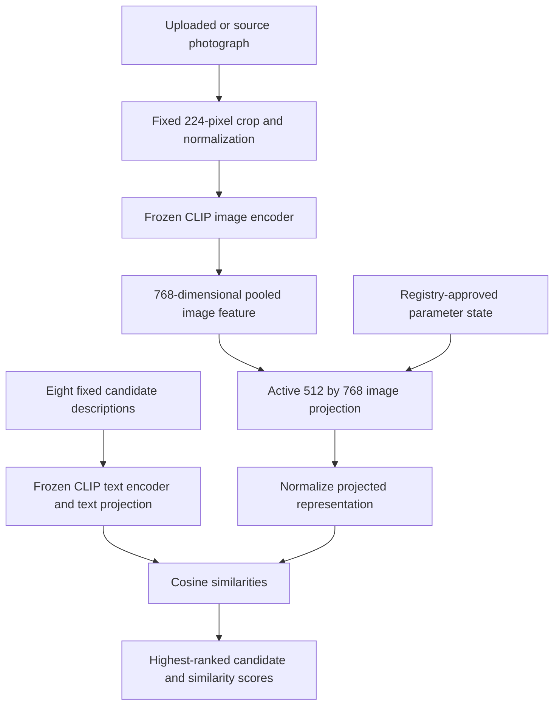
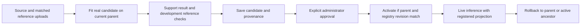

# VisionPatch v2: what changes inside the model

VisionPatch is a local workbench for correcting an unwanted visual association inside an existing model, inspecting collateral changes and maintaining reversible model versions. Its scientific case is selective repair: changing a particular behavior while measuring whether legitimate related behavior survives.

An example is an object classifier that mistakes a cup for a camera because the cup photograph contains the printed word "camera." An administrator supplies that failing image and a matched reference with the misleading text blanked. The system fits a numerical update to the image projection, then checks its effect on object and text reference tasks before approval. Predictions after activation use changed model parameters; the uploaded image is not looked up in a correction-answer table.

This makes sense as a model-maintenance experiment for a team already using visual recognition—for instance, inspecting whether an image-search model follows packaging text instead of the pictured object. That example motivates the research question; we have not validated a commercial deployment or collected a real operational incident dataset. A specialized classifier, masking or ordinary fine-tuning may be a better solution in a particular application. The study includes simpler controls instead of assuming editing must win.

## Relationship to knowledge editing research

Santurkar and colleagues studied rewriting classifier prediction rules through internal key/value associations, including a CLIP typographic-attack example. Their method extracts spatial concept representations and applies constrained layer updates. VisionPatch adopts the paired-representation repair idea, with substantial architectural adaptations: whole-image pooled features, a final linear projection, a small closed-form multi-example update, and explicit object/text retention references. We do not reproduce their spatial editing algorithm or inherit their experimental results. [Original NeurIPS 2021 paper](https://papers.nips.cc/paper_files/paper/2021/file/c46489a2d5a9a9ecfc53b17610926ddd-Paper.pdf), [authors' implementation](https://github.com/MadryLab/EditingClassifiers).

The accurate project description is **visual model editing of a learned association**. This system is not general insertion of new factual knowledge, correction of arbitrary product identities, or multimodal dialogue. It tests whether a local parameter change transfers to unseen photographs and preserves neighboring capabilities. Ordinary training time is not the measure of scientific depth; correction generalization, selectivity and reproducibility are.

## Recognition path

CLIP learns aligned image and text representations. Our frozen model embeds each image and each candidate description, then ranks their similarities. This is the model's original style of zero-shot classification. [CLIP paper](https://proceedings.mlr.press/v139/radford21a.html).

The image encoder, text encoder and text projection do not train during an edit. Only the image projection changes. Fixed candidate labels are airplane, camera, cup, elephant, grand piano, laptop, watch and cell phone. The model must pick one of them even if the image depicts something unsupported. Scores compare candidates and are not calibrated correctness probabilities.

Changing the projection affects every image passed through it. There is no guaranteed word detector or perfect automatic scope boundary. This is precisely why clean objects, genuine target objects, legitimate text and other misleading words belong in the evaluation.

## Fitting the repair

Let `h(source)` be the frozen image feature of a misleading photograph, `h(reference)` the feature of its matched blank-label reference, and `W` the current image projection. The target is the reference representation `W h(reference)`. We seek a small projection update so that `(W + delta) h(source)` approaches that target while disturbing designated retention directions less.

The editor uses a regularized second-moment matrix estimated from retention features and solves small linear systems in CPU float64. The resulting change is stored as two low-rank factors plus a complete parent projection snapshot. The rank bound is the support-pair count: at most four in an independent study edit and at most one for the current single-pair interactive workflow. A low rank does not guarantee a small behavioral effect.

The protected variant combines retention statistics from clean-object photographs and legitimate word cards. A text weight controls the latter contribution. The study compares object-only editing, two protected settings and gradient fine-tuning of the same projection. These are trained numerical parameter updates. None of them trains CLIP from scratch.

Both the study and interactive workbench target the matched reference's current-parent output. In a sequential edit, "current" includes earlier edits. A pair with different underlying scenes can teach the wrong association. The workbench therefore reports whether the reference's predicted label agrees with the administrator's expected object and warns about disagreement. It cannot certify that an arbitrary pair is semantically valid.

The administrator's expected label is used to assess the support result; the paired feature representation provides the fitting target. The `target_word` field records intent and provenance. It is not a runtime text-matching rule that forces a supplied answer.

## Interactive correction and persistent versions

The correction studio is available at `/`, with `/workbench` as an alias and endpoints under `/api/workbench`. This is the single current website and activation workflow. The earlier pilot interface is archived in Git; its legacy API is disabled by default and reserved for explicit historical verification. Creating a candidate does not rewrite the published pilot or final study results.

Preview encodes the two images with pinned CLIP, fits one correction pair, evaluates 64 clean reference photos and 32 legitimate text cards, and saves a candidate. **Preview does not activate it.** These reference examples are fitting/development information, so their scores cannot establish independent generalization. A repaired teaching image alone proves only support fit.

Approval and activation are distinct transitions. SQLite stores the candidate status, active chain, exact parameter hashes, actor/reason metadata and append-only audit events. Artifact files hold the actual parent snapshot and update factors. Files are atomically promoted before their database rows are committed. A failed transaction may leave an unreferenced artifact, but cannot publish a partially committed active patch.

Activation checks explicit approval, the exact expected parent projection, its parent patch identity and the caller's registry revision. A stale browser tab receives a conflict instead of applying a patch to a different active state. The registry validates stored artifact hashes when reconstructing the active chain after restart.

Rollback restores saved parent bytes. It does not subtract a floating-point update, which could introduce rounding differences. It may pop the latest edit, retain a selected active ancestor, or restore the base. An active patch must be rolled back before withdrawal. State conflicts and corrupted artifacts are rejected; these checks do not automatically resolve disagreements about the intended semantic correction.

The workbench uses the registry's current projection for its own recognition endpoint. Repeated inference can reuse a frozen encoder feature because the encoder does not change. This is different from a cached answer: applying another projection to the same feature produces a new model prediction.

Image uploads have decoded-byte and pixel limits and are handled locally. Their content hashes are retained in metadata; the original uploaded image bytes are not automatically archived. Repeating an interactive fit from raw images therefore requires retaining authorized copies separately. The controlled study has its own reproducible source manifest.

Actor names are supplied by the local administrator. This is an explicit local approval workflow, not authenticated access control or a signed audit ledger. Keep the service bound to loopback in this prototype.

## Reproducible experiment path

The experiment runner follows a different path from ad hoc interactive proposals:

1. Prepare a source-grouped manifest and controlled rendering conditions without model-based selection.
2. Profile a small finite workload on the measured hardware.
3. Encode training and validation data, fit the fixed candidate grid and select globally using validation only.
4. Fit all six sequential edit orders using training examples; each stage binds its actual parent state.
5. Seal model files, code, input manifests, font assets, candidate artifacts, selections and output paths.
6. Encode final images once, compare all methods and already-fitted sequential states, and write observations and denominator-aware metrics without fitting.

Feature caches require matching input/code/runtime fingerprints and file checksums. The final seal rejects changed bound inputs. Completed reports are not overwritten. Interrupted fitting has no optimizer-resume claim: a new fitting output is required. A complete matching final feature cache may support resuming scoring without new fitting or configuration selection.

The dataset has 80 reused training originals, 32 new validation originals and 48 new final originals; all 224 old v1 photographs are excluded from the new evaluation selection. Final object augmentations share their source grouping. Controlled text cards have only eight word concepts. [STUDY_V2.md](STUDY_V2.md) specifies all conditions, fit budgets, baselines, selection rules, denominators and limitations.

Task-aware privileged masking is an important strong control: it knows the synthetic overlay region for object tasks and leaves legitimate text tasks unmodified. Its results cannot be described as learned detection or model editing. Likewise, live interactive candidates have not received the study's final evaluation; their development preview must remain labeled separately.

## Boundaries of the claim

This project can demonstrate a parameter repair, evidence of transfer within a controlled benchmark, measured collateral changes, interacting corrections and exact state restoration. It cannot establish arbitrary visual reliability, reliable recognition outside eight candidates, natural-scene OCR performance, a novel editing algorithm or guaranteed locality.

Byte-exact rollback is an engineering guarantee under the checked artifact/state assumptions; recognition accuracy is an empirical result. A perfect count on a small synthetic benchmark does not turn it into an accuracy guarantee. A tie with fine-tuning, damaged text recognition or order-dependent interference is a result to disclose and explain.
