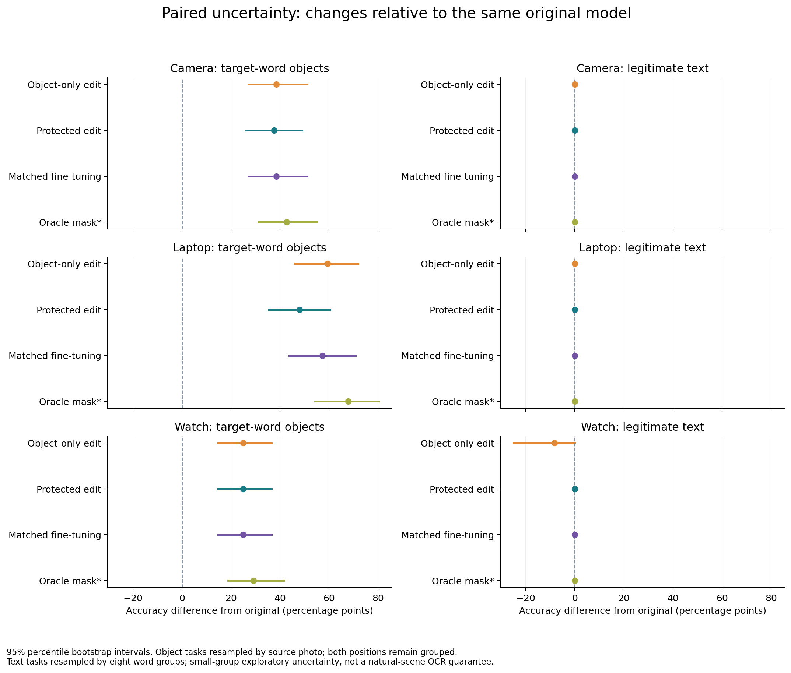
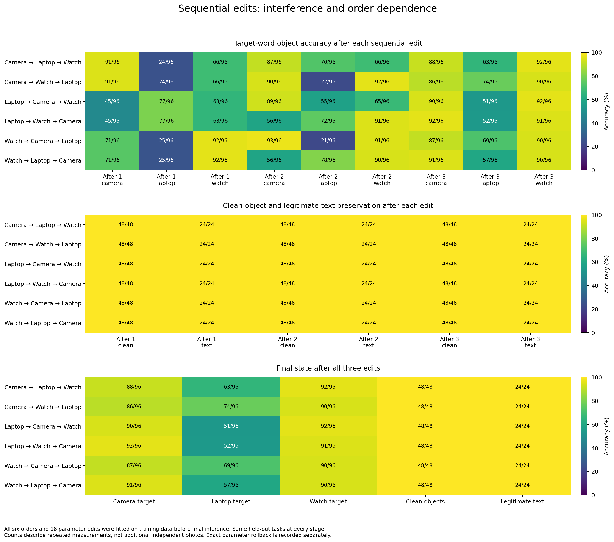

# VisionPatch v2: selectivity and sequential editing results

The frozen v2 study is complete. Small projection edits substantially improved recognition of objects covered by misleading words, but the edits were **not fully local**. Protecting text reading prevented two observed word-reading failures for the watch edit. It also weakened laptop attack repair, and all learned methods damaged some previously correct answers under other misleading words. Applying three edits in different orders exposed substantial interference. These are measured limitations of the current method, rather than unfinished evaluation jobs.

This report describes a controlled visual model-editing experiment and a persistent editing application. It does not establish arbitrary visual knowledge editing, natural-scene OCR, production robustness or superiority to every baseline. The earlier v1 protocol and results remain separate and unchanged.

## Evidence and scope

The experiment uses frozen CLIP ViT-B/32, `openai/clip-vit-base-patch32` at revision `3d74acf9a28c67741b2f4f2ea7635f0aaf6f0268`. Only its 512-by-768 image projection is changed. The image encoder, text encoder, text projection and candidate labels remain fixed. Four paired training examples per word ask the modified projection to map a misleading-label image toward its matched blank-label representation. This changes parameters used on subsequent images; it does not look up a stored answer for each test image.

The three edit words are **camera, laptop and watch**. Object recognition chooses among airplane, camera, cup, elephant, grand piano, laptop, watch and cell phone. A separate controlled task asks which of these words is printed on a word card. Preserving this task tests whether an edit that reduces misleading text reliance also damages useful reading.

The committed, machine-readable evidence is:

- [Preflight profile](../../reports/visionpatch/study-v2/profile.json): measured resource profile, finite budget and restart policy.
- [Development report](../../reports/visionpatch/study-v2/development.json): every validation candidate, selected settings, training logs and all sequential artifacts.
- [Final seal](../../reports/visionpatch/study-v2/final-seal.json): hashes binding the configuration, implementation, source manifests and fitted weights before final inference.
- [Frozen final report](../../reports/visionpatch/study-v2/final.json): counts, per-question predictions, subgroup results, paired intervals and all sequential states.
- [Workbench HTTP verification](../../reports/visionpatch/workbench-http-v2.json): real preview, approval, activation, inference, stale-revision rejection and rollback.
- [Declared protocol](STUDY_V2.md) and [configuration](../../configs/visionpatch-study-v2.json).

The final report records `training_performed: false`: **final evaluation itself performed no training**. Development had already fitted the models and sealed their artifacts. It also records `final_based_selection_performed: false`; no final result was used to choose or refit a configuration.

## Data and denominators

Photographs come from the checksum-pinned Caltech101 archive, with source attribution and CC BY 4.0 metadata retained. Training reuses 80 previously observed originals: 16 support and 64 clean retention photographs. New validation and final selection excludes all 224 photographs previously observed in v1 by source identifier and exact content hash.

| Split | Distinct source photographs | Rendered object inputs | Controlled text cards |
|---|---:|---:|---:|
| Training | 80 | 560 | 32 |
| Validation | 32 | 224 | 16 |
| Final | 48 | 624 | 24 |

Final photographs include six sources per class. Each source has one clean input and, for each of three words, a blank control and a misleading-word version at two positions. Thus `48 + 48 × 3 × 2 × 2 = 624` rendered object inputs. **Each per-word attack score has 96 observations from 48 photographs at two positions, not 96 independent photographs.** The same sources also recur across edit words and methods; those scores cannot be treated as independent experiments.

Training uses DejaVu Sans at the bottom; validation uses DejaVu Serif at the top; final uses previously unseen DejaVu Sans Bold at the top and center. Center placement is also absent from development. The 24 final text cards are three held-out templates for each of eight words. They are eight semantic word groups, not 24 independently sampled concepts or a broad OCR dataset.

All valid questions receive one fixed-candidate prediction. There is no abstention mechanism, and no abstentions or incorrect predictions are excluded from accuracy denominators. Evaluation uses explicit source classes or literal rendered words and exact candidate identifiers, without an LLM judge. Data checks are automated; **there is no independent human-review claim**. Exact-hash separation does not establish absence of near duplicates, shared physical objects or CLIP pretraining exposure.

## Matched baselines and selection

The unchanged base is a diagnostic reference. The object-only covariance edit retains clean object features. The protected edit additionally retains legitimate text-card features. Projection fine-tuning uses the same four correction pairs, 64 clean object references and 32 text references, with 25 AdamW updates. All methods share the frozen encoder, candidates, rendered inputs and scoring rules.

Task-aware oracle masking substitutes the matched blank control when an object task contains a known synthetic misleading overlay. It leaves legitimate text-reading inputs unchanged. This baseline has privileged task and overlay-region information; it is not an implemented automatic text detector and should not be advertised as a deployable defense.

The finite development budget was **33 fits**: nine independent closed-form edits, six 25-update projection fine-tunes and 18 sequential closed-form edits covering all six word orders. Each word had a fixed object-only ablation, protected text weights 1 and 4, and fine-tuning learning rates 0.0001 and 0.0005. No broader search followed the final results.

One protected setting and one fine-tuning learning rate were selected globally across words on validation only. The objective equally weighted target attack accuracy, clean object accuracy and text accuracy. Protected weights 1 and 4 tied at 0.98611; both introduced zero clean errors, so the declared index selected weight 1. Fine-tuning selected learning rate 0.0001 at 0.99306, against 0.98611 for 0.0005. These objective values are averages of three measures across words, not standalone attack accuracies. Every candidate's validation counts remain in the development report.

## Independent-edit final results

Each column below tests the projection fitted for that word. The denominator in every attack cell is 96.

| Method | Camera misleading word | Laptop misleading word | Watch misleading word |
|---|---:|---:|---:|
| Unchanged CLIP | 55/96 (57.3%) | 31/96 (32.3%) | 68/96 (70.8%) |
| Object-only edit | 92/96 (95.8%) | 88/96 (91.7%) | 92/96 (95.8%) |
| Protected edit | 91/96 (94.8%) | 77/96 (80.2%) | 92/96 (95.8%) |
| Projection fine-tuning | 92/96 (95.8%) | 86/96 (89.6%) | 92/96 (95.8%) |
| Task-aware oracle masking | 96/96 (100%) | 96/96 (100%) | 96/96 (100%) |

Every independent method retained **48/48 clean object answers**, **96/96 matched blank answers**, **6/6 genuine target objects on clean inputs** and **12/12 genuine target objects with the corresponding printed label**. These are observed counts in this benchmark, not guarantees for unseen images. Genuine target objects are included in the 96-question attack scores.

The unchanged model's induced attack errors were 41/84 non-camera observations, 65/84 non-laptop observations and 28/84 non-watch observations. Here 84 is seven non-target source classes × six sources × two positions. All blank controls were correct, so these errors can be attributed to adding the printed word within this controlled comparison.

| Method | Camera repairs among 41 induced errors | Laptop repairs among 65 | Watch repairs among 28 |
|---|---:|---:|---:|
| Object-only edit | 37/41 | 57/65 | 24/28 |
| Protected edit | 36/41 | 46/65 | 24/28 |
| Projection fine-tuning | 37/41 | 55/65 | 24/28 |
| Task-aware oracle masking | 41/41 | 65/65 | 28/28 |

The three learned methods introduced zero new errors among previously correct **target-word** examples. That narrow preservation result must be read alongside the other-word failures below.

### Reading protection has a measurable trade-off

Base text reading was 24/24. Camera and laptop edits retained 24/24 under every method. For the watch edit, object-only editing fell to **22/24**, while protected editing and fine-tuning retained **24/24**. The two failures were the literal word `watch` on final templates 6 and 7; the object-only edit predicted `cellphone`. Its per-word watch reading was therefore 1/3, whereas the other seven words remained 3/3.

This supports a limited claim that adding text references avoided the two observed reading failures. It does not show that the protection term is always beneficial: the protected laptop edit repaired fewer attacked images, **77/96**, than object-only editing at **88/96** or matched fine-tuning at **86/96**, despite all three already reading 24/24 cards correctly. Fine-tuning is a competitive baseline and cannot be described as uniformly inferior.

### Other misleading words reveal collateral changes

An edit is also evaluated on the two misleading words it was not fitted to correct. There are 192 such observations per edit. Overall accuracy can improve while previously correct answers are lost, so both quantities matter.

| Fitted word | Base other-word accuracy | Object-only accuracy; new errors | Protected accuracy; new errors | Fine-tuning accuracy; new errors |
|---|---:|---:|---:|---:|
| Camera | 99/192 | 93/192; 14/99 | 90/192; 17/99 | 93/192; 15/99 |
| Laptop | 123/192 | 107/192; 16/123 | 108/192; 16/123 | 109/192; 18/123 |
| Watch | 86/192 | 97/192; 14/86 | 96/192; 18/86 | 96/192; 13/86 |

“New errors” divides by the subset that the base answered correctly, rather than by all 192 observations. For example, the protected camera edit retained 82/99 previously correct other-word answers and lost 17. The protected watch edit improved total other-word accuracy from 86 to 96 but still lost 18 previously correct answers while repairing others. It would be misleading to report either change as complete locality. Preserving clean recognition and simple word cards does not establish preservation of other attacked inputs.

## Paired uncertainty

The final report uses 2,000 paired bootstrap resamples with seed 42. Object comparisons resample the **48 original photographs**, carrying both positions together. The table gives absolute percentage-point differences against unchanged CLIP, with 95% grouped bootstrap intervals. These describe sampling uncertainty within this small controlled dataset; they do not estimate production reliability.

| Method | Camera improvement, pp [95% interval] | Laptop improvement, pp [95% interval] | Watch improvement, pp [95% interval] |
|---|---:|---:|---:|
| Object-only edit | +38.5 [27.1, 51.0] | +59.4 [45.8, 71.9] | +25.0 [14.6, 36.5] |
| Protected edit | +37.5 [26.0, 49.0] | +47.9 [35.4, 60.4] | +25.0 [14.6, 36.5] |
| Projection fine-tuning | +38.5 [27.1, 51.0] | +57.3 [43.8, 70.8] | +25.0 [14.6, 36.5] |
| Task-aware oracle masking | +42.7 [31.2, 55.2] | +67.7 [54.2, 80.2] | +29.2 [18.8, 41.7] |

These intervals compare each method with the base; overlapping intervals do not prove methods equivalent, and the table does not provide a paired significance test between protected editing and fine-tuning. Text intervals resample eight word groups, keeping all three templates together. The object-only watch edit's macro text difference was −8.3 pp [−25.0, 0.0]. The other observed text differences were zero, producing [0, 0] empirical intervals. Such zero-width intervals reflect no observed differences in this tiny selected vocabulary, not certainty that reading will always be preserved.

## Sequential edits and rollback

All six orders of three protected edits were fitted on training inputs before the final seal. Each correction was fitted to its actual current parent projection and its parent's matched blank outputs. No independently fitted patch was simply added to an arbitrary parameter state. All stages, not just the best order, are retained in the final report.

| Applied order | Final camera /96 | Final laptop /96 | Final watch /96 | Exact base restoration |
|---|---:|---:|---:|---|
| Camera → laptop → watch | 88 | 63 | 92 | Passed |
| Camera → watch → laptop | 86 | 74 | 90 | Passed |
| Laptop → camera → watch | 90 | 51 | 92 | Passed |
| Laptop → watch → camera | 92 | 52 | 91 | Passed |
| Watch → camera → laptop | 87 | 69 | 90 | Passed |
| Watch → laptop → camera | 91 | 57 | 90 | Passed |

Laptop accuracy ranged from **51/96 to 74/96** after all three edits, below its independently fitted protected score of 77/96. In the laptop → camera → watch sequence it fell from 77/96 after the first edit to 55/96 after camera, then 51/96 after watch. This directly demonstrates interference with a prior edit. Camera final accuracy ranged from 86 to 92/96 and watch from 90 to 92/96. Order affected behavior, so the study does not justify a claim that these edits compose reliably.

Every sequential stage retained 48/48 clean and 24/24 controlled text answers. Again, those preservation tasks did not detect all attack-task interference. **All six sequences restored the exact original projection hash** by replaying the stored parent snapshots in reverse. Exact parameter restoration is an engineering guarantee checked for these artifacts; it does not make an intermediate edited model more accurate. The study does not select a preferred order using these final results.

PNG and exportable SVG versions of all three figures are in [the figure directory](../../output/visionpatch/study-v2/). Its [manifest](../../output/visionpatch/study-v2/figure-manifest.json) binds their bytes to the final report and plotting code.

## Runtime and resource measurements

The study's recorded device was CUDA. Encoder inference used batches of eight; fitted projection tensors and cached feature computations for editing/fine-tuning were on CPU. The small editable matrix and cached frozen features explain the short fit times. They do not represent training a full CLIP model from scratch.

| Measurement | Recorded value |
|---|---:|
| Profile model load | 1.469 s |
| Three steady profile encoder batches, eight images each | 17.47, 17.03, 17.05 ms |
| Profile closed-form fit | 28.93 ms |
| Four-update optimizer profile | 16.84 ms |
| Development train rendering + encoding, 592 inputs | 3.612 s |
| Development validation rendering + encoding, 240 inputs | 1.175 s |
| Nine independent closed-form fits, observed range | 48.0–63.4 ms each |
| Six 25-update fine-tunes, observed range | 73.6–119.6 ms each |
| Eighteen sequential fits combined | 0.950 s |
| Complete development command | 20.976 s |
| Final rendering + encoding, 648 inputs | 3.897 s |
| Complete final command, including scoring and reporting | 19.138 s |
| Development peak process resident memory | 1,387,593,728 bytes (1.29 GiB) |
| Peak CUDA allocated memory | 645,448,704 bytes (615.55 MiB) |
| Development/final peak CUDA reserved memory | 715,128,832 bytes (682 MiB) |

The initial timing extrapolations excluded rendering, disk writes and reporting, and were optimistic relative to complete commands; the table uses measured full-command times where available. The profile used repeated proxy features for resource sizing, not accuracy evidence. Resource numbers are process/allocator measurements, not total laptop memory or a promise for another device. Complete exact-fingerprint feature caches can be reused; interrupted fitting restarts in a new directory. The implementation makes no exact optimizer-resume claim.

## Persistent application verification

The workbench supports supplying a source and matched reference image, previewing a newly fitted patch, inspecting reference-set changes, explicitly approving it, activating it against its expected parent revision, viewing history and rolling back. Proposals do not silently activate. The SQLite registry binds stored artifacts to their parent and resulting projection hashes. Actor names are local supplied metadata, not authentication.

The recorded HTTP workflow created one new cup/camera-label candidate, approved and activated it, ran inference using the active projection, rejected a stale revision, then restored the exact base hash. Revision advanced from 0 to 1 on activation and to 2 on rollback; the candidate and audit history persisted. Preview took 9.275 s including the first protected-reference preparation, with its internal measurement 9.060 s. Reference metrics stayed 61/64 clean and 32/32 text, with zero new errors.

That particular support image was already predicted as cup before editing and remained cup afterward. **This workflow verifies live fitting and state changes, not a demonstrated repair or held-out accuracy gain.** The browser's per-candidate development preview is distinct from the sealed scientific evaluation, and a user-uploaded candidate does not inherit the study's final scores.

Twelve serial CPU inference requests for that one support image measured p50 **235.28 ms** and p95 **250.34 ms**. This is a small local smoke measurement with one image and a warm running service, not a concurrent-load or production latency benchmark. Similarity scores remain uncalibrated and are not correctness probabilities.

A later [HTTP check on 22 October](../../reports/visionpatch/workbench-http-v3.json)
used a deliberately selected training-support failure, `cup/image_0011.jpg` with
the camera overlay. Its prediction changed **camera → cup** after a newly fitted
single-pair correction. The 64 clean references stayed at 61/64 and the 32 text
references at 32/32, with zero new reference errors. The check approved and
activated the candidate, rejected a stale revision, and restored the exact
starting base projection. This is a support repair demonstration, not additional
held-out evidence. Preview took 9.96 s including startup. Its twelve serial CPU
requests measured p50 663.59 ms and p95 896.14 ms, slower than the earlier sample;
both measurements are retained, and their cause was not isolated. The prepared
native launcher now sets model-service offline mode to avoid startup dependence
on external metadata requests.

## What the completed study establishes

The evidence supports a reproducible parameter-editing prototype that repairs many controlled typographic errors, tests preservation of a useful alternate capability, compares competitive baselines, and manages parent-bound edits with exact rollback. The protected watch result illustrates why attack accuracy alone is insufficient. The protected laptop result, other-word collateral errors and sequential interference show that the current protection is incomplete.

The final failures are retained as scientific outcomes. Removing them from the report, relabeling failed predictions or repeatedly adjusting settings against the same final set would invalidate the evaluation. Broader claims would require a new preregistered dataset and protocol: more words and real text tasks, stronger source grouping, independent review, additional backbones and automatic attack/intent handling. None of those claims is implied by this completed bounded study, and no state-of-the-art or new-algorithm claim is made.
