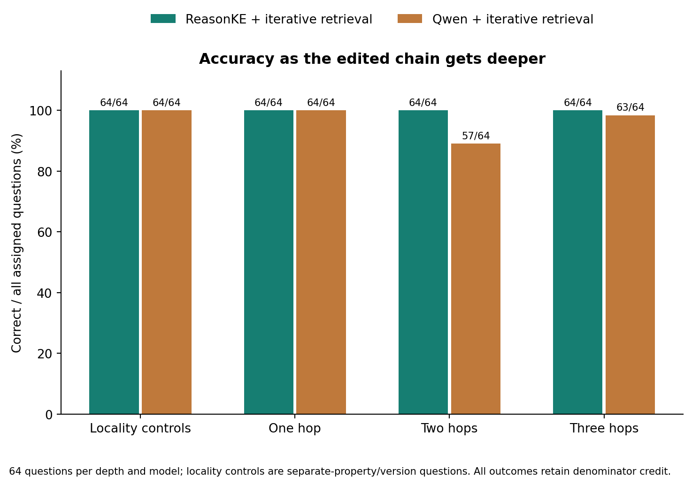
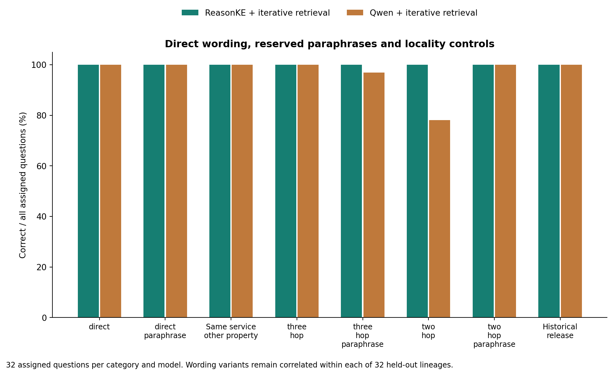
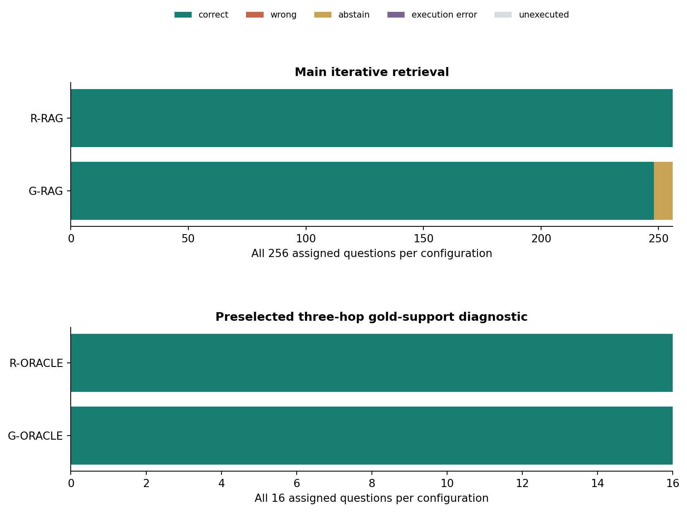
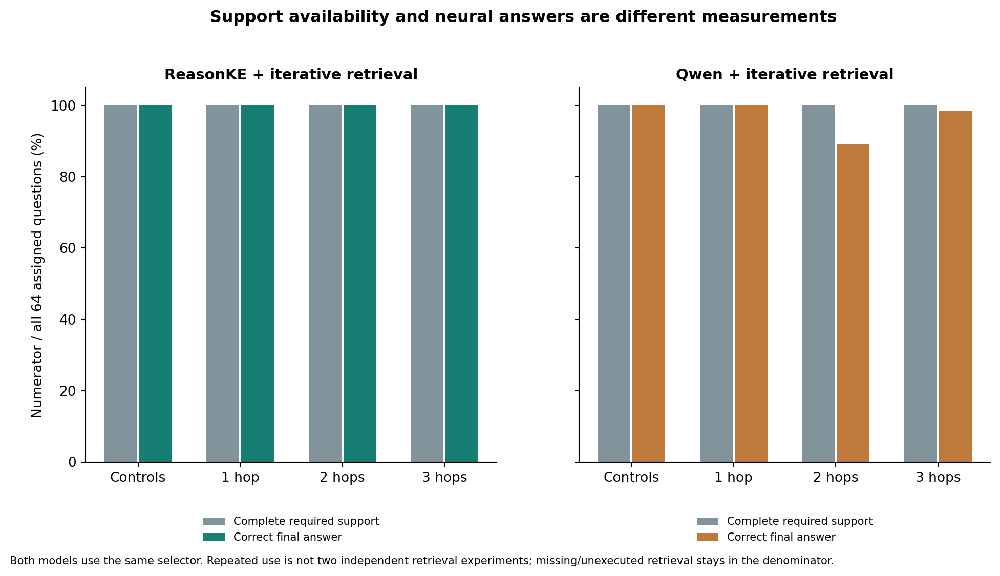
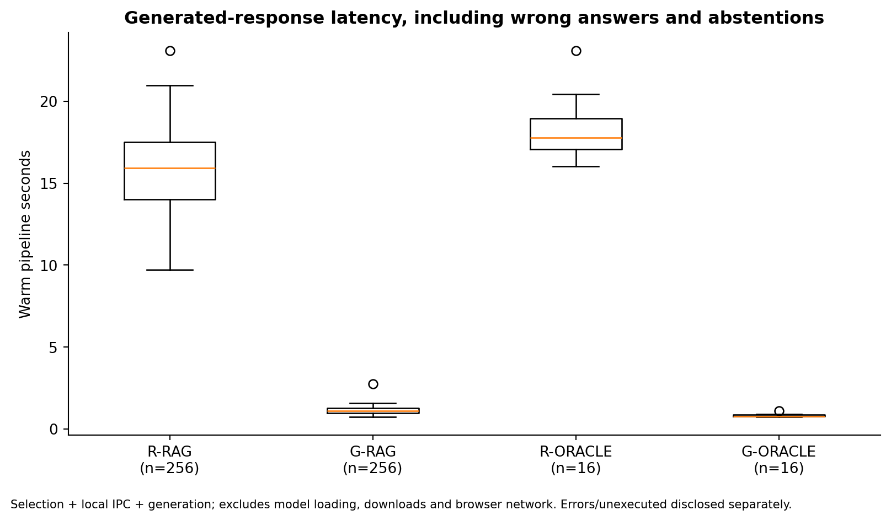

# EditGuard: separate depth challenge

Execution: **completed**. All 544 assigned model requests remain visible: 256 main questions and 16 preselected oracle questions per checkpoint, over 32 held-out fictional graph lineages.

This study has its own frozen protocol, entity assignments, wording split and iterative selector. The 256 main questions are correlated variants over 32 independent lineages. Profile and development receipts establish planning/selection evidence and are not additional final-test observations. This study is reported separately from operations-v1; neither score is pooled into a larger headline accuracy. Both checkpoints were trained upstream; no per-edit weight training or causal training comparison is claimed.

| Configuration | Correct / assigned | Wrong | Abstained | Execution errors | Unexecuted | Answer coverage | Generated p50 / p95 seconds |
| --- | ---: | ---: | ---: | ---: | ---: | ---: | ---: |
| ReasonKE + iterative retrieval | 256/256 | 0 | 0 | 0 | 0 | 100.0% | 15.94 / 19.28 (n=256) |
| Qwen + iterative retrieval | 248/256 | 0 | 8 | 0 | 0 | 96.9% | 1.12 / 1.38 (n=256) |
| ReasonKE + gold support | 16/16 | 0 | 0 | 0 | 0 | 100.0% | 17.77 / 21.12 (n=16) |
| Qwen + gold support | 16/16 | 0 | 0 | 0 | 0 | 100.0% | 0.76 / 0.95 (n=16) |

Primary accuracy is correct / all assigned. Abstentions, errors and unexecuted rows receive zero primary credit. Coverage is (correct + wrong) / all assigned, not a filtered success rate. Oracle rows are a distinct, hash-preselected sixteen-question generation diagnostic, not ordinary retrieval accuracy.

## Retrieval and generation

| Configuration / depth | Found / required fact occurrences | Complete paths / assigned | Correct / assigned |
| --- | ---: | ---: | ---: |
| R-RAG / 0 | 64/64 | 64/64 | 64/64 |
| R-RAG / 1 | 64/64 | 64/64 | 64/64 |
| R-RAG / 2 | 128/128 | 64/64 | 64/64 |
| R-RAG / 3 | 192/192 | 64/64 | 64/64 |
| G-RAG / 0 | 64/64 | 64/64 | 64/64 |
| G-RAG / 1 | 64/64 | 64/64 | 64/64 |
| G-RAG / 2 | 128/128 | 64/64 | 57/64 |
| G-RAG / 3 | 192/192 | 64/64 | 63/64 |
| R-ORACLE / 3 | 48/48 | 16/16 | 16/16 |
| G-ORACLE / 3 | 48/48 | 16/16 | 16/16 |

Depth 0 denotes unrelated-property or historical-version controls; each needs an explicit fact. Required support recall is not answer accuracy. Both generators receive the same selector; its duplicated use is not independent retrieval evidence. `results.json` retains complete-support and missing-support generation subgroups as descriptive diagnostics, without replacing assigned primary denominators.

## Paired uncertainty

- RAG: ReasonKE minus Qwen 3.12 percentage points; 95% lineage-bootstrap interval [1.56, 5.08], 256 paired questions across 32 lineages, 10000 resamples, seed 42.
- RAG-depth-0: ReasonKE minus Qwen 0.00 percentage points; 95% lineage-bootstrap interval [0.00, 0.00], 64 paired questions across 32 lineages, 10000 resamples, seed 42.
- RAG-depth-1: ReasonKE minus Qwen 0.00 percentage points; 95% lineage-bootstrap interval [0.00, 0.00], 64 paired questions across 32 lineages, 10000 resamples, seed 42.
- RAG-depth-2: ReasonKE minus Qwen 10.94 percentage points; 95% lineage-bootstrap interval [4.69, 18.75], 64 paired questions across 32 lineages, 10000 resamples, seed 42.
- RAG-depth-3: ReasonKE minus Qwen 1.56 percentage points; 95% lineage-bootstrap interval [0.00, 4.69], 64 paired questions across 32 lineages, 10000 resamples, seed 42.
- ORACLE: ReasonKE minus Qwen 0.00 percentage points; 95% lineage-bootstrap interval [0.00, 0.00], 16 paired questions across 13 lineages, 10000 resamples, seed 42.

Related wording variants are correlated; the independent unit is a graph lineage. If a paired bootstrap interval has zero width, it reflects identical sampled lineage differences in this finite dataset, not universal certainty or guaranteed accuracy. A perfect observed result is retained without manufactured failures. These bounded data do not establish arbitrary paraphrase or unrestricted conversation reliability.

## Latency and resources

Warm request time includes context selection, local IPC and generation. Loading, downloads and browser network are excluded. Generated wrong and abstained responses remain in the latency population; failed-request latency and its n are retained separately in `results.json` and `scorecard.csv`.

- reasonke: YukinoKaren/ReasonKE_plus at ceaedc2ae7c8fed6257953587d991ce550db6106; GPU Tesla T4; load seconds 79.15075379999985; peak loading allocated/reserved bytes 7071596544 / 7140802560. See raw receipts for software versions, generation tokens and per-request CUDA usage.
- instruction: Qwen/Qwen2.5-7B-Instruct at a09a35458c702b33eeacc393d103063234e8bc28; GPU Tesla T4; load seconds 77.24367784599963; peak loading allocated/reserved bytes 7071596544 / 7140802560. See raw receipts for software versions, generation tokens and per-request CUDA usage.

## Retained failure examples

The deterministic first twelve non-correct record IDs are shown below. They are illustrative, not a complete failure taxonomy. All outcomes remain in the receipts and exports.

| Record | Outcome | Expected | Generated final answer / error |
| --- | --- | --- | --- |
| G-RAG:depth-001-two_hop | abstain | Diya Desai | UNKNOWN |
| G-RAG:depth-004-two_hop | abstain | Arjun Desai | UNKNOWN |
| G-RAG:depth-016-two_hop | abstain | Arjun Nair | UNKNOWN |
| G-RAG:depth-024-three_hop_paraphrase | abstain | Indore | UNKNOWN |
| G-RAG:depth-025-two_hop | abstain | Diya Kapoor | UNKNOWN |
| G-RAG:depth-028-two_hop | abstain | Arjun Kapoor | UNKNOWN |
| G-RAG:depth-031-two_hop | abstain | Ishita Kapoor | UNKNOWN |
| G-RAG:depth-040-two_hop | abstain | Arjun Menon | UNKNOWN |

## Limits and provenance

Assignments are controlled fiction, labels and graph paths are automatically audited, and no independent human semantic-review claim is made. Wording banks differ across splits but templates repeat within each split; relation vocabulary and simple city values repeat. Strict whole-final-answer alias matching checks the endorsed answer, not mere target mention. A correct final answer does not verify generated reasoning or surrounding prose. Administrator state/rollback checks and deterministic database answers are not neural answer-quality evidence.

The exporter replays the protocol-bound audit before writing, makes zero model calls, and preserves prior report directories. `scorecard.csv`, `retrieval.csv` and `latency.csv` disclose denominators and sample sizes. `figure-manifest.json` binds source receipts, protocol, exporter and exported files by SHA-256. The original operations-v1 study is unchanged.
