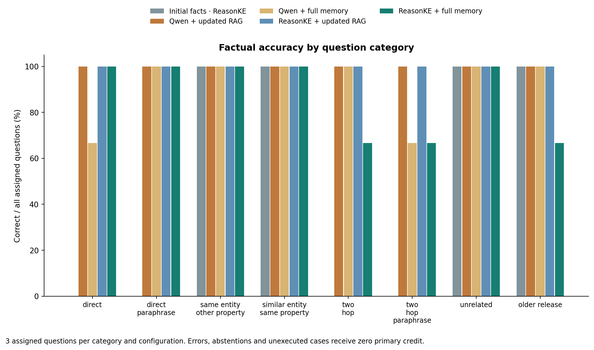
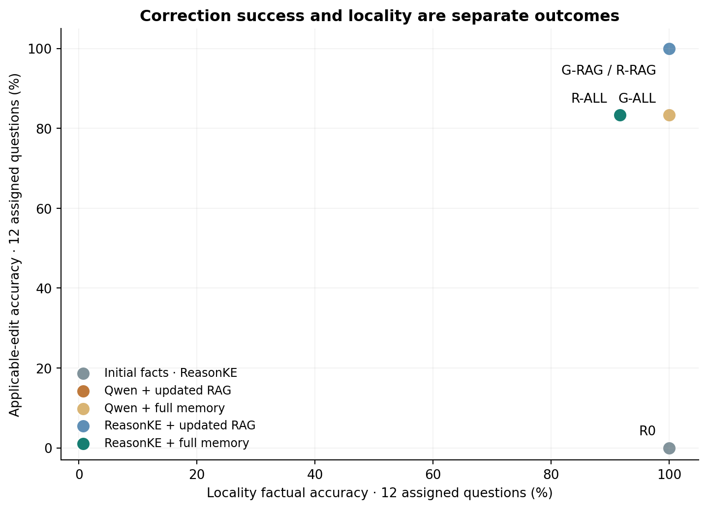
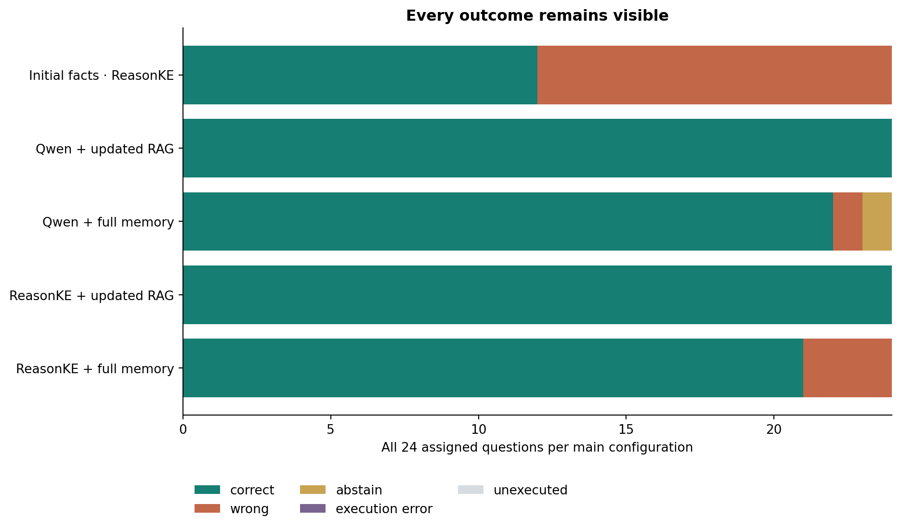
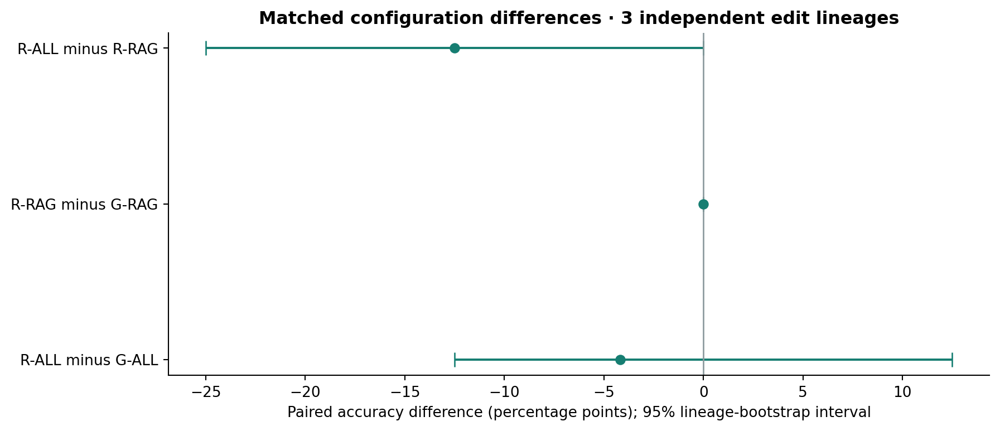
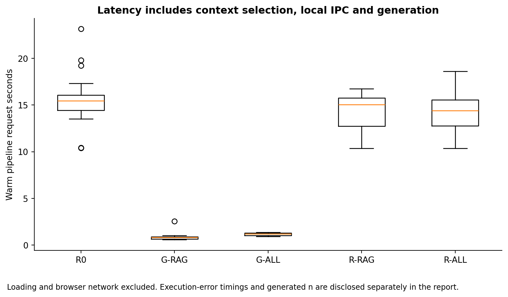

# EditGuard: controlled operations evaluation (development)

This report is generated from actual model receipts. Phase: development; execution: completed. The independent sample consists of 3 fictional edit lineages; wording variants are correlated.

## Model and context comparison

| Configuration | Correct / assigned | Applicable | Locality | Coverage | p50 / p95 pipeline seconds |
| --- | ---: | ---: | ---: | ---: | ---: |
| Initial facts · ReasonKE | 12/24 | 0/12 | 12/12 | 100.0% | 15.45 / 19.71 (n=24) |
| Qwen + updated RAG | 24/24 | 12/12 | 12/12 | 100.0% | 0.81 / 1.02 (n=24) |
| Qwen + full memory | 22/24 | 10/12 | 12/12 | 95.8% | 1.19 / 1.36 (n=24) |
| ReasonKE + updated RAG | 24/24 | 12/12 | 12/12 | 100.0% | 15.03 / 16.05 (n=24) |
| ReasonKE + full memory | 21/24 | 10/12 | 11/12 | 100.0% | 14.40 / 17.01 (n=24) |

## Paired differences

- R-ALL minus G-ALL: -4.17 percentage points; 95% grouped interval [-12.50, 12.50].
- R-RAG minus G-RAG: 0.00 percentage points; 95% grouped interval [0.00, 0.00].
- R-ALL minus R-RAG: -12.50 percentage points; 95% grouped interval [-25.00, 0.00].

## Retrieval and generation

- G-RAG: 30/30 required facts found; complete two-hop support 6/6. Shared retrieval is not two independent retrieval experiments.
- R-RAG: 30/30 required facts found; complete two-hop support 6/6. Shared retrieval is not two independent retrieval experiments.

## Preservation and false edited-value endorsements

- R-ALL: preserved 11/12 R0-correct locality answers; false edited-value endorsements 1/12. A zero preservation denominator is undefined.
- R-RAG: preserved 12/12 R0-correct locality answers; false edited-value endorsements 0/12. A zero preservation denominator is undefined.

## Runtime and resource use

- reasonke: YukinoKaren/ReasonKE_plus at ceaedc2ae7c8fed6257953587d991ce550db6106; Tesla T4; loading 78.89 seconds; peak reserved CUDA during loading 7140802560 bytes. NF4 weights, FP16 compute, greedy decoding.
- instruction: Qwen/Qwen2.5-7B-Instruct at a09a35458c702b33eeacc393d103063234e8bc28; Tesla T4; loading 77.71 seconds; peak reserved CUDA during loading 7140802560 bytes. NF4 weights, FP16 compute, greedy decoding.

## Failure examples

Every failure remains in the raw receipts. The following is a deterministic first-12 subset in record-ID order, not a claim to cover all failure modes.

| Case | Condition | Expected | Actual / error | Outcome |
| --- | --- | --- | --- | --- |
| ops-003-direct | G-ALL | Copper unit 74 | Cedar unit 134 | wrong |
| ops-004-two_hop_paraphrase | G-ALL | Lina Dane | UNKNOWN | abstain |
| ops-004-two_hop | R-ALL | Lina Dane | Ilan Voss | wrong |
| ops-004-two_hop_paraphrase | R-ALL | Lina Dane | Ilan Voss | wrong |
| ops-009-wrong_version_or_tier | R-ALL | Willow unit 200 | Amber unit 80 | wrong |

## Interpretation and limits

The study measures short factual answers in a controlled fictional handbook, with shared wording templates and automated graph auditing. It is not an estimate of unrestricted dialogue accuracy. Both model checkpoints were trained upstream; this project did not perform their SFT or RL training. Comparing them does not isolate the causal effect of ReasonKE training.

R0 is an initial-fact diagnostic scored against post-edit targets, not a measure of its original-world factual accuracy. Whole-final-span alias matching is strict. Correct targets mentioned only as examples, rejections or explanations are not credited. All abstentions, execution errors and unexecuted records stay in the primary denominator. State-machine tests, deterministic answers and neural answer accuracy remain separate evidence.

Correct final answers do not establish faithful generated explanations. The earlier development traces contained unsupported claims; explanation auditing must be reported separately. The comparison alone does not prove arbitrary edit safety or semantic conflict detection.

The concrete outcome is the reproducible scorecard above plus an implemented reversible maintenance workflow. No victory over updated RAG or universal accuracy is assumed.

## Provenance

See `results.json`, `scorecard.csv` and `figure-manifest.json`; each figure is derived from saved records. Raw receipts identify model revisions, fact IDs, prompt digests, tokens, errors and resource measurements.
