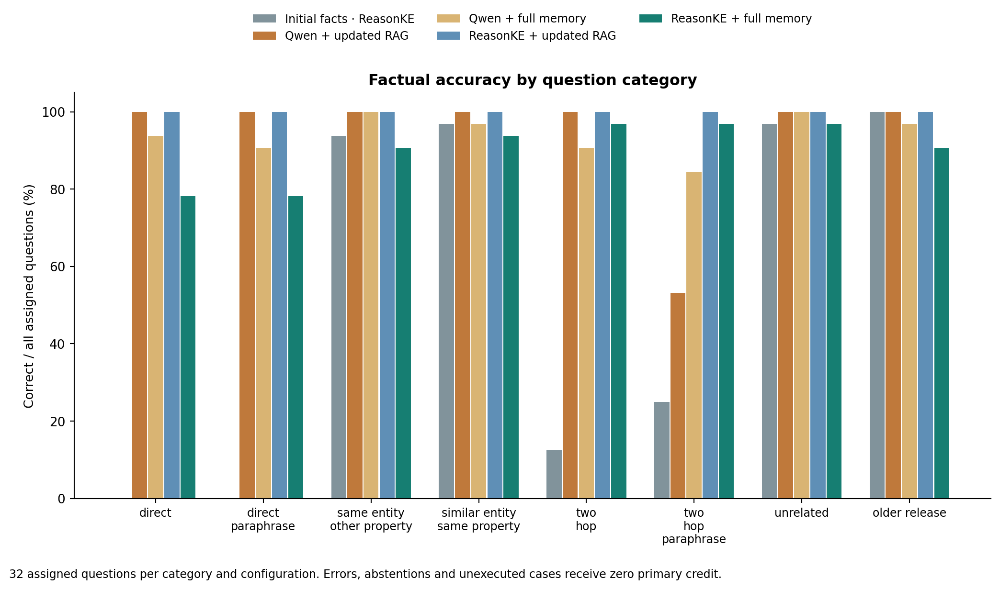
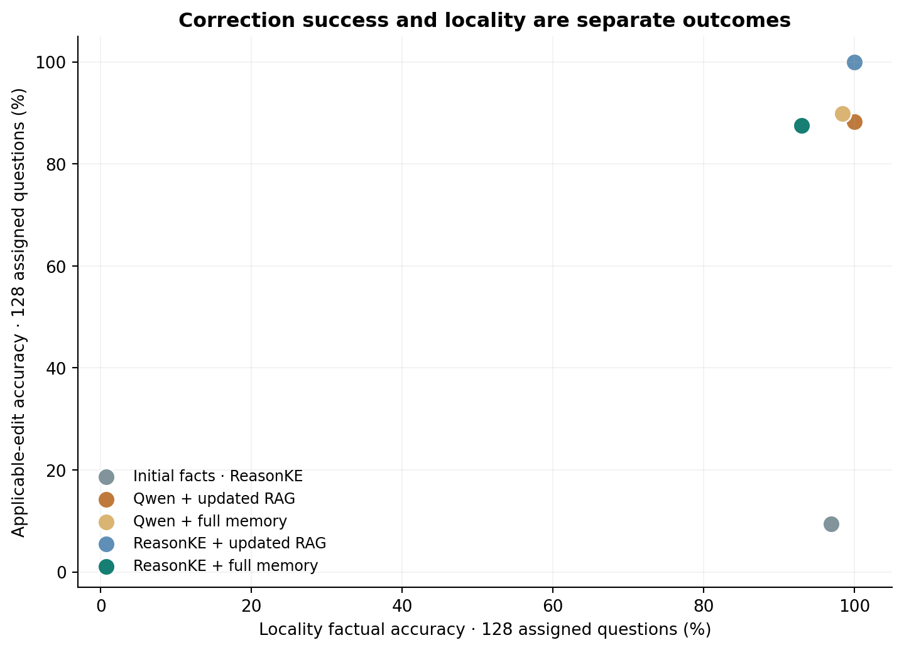
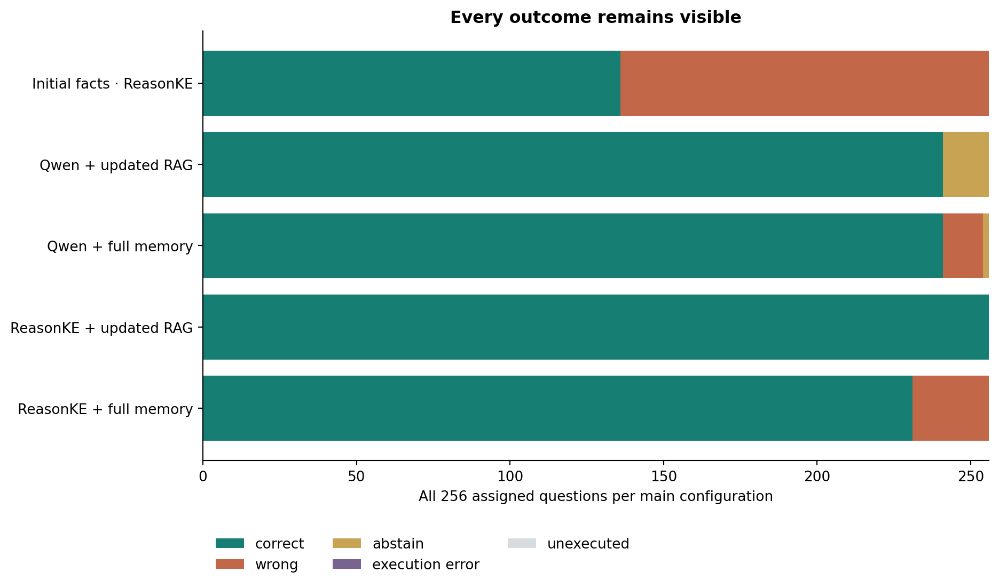
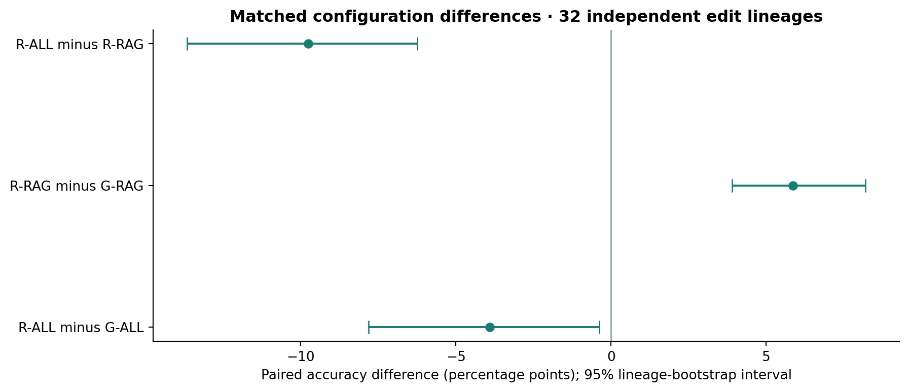
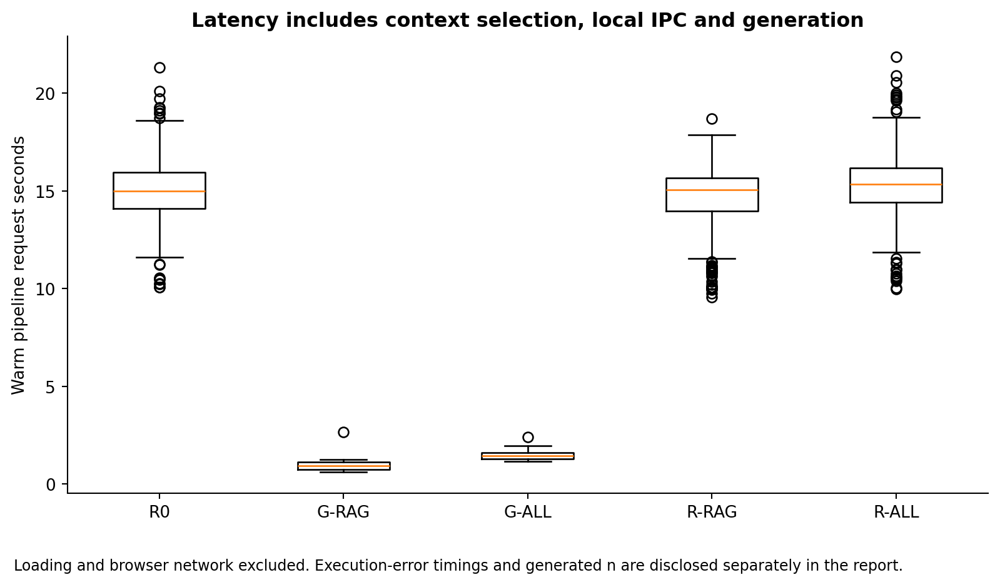

# EditGuard: controlled operations evaluation (final)

This report is generated from actual model receipts. Phase: final; execution: completed. The independent sample consists of 32 fictional edit lineages; wording variants are correlated.

## Model and context comparison

| Configuration | Correct / assigned | Applicable | Locality | Coverage | p50 / p95 pipeline seconds |
| --- | ---: | ---: | ---: | ---: | ---: |
| Initial facts · ReasonKE | 136/256 | 12/128 | 124/128 | 100.0% | 15.01 / 18.17 (n=256) |
| Qwen + updated RAG | 241/256 | 113/128 | 128/128 | 94.1% | 0.92 / 1.20 (n=256) |
| Qwen + full memory | 241/256 | 115/128 | 126/128 | 99.2% | 1.44 / 1.66 (n=256) |
| ReasonKE + updated RAG | 256/256 | 128/128 | 128/128 | 100.0% | 15.06 / 16.71 (n=256) |
| ReasonKE + full memory | 231/256 | 112/128 | 119/128 | 100.0% | 15.35 / 18.72 (n=256) |

## Paired differences

- R-ALL minus G-ALL: -3.91 percentage points; 95% grouped interval [-7.81, -0.39].
- R-RAG minus G-RAG: 5.86 percentage points; 95% grouped interval [3.91, 8.20].
- R-ALL minus R-RAG: -9.77 percentage points; 95% grouped interval [-13.67, -6.25].

## Retrieval and generation

- G-RAG: 320/320 required facts found; complete two-hop support 64/64. Shared retrieval is not two independent retrieval experiments.
- R-RAG: 320/320 required facts found; complete two-hop support 64/64. Shared retrieval is not two independent retrieval experiments.
- G-ORACLE: 16/16 correct with gold supporting facts. This isolates a generation diagnostic on preselected questions.
- R-ORACLE: 16/16 correct with gold supporting facts. This isolates a generation diagnostic on preselected questions.

## Preservation and false edited-value endorsements

- R-ALL: preserved 117/124 R0-correct locality answers; false edited-value endorsements 3/128. A zero preservation denominator is undefined.
- R-RAG: preserved 124/124 R0-correct locality answers; false edited-value endorsements 0/128. A zero preservation denominator is undefined.

## Runtime and resource use

- reasonke: YukinoKaren/ReasonKE_plus at ceaedc2ae7c8fed6257953587d991ce550db6106; Tesla T4; loading 79.63 seconds; peak reserved CUDA during loading 7140802560 bytes. NF4 weights, FP16 compute, greedy decoding.
- reasonke: YukinoKaren/ReasonKE_plus at ceaedc2ae7c8fed6257953587d991ce550db6106; Tesla T4; loading 237.81 seconds; peak reserved CUDA during loading 7140802560 bytes. NF4 weights, FP16 compute, greedy decoding.
- instruction: Qwen/Qwen2.5-7B-Instruct at a09a35458c702b33eeacc393d103063234e8bc28; Tesla T4; loading 690.37 seconds; peak reserved CUDA during loading 7140802560 bytes. NF4 weights, FP16 compute, greedy decoding.

## Failure examples

Every failure remains in the raw receipts. The following is a deterministic first-12 subset in record-ID order, not a claim to cover all failure modes.

| Case | Condition | Expected | Actual / error | Outcome |
| --- | --- | --- | --- | --- |
| ops-005-two_hop_paraphrase | G-ALL | Nira Dane | Indigo unit 136 Nira Dane | wrong |
| ops-006-direct_paraphrase | G-ALL | Silver unit 77 | Saffron unit 137 | wrong |
| ops-016-direct_paraphrase | G-ALL | Saffron unit 87 | Violet unit 147 | wrong |
| ops-027-two_hop | G-ALL | Orin Lorne | Mara Arden | wrong |
| ops-027-two_hop_paraphrase | G-ALL | Orin Lorne | Mara Arden | wrong |
| ops-034-direct | G-ALL | Violet unit 105 | Willow unit 165 | wrong |
| ops-034-direct_paraphrase | G-ALL | Violet unit 105 | Willow unit 165 | wrong |
| ops-041-two_hop | G-ALL | Ilan Wren | Tovan Solen | wrong |
| ops-041-two_hop_paraphrase | G-ALL | Ilan Wren | Tovan Solen | wrong |
| ops-044-similar_entity_same_relation | G-ALL | Silver unit 175 | Willow unit 115 | wrong |
| ops-045-two_hop_paraphrase | G-ALL | Nira Wren | Cedar unit 116 Nira Wren | wrong |
| ops-046-wrong_version_or_tier | G-ALL | Amber unit 237 | UNKNOWN | abstain |

## Interpretation and limits

The study measures short factual answers in a controlled fictional handbook, with shared wording templates and automated graph auditing. It is not an estimate of unrestricted dialogue accuracy. Both model checkpoints were trained upstream; this project did not perform their SFT or RL training. Comparing them does not isolate the causal effect of ReasonKE training.

R0 is an initial-fact diagnostic scored against post-edit targets, not a measure of its original-world factual accuracy. Whole-final-span alias matching is strict. Correct targets mentioned only as examples, rejections or explanations are not credited. All abstentions, execution errors and unexecuted records stay in the primary denominator. State-machine tests, deterministic answers and neural answer accuracy remain separate evidence.

Correct final answers do not establish faithful generated explanations. The earlier development traces contained unsupported claims; explanation auditing must be reported separately. The comparison alone does not prove arbitrary edit safety or semantic conflict detection.

The concrete outcome is the reproducible scorecard above plus an implemented reversible maintenance workflow. No victory over updated RAG or universal accuracy is assumed.

## Provenance

See `results.json`, `scorecard.csv` and `figure-manifest.json`; each figure is derived from saved records. Raw receipts identify model revisions, fact IDs, prompt digests, tokens, errors and resource measurements.
